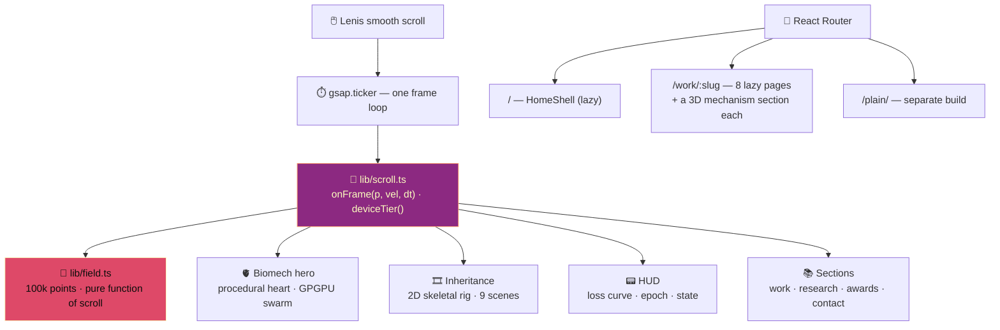

<div align="center">


<br/>

<a href="https://portfolio-sigma-blond-57.vercel.app/"></a>


<br/><br/>

<a href="https://portfolio-sigma-blond-57.vercel.app/"></a>

</div>


<details>
<summary><b>📑 Table of contents</b></summary>

- [📌 What it is](#-what-it-is)
- [📖 The eight case studies](#-the-eight-case-studies)
- [🖼️ Gallery](#️-gallery)
- [🧠 How it's built](#-how-its-built)
- [🔬 Worth a look](#-worth-a-look)
- [🚀 Getting started](#-getting-started)
- [📂 Project structure](#-project-structure)
- [🧭 Notes](#-notes)

</details>

## 📌 What it is

One repo, one build, **two sites on one origin**:

| Path | Site | Built with |
|---|---|---|
| `/` | 🌌 **The main site** — a half-flesh, half-machine **3D heart** you can drag, click and overclock, a scroll-driven 100k-point particle field, a silhouette **story told along the bottom edge**, a HUD that reads like a training run, and **eight standalone case-study pages** under `/work/:slug` | `v2/` · React, three.js, GSAP, Lenis |
| `/plain/` | 📄 **The plain version** — one calm, readable page for anyone who'd rather skip the motion | repo root · React, shadcn/ui, Framer Motion |

> 🚀 `npm run build:site` builds the main site into `v2/dist`, then the plain site into
> `v2/dist/plain` with `--base=/plain/`. `vercel.json` routes each path to its own `index.html` —
> **a single push deploys both**.

## 📖 The eight case studies

Every page invents its own fonts, palette, motion and technique — nothing is shared but the
router. Each is code-split, so a project page never downloads the landing page's WebGL.

Each one also carries a **mechanism section**: a pinned scroll storyboard whose stage is an
interactive three.js scene of that project's actual pipeline, built from the page's own data and
drawn in the page's own style, ending in a panel where you take control.

| | Project | Concept | Technique | 🧱 3D mechanism — your turn |
|:---:|---|---|---|---|
| 👶 | [Why my baby is crying](https://portfolio-sigma-blond-57.vercel.app/work/baby-cry) | *Night Shift* | raw WebGL fragment shader, no three.js | cry spectrogram terrain → bandpass → 461 features → forest vote · pick a cry type |
| 🧠 | [EEG emotion detection](https://portfolio-sigma-blond-57.vercel.app/work/eeg-emotion) | *Paper* | pinned horizontal transport + SVG traces | ink head, 14 electrodes, traces, VAD cube · click an electrode |
| 📢 | [Tamil political sentiment](https://portfolio-sigma-blond-57.vercel.app/work/dravidian-sentiment) | *Muzhakkam* | kinetic typography and poster slams | Tamil tiles shredded and re-joined, dense / sparse / fused space · switch channel |
| 🔐 | [Federated fraud detection](https://portfolio-sigma-blond-57.vercel.app/work/fraud-detection) | *Sealed* | character-scramble decryption at 24 fps | two glass vaults, SMOTE inside, sealed packets, hard vote · send a transaction |
| 🦌 | [WISP](https://portfolio-sigma-blond-57.vercel.app/work/wisp) | *After Dark* | procedural imagery — zero photographs | the IR frame as attribution relief, six Captum methods · carry a torch |
| 🗂️ | [Memora](https://portfolio-sigma-blond-57.vercel.app/work/memora) | *The Catalogue* | ScrollTrigger pinning with real 3D transforms | an oak drawer of 40 cards, filed and filtered · ask by topic |
| 🕸️ | [Semantic modeling](https://portfolio-sigma-blond-57.vercel.app/work/semantic-modeling) | *The Plate* | canvas force simulation | the graph as a 3D blueprint, 32% dedupe, partitions · click for 2 hops |
| 🌱 | [Qubit green finance](https://portfolio-sigma-blond-57.vercel.app/work/qubit-green-finance) | *Allocation* | CSS scroll-snap + `clip-path` reveals | isometric blocks, ESG floor, 40% cap · budget and floor sliders re-solve the LP |

## 🖼️ Gallery

<div align="center">
<table>
<tr>
<td align="center" width="50%"><b>👶 Night Shift</b><br/><a href="https://portfolio-sigma-blond-57.vercel.app/work/baby-cry"></a></td>
<td align="center" width="50%"><b>📢 Muzhakkam</b><br/><a href="https://portfolio-sigma-blond-57.vercel.app/work/dravidian-sentiment"></a></td>
</tr>
<tr>
<td align="center"><b>🦌 After Dark</b><br/><a href="https://portfolio-sigma-blond-57.vercel.app/work/wisp"></a></td>
<td align="center"><b>📄 The plain version</b><br/><a href="https://portfolio-sigma-blond-57.vercel.app/plain/"></a></td>
</tr>
<tr>
<td align="center"><b>🧱 Allocation · the programme, built</b><br/><a href="https://portfolio-sigma-blond-57.vercel.app/work/qubit-green-finance"></a></td>
<td align="center"><b>🗂️ The Catalogue · filed, not replayed</b><br/><a href="https://portfolio-sigma-blond-57.vercel.app/work/memora"></a></td>
</tr>
</table>
</div>

## 🧠 How it's built



| Decision | Why |
|---|---|
| 🔁 **One frame loop** | on the landing page everything subscribes to `onFrame` — no competing `requestAnimationFrame`s |
| 🫀 **No model files** | the heart, its grafts, the swarm and the story's characters are all procedural — zero downloaded assets, zero new dependencies |
| 🧱 **Shared plumbing, no shared look** | `_shared/stage3d` + `_shared/Mechanism` give every case study a renderer, orbit, picking and a pinned storyboard; each page brings its own scene, colours and type, and the loop only runs while the section is on screen |
| 📱 **Device tiers** | reduced-motion / mobile / desktop decide point counts and effects |
| 🧩 **Lazy everything** | the entry chunk is React + router; each route fetches its own world |
| 🔎 **Per-route canonical** | each case study canonicalises to itself; unknown paths get `noindex` |
| ♿ **AA contrast + labelled links** | Lighthouse a11y and SEO **100** on `/`, `/plain/` and `/work/*` |

## 🔬 Worth a look

<details>
<summary><b>🔒 Contact form with row-level security the right way round</b></summary>

```sql
ALTER TABLE contact_messages ENABLE ROW LEVEL SECURITY;
CREATE POLICY "anon_insert_contact_messages" ON contact_messages
  FOR INSERT TO anon, authenticated WITH CHECK (true);
```

Anyone can **send**; nobody but the service role can **read**. Supabase is lazy-loaded only when
the form is used, and without keys the form falls back to `mailto:`.

</details>

<details>
<summary><b>🌌 The plain site's NeuralField</b></summary>

Particle count scales with viewport area (`width × height / 18000 × density`), hue is sampled from
a narrow teal band so it reads as one material, and pointer **velocity** — not just position —
decides how hard particles are pushed.

</details>

<details>
<summary><b>🥚 Easter eggs</b></summary>

Open the console on the main site. Try typing on the page, too. And the heart has a loose
bolt — interact with it enough and you'll see which one.

</details>

## 🚀 Getting started

```bash
git clone https://github.com/Vishal-AS-0407/portfolio.git
cd portfolio
npm install && npm --prefix v2 install

npm --prefix v2 run dev       # main site  → http://localhost:5173
npm run dev                   # plain site → http://localhost:8080
npm run build:site            # both, into v2/dist
npm --prefix v2 run preview   # combined build → http://localhost:4173
```

> 💡 **Tip:** for the contact form set `VITE_SUPABASE_URL` and `VITE_SUPABASE_ANON_KEY` and apply
> `supabase/migrations/`. Without them it falls back to a `mailto:` link.

<details>
<summary><b>☁️ Deploying on Vercel</b></summary>

It works whichever folder the Vercel project is rooted at:

| Root Directory | What happens |
|---|---|
| **repo root** *(the live setup)* | root `vercel.json` installs both apps, runs `npm run build:site`, serves `v2/dist` |
| **`v2`** | `v2/vercel.json` does the same from inside `v2` — keep *Include source files outside of the Root Directory* on |

Both route `/plain/*` to the plain site and everything else to the main site. Live at
**https://portfolio-sigma-blond-57.vercel.app/** — the URL Google Scholar and the GitHub READMEs
link to. With a custom domain, search the repo for `portfolio-sigma-blond-57` and replace it.

</details>

## 📂 Project structure

```
📦 portfolio
 ┣ 📂 v2                     🌌 main site
 ┃ ┣ 📂 src/routes           Home · HomeShell · NotFound
 ┃ ┣ 📂 src/hero/biomech     the 3D heart · grafts · swarm · teardown egg · synth
 ┃ ┣ 📂 src/story            Inheritance · skeletal rig · 9-scene script
 ┃ ┣ 📂 src/projects         8 case studies, one folder each (+ mechanism.ts)
 ┃ ┣ 📂 src/projects/_shared stage3d · Mechanism · BackLink · page shell
 ┃ ┣ 📂 src/components       Section · chrome (Stage, HUD, Cursor, Preloader)
 ┃ ┗ 📂 src/lib              scroll spine · particle field · eggs
 ┣ 📂 src                    📄 plain site (shadcn/ui)
 ┣ 📂 supabase/migrations    contact table + RLS
 ┣ 📂 docs/design            concept doc per case study, hero/story and mechanism plans
 ┗ ⚙️ vercel.json            routes / and /plain/
```

## 🧭 Notes

<details>
<summary><b>Housekeeping</b></summary>

- 🔒 Both `bun.lockb` and `package-lock.json` exist at the root; deploys use npm.
- 🧱 `src/components/ui/` is the full shadcn/ui set — unused parts are tree-shaken away.
- ✅ Shipped: the 3D hero, the scroll-told story and a 3D mechanism on every case study —
  plans in `docs/design/biomech-and-inheritance.md` and `docs/design/subpages-mechanism.md`.

</details>


<div align="center">

<a href="https://portfolio-sigma-blond-57.vercel.app/"></a>
<a href="https://www.linkedin.com/in/vishal-a-s04/"></a>
<a href="https://scholar.google.com/citations?user=fPK6EDAAAAAJ&hl=en"></a>
<a href="mailto:vishalpersonal04@gmail.com"></a>

⭐ **If you like it, star the repo!**


</div>
