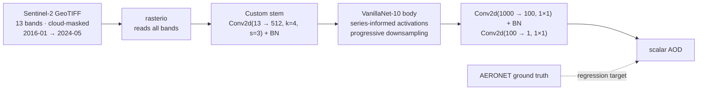

<h1 align="center">Aerosol Optical Depth Estimation</h1>

<p align="center">
  <b>Predicting AOD from 13-band Sentinel-2 imagery, with a VanillaNet backbone<br>
  chosen because it can fold its own batch-norm away at inference.</b>
</p>

<p align="center">
  
  
  
  
</p>

---

## The problem

**Aerosol Optical Depth** measures how much sunlight the particles suspended in a column of
atmosphere block. It is a direct handle on air quality, a major uncertainty in climate models, and
one of the few atmospheric quantities that connects satellite data to public health.

It is measured accurately by **AERONET** — a global network of ground sun-photometers. There are a
few hundred of them, on a planet. Everywhere else, AOD has to be inferred from satellite imagery.

That is hard for a reason specific to the physics: **the satellite sees the surface and the
atmosphere superimposed**, and it is the *atmosphere* you want. A hazy image over bright desert and
a clear image over dark forest can produce similar radiances. Separating the aerosol signal from the
surface reflectance is the entire problem, and it is what makes multispectral input essential —
different bands are sensitive to aerosols and to the ground in different proportions, so the
separation lives in the *relationships between bands*, not in any single one.

Built for the Solafune AOD competition. **45th place.**

## What it does



---

## Novelty

### 1. VanillaNet — an architecture chosen for what it does *after* training

The interesting property of VanillaNet is not its accuracy, it is **structural
re-parameterisation**. Its activation function is a learnable depthwise convolution followed by
batch norm:

```python
class activation(nn.ReLU):
    def __init__(self, dim, act_num=3, deploy=False):
        self.weight = nn.Parameter(torch.randn(dim, 1, act_num*2 + 1, act_num*2 + 1))
        if not deploy:
            self.bn = nn.BatchNorm2d(dim, eps=1e-6)
```

At training time that is a conv **and** a batch-norm — two ops, extra parameters, extra memory
traffic. At deployment, `switch_to_deploy()` folds the batch-norm's scale and shift **into the
convolution weights**:

```python
def _fuse_bn_tensor(self, weight, bn):
    running_mean, running_var = bn.running_mean, bn.running_var
    gamma, beta, eps = bn.weight, bn.bias, bn.eps
    std = (running_var + eps).sqrt()
    return weight * (gamma / std).reshape(-1, 1, 1, 1), beta - running_mean * gamma / std

def switch_to_deploy(self):
    kernel, bias = self._fuse_bn_tensor(self.weight, self.bn)
    self.weight.data = kernel
    self.__delattr__('bn')
```

Two layers become one, with **mathematically identical output** — batch-norm at inference is an
affine transform, and an affine transform composed with a convolution is another convolution. Free
speed, no accuracy cost, no approximation.

For an environmental-monitoring model this is the right thing to optimise for. Training happens
once; inference runs over every Sentinel-2 tile, forever. A model that is expensive to train and
cheap to run is exactly the shape this workload wants.

The "series-informed" activation is the other half: instead of a fixed pointwise ReLU, each channel
learns a **7×7 spatial kernel** (`act_num=3` → `2·3+1`). The non-linearity has a receptive field.
That is what lets VanillaNet stay shallow — it recovers expressiveness through wider activations
rather than through depth, and shallow means fewer sequential kernel launches at inference.

### 2. The 13-band stem is the real modification

```python
self.vanillanet[0] = nn.Sequential(
    nn.Conv2d(13, 512, kernel_size=(4, 4), stride=(3, 3), padding=(1, 1)),
    nn.BatchNorm2d(512, eps=1e-06, momentum=0.1, affine=True, track_running_stats=True)
)
```

Every ImageNet backbone expects three channels. Sentinel-2 has **thirteen** — B1 coastal aerosol,
B2–B4 visible, B5–B7 red edge, B8/B8A NIR, B9 water vapour, B10 cirrus, B11/B12 SWIR.

Replacing the stem rather than stacking bands into RGB triples is the correct move, and the
retained bands matter enormously here: **B1 exists specifically for aerosol retrieval** and B10 for
cirrus detection. Both would be discarded by any RGB-shaped adaptation, and they are the two most
directly relevant to the target.

The stem is deliberately wide (512 channels immediately) with an aggressive `stride=3`, so the
network mixes all 13 bands in the first operation — the cross-band relationships that separate
aerosol from surface get to exist from layer one — while cutting spatial resolution early to keep
the wide stem affordable.

### 3. A fully convolutional regression head

```python
self.vanillanet[-1] = nn.Sequential(nn.Conv2d(1000, 100, kernel_size=(1,1)), nn.BatchNorm2d(100))
self.conv1 = nn.Conv2d(100, 1, kernel_size=(1,1))
...
return x[:, 0, 0, 0]
```

The classification head is replaced with two 1×1 convolutions narrowing 1000 → 100 → 1, and the
scalar is read out of the single remaining spatial cell. No flatten, no `Linear` — which means the
network has **no fixed input-size requirement**, and satellite tiles that vary in extent still work.
Combined with the adaptive pooling in the VanillaNet body, the model is resolution-agnostic by
construction.

### 4. Three architectures kept, not just the winner

```
model/vanillanet.py     the submitted model
model/Resnetlstm.py     ResNet features → LSTM
model/Vgglstm.py        VGG features → LSTM
```

The two LSTM variants are a genuinely different hypothesis — that AOD has a **temporal** structure
worth modelling, since the dataset spans 2016 to 2024 and aerosol load is strongly seasonal. That
turned out not to be the submitted approach, and keeping both in the repo is the honest record of
an explored branch rather than a tidied-up history.

### 5. `rasterio`, not PIL

```python
with rasterio.open(file_path) as fl:
    image = fl.read()          # all 13 bands, native dtype, georeferenced
```

The right library for the job. `rasterio` reads multi-band GeoTIFF at full bit depth and preserves
the geospatial metadata; PIL would silently reduce to 8-bit RGB and throw away ten bands and most
of the dynamic range. Sentinel-2 reflectance is 12-bit — quantising it to 8 bits would destroy
precisely the subtle inter-band differences the aerosol signal lives in.

### 6. Configuration in JSON, separate from code

```json
{"model_configuration": {"learning_rate": 0.0001, "seed": 100, "batch_size": 16,
                         "epochs": 200, "device": "cuda", "test_every": 5,
                         "test_batch_size": 15},
 "meta_data": {"model_name": "Vanilla_net", "experiment_number": 4}}
```

An `experiment_number` field, a fixed `seed`, checkpoint and prediction paths, and a `test_every`
cadence. This is experiment tracking built in from the start — a competition setting where you run
dozens of variants is exactly where it pays, and `experiment_number: 4` is the evidence it was used.

`main.py` is 34 lines: read config, build model, hand it to the `Trainer`. The trainer holds
mixed-precision training, rotating checkpoints, periodic evaluation and optional experiment
logging.

---

## Repository layout

```
main.py                  entry point — reads config.json, builds, trains
config.json              paths, hyperparameters, experiment number
dataLoader.py            rasterio-backed Dataset, filename-ordered, CSV target mapping
trainer/trainer.py       AMP training loop, rotating checkpoints, periodic test, logging
model/
  model_van.py           VanillaPred — 13-band stem + VanillaNet-10 + regression head
  vanillanet.py          the VanillaNet implementation, with switch_to_deploy()
  Resnetlstm.py          alternative: ResNet features → LSTM
  Vgglstm.py             alternative: VGG features → LSTM
  resnet/                supporting blocks, layers, models
requirements.txt
```

## Running it

```bash
git clone https://github.com/Vishal-AS-0407/Aerosol-Optical-Depth-Estimation.git
cd Aerosol-Optical-Depth-Estimation
pip install -r requirements.txt
```

Lay the data out as `config.json` expects:

```
Data/train_images/     Sentinel-2 GeoTIFFs
Data/train_answer.csv  ground-truth AOD (headerless; col 0 = filename, col 2 = value)
Data/test_images/
```

```bash
python main.py
```

Checkpoints go to `checkpoint/`, predictions to `prediction/`.

[Competition and data](https://solafune.com/competitions/ca6ee401-eba9-4f7d-95e6-d1b378a17200)

---

## Honest notes

- **No metrics are committed.** The final placement (45th) is the only performance figure. RMSE or
  R² against the AERONET targets, and a scatter of predicted vs. true AOD, would say far more about
  where the model actually fails — and for AOD the failure mode usually depends on surface type,
  which a scatter coloured by land cover would show immediately.
- **`switch_to_deploy()` is implemented but never called.** The whole architectural argument for
  VanillaNet is the re-parameterisation, and the inference path in this repo does not use it. One
  call over the model's modules before saving the deployment checkpoint would realise the benefit
  the backbone was chosen for.
- **`create_model('vanillanet_10')` is called without `pretrained=True`**, so the backbone starts
  from random initialisation. Given a competition dataset and 200 epochs that may well be
  deliberate — a 13-band stem cannot inherit RGB stem weights anyway — but the body could have.
- **`assert loss.dtype is torch.float16`** in the training step will fail on CPU or with AMP
  disabled. It documents the intent (this loop assumes mixed precision) at the cost of portability.
- **No augmentation and no normalisation** in the dataset — raw reflectance goes straight in. The
  stem's batch-norm absorbs the scale, but per-band standardisation would still likely help, and
  flips/rotations are free on satellite imagery where orientation carries no meaning.
- **`__pycache__/*.pyc` is committed.** Add `__pycache__/` to `.gitignore`.
- **`utils/utility.py` is imported by `dataLoader.py` but not committed**, so the loader will not
  import as cloned. It provides `sort_filenames_by_number`, which is a numeric filename sort —
  small enough to reconstruct, but the repo does not run without it.
- **`Data/` is not committed** (competition data), so the pipeline needs the dataset downloaded
  first.
