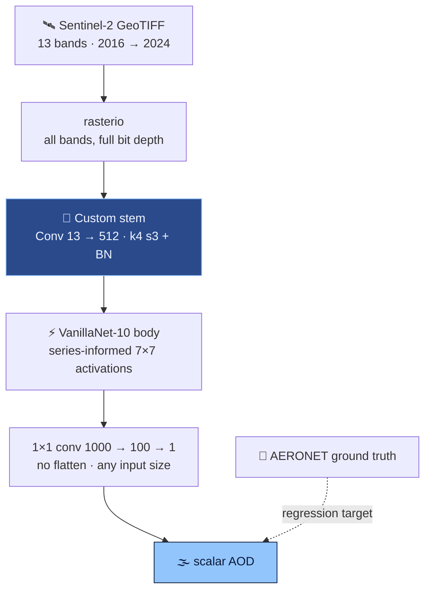

<div align="center">


<br/>


</div>


## 📌 Overview

**Aerosol Optical Depth** — how much sunlight airborne particles block — is a direct handle on air
quality and a major climate-model uncertainty. Ground truth comes from **AERONET**: a few hundred
sun-photometers for the whole planet. Everywhere else, it has to be inferred from orbit.

> 🌫️ **The physics problem:** the satellite sees surface and atmosphere **superimposed**. Hazy
> desert and clear forest can look alike. The aerosol signal lives in the **relationships between
> bands** — which is why all 13 matter.

## 🧠 Model



## ✨ Highlights

<table>
<tr>
<td width="50%" valign="top">

### ⚡ Chosen for inference
VanillaNet's activation is a conv **plus** BatchNorm in training; `switch_to_deploy()` folds the
BN **into the weights** — identical output, one op instead of two.

</td>
<td width="50%" valign="top">

### 🛰️ A 13-band stem
B1 exists *for* aerosol retrieval, B10 for cirrus — an RGB-shaped adaptation throws away exactly
the two bands that matter most.

</td>
</tr>
<tr>
<td valign="top">

### 📐 Resolution-agnostic
A fully convolutional head (1×1 convs, no `Linear`) — tiles of any extent work.

</td>
<td valign="top">

### 🧪 Experiments, tracked
`config.json` with seed, `experiment_number`, test cadence — plus ResNet-LSTM and VGG-LSTM
branches kept as the record of a temporal hypothesis.

</td>
</tr>
</table>

<details>
<summary><b>🔬 BatchNorm folding</b></summary>

```python
def _fuse_bn_tensor(self, weight, bn):
    std = (bn.running_var + bn.eps).sqrt()
    return weight * (bn.weight / std).reshape(-1, 1, 1, 1), bn.bias - bn.running_mean * bn.weight / std

def switch_to_deploy(self):
    kernel, bias = self._fuse_bn_tensor(self.weight, self.bn)
    self.weight.data = kernel
    self.__delattr__('bn')
```

BN at inference is an affine transform; an affine transform after a convolution is another
convolution. Train once, run over every tile forever — the right shape for this workload.

</details>

<details>
<summary><b>🛰️ The bands</b></summary>

| Band | Role |
|---|---|
| **B1** | coastal **aerosol** |
| B2–B4 | visible |
| B5–B7 | red edge |
| B8 / B8A | near infrared |
| B9 | water vapour |
| **B10** | **cirrus** |
| B11 / B12 | short-wave infrared |

Read with `rasterio` at native 12-bit depth — PIL would quantise to 8-bit RGB and destroy the subtle
inter-band differences the signal lives in.

</details>

## 🛠️ Tech stack

<p align="center">
  
  
  
  
</p>

## 🚀 Getting started

```bash
git clone https://github.com/Vishal-AS-0407/Aerosol-Optical-Depth-Estimation.git
cd Aerosol-Optical-Depth-Estimation
pip install -r requirements.txt
python main.py         # reads config.json → checkpoint/ and prediction/
```

> 💡 **Tip:** download the competition data from [Solafune](https://solafune.com/) (the original
> competition page has since been taken down) into `Data/train_images/`, `Data/test_images/` and `Data/train_answer.csv`.

```
📦 Aerosol-Optical-Depth-Estimation
 ┣ 🐍 main.py              read config → build → train
 ┣ ⚙️ config.json          paths · hyperparameters · experiment number
 ┣ 🐍 dataLoader.py        rasterio Dataset
 ┣ 📂 trainer              AMP loop · checkpoints · periodic test
 ┗ 📂 model
   ┣ 🐍 model_van.py       13-band stem + VanillaNet-10 + head  ⭐
   ┣ 🐍 vanillanet.py      with switch_to_deploy()
   ┣ 🐍 Resnetlstm.py      temporal alternative
   ┗ 🐍 Vgglstm.py         temporal alternative
```

## 🧭 Notes & roadmap

<details>
<summary><b>Next steps</b></summary>

- 📏 Add RMSE / R² and a predicted-vs-true scatter coloured by land cover.
- ⚡ Call `switch_to_deploy()` before saving the inference checkpoint.
- 🎨 Per-band standardisation + flips/rotations (orientation is meaningless on satellite tiles).
- 🧩 Commit `utils/utility.py` (`sort_filenames_by_number`) so the loader imports as cloned.

</details>


<div align="center">

<a href="https://portfolio-sigma-blond-57.vercel.app"></a>
<a href="https://www.linkedin.com/in/vishal-a-s04/"></a>
<a href="https://github.com/Vishal-AS-0407"></a>

⭐ **If this helped you, star the repo!**


</div>
