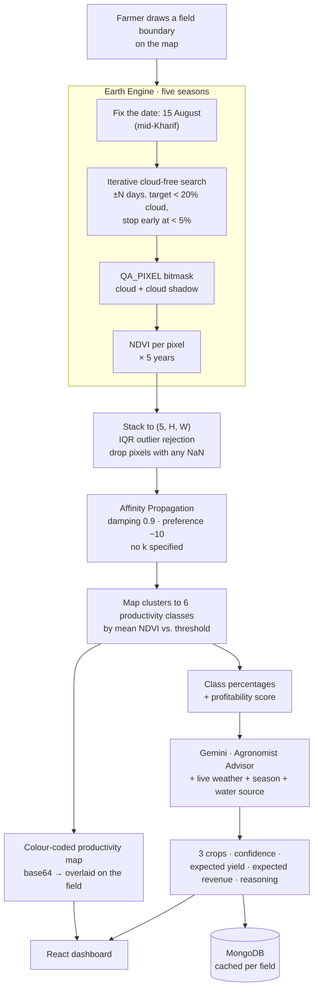

<h1 align="center">Agrizon</h1>

<p align="center">
  <b>Draw your field on a map. Get back five years of satellite history,<br>
  a productivity map of the ground inside it, and three crops worth planting.</b>
</p>

<p align="center">
  <a href="https://agri-zon.vercel.app"></a>
  
  
  
  
</p>

---

## The problem

A smallholder farmer's most consequential decision each season is *what to plant*. It is made from
memory, from what the neighbours are doing, and from what the local input dealer is selling.

Two facts about the ground make this harder than it looks:

**1 — A field is not uniform.** A two-hectare plot has a wet corner, a patch where nothing has ever
grown well, and a strip along the bund that outperforms everything else. Farmers know this in their
bodies and have no way to quantify it — so inputs get applied uniformly across ground that has
never behaved uniformly.

**2 — One season is noise.** Last year's yield tells you about last year's rain. The signal you
actually want — *which parts of this field are reliably productive* — only appears across multiple
seasons, and nobody has the data.

Meanwhile the data exists and is free. Landsat has been photographing every field on Earth for
decades. The gap is not availability; it is that turning a satellite archive into "plant groundnut
in the north half" requires remote sensing, cloud masking, multi-year statistics, clustering and
agronomy — which is not a farmer's job.

## What it does



---

## Novelty

### 1. Five years at the same point in the season, not five arbitrary dates

```python
def get_growth_season_dates(self, location='andhra'):
    """Major seasons: Kharif (June-Oct), Rabi (Nov-Feb).
       We'll use mid-Kharif (August) as default."""
    return date(base_year, 8, 15)
```

**15 August, five years running.** This is the single most important design decision in the
pipeline and it is easy to miss.

NDVI varies enormously through a season — bare soil in June, canopy closure in September, senescence
in November. Sampling five random cloud-free dates would produce five images of *different
phenological stages*, and clustering them would separate pixels by *when they were photographed*
rather than by how productive they are. Fixing the date to mid-Kharif — the peak of the monsoon
crop, when the canopy is developed and differences in soil quality actually show up in the
vegetation — means the five values for a pixel are genuinely comparable, and the variation between
them is the thing you want to measure.

The year-boundary handling is a nice touch: before August, use last year, so an analysis run in
March uses a completed season rather than a future date.

### 2. Cloud-free search that widens outward and stops when it is good enough

```python
for days_diff in range(0, max_search_days):
    # search ±days_diff around the target date
    if cloud_cover < 5:
        print(f"  ✓ Selected {date_str} (excellent quality: {cloud_cover:.1f}% clouds)")
        return image, search_date, cloud_cover      # early exit
    if cloud_cover < best_cloud_cover:
        best_image, best_cloud_cover = image, cloud_cover
```

Kharif *is* the monsoon. Demanding an image on exactly 15 August in south India will frequently
find nothing but cloud. So the search spirals outward day by day, keeps the best candidate seen so
far, and **returns immediately on anything under 5% cloud** rather than exhaustively searching for
a marginally better frame.

This is the right shape for the problem: closest-in-time is what preserves phenological
comparability, so a 3%-cloud image two days off target beats a 0%-cloud image three weeks off.
The early exit encodes that priority. And when nothing qualifies within the window it raises rather
than silently returning a cloudy scene.

### 3. Two layers of cloud handling — scene-level and pixel-level

Scene metadata filtering (`CLOUD_COVER < 20`) picks the image. Then **bit-level masking** cleans
what is left:

```python
qa = image.select('QA_PIXEL')
cloud_mask = qa.bitwiseAnd(1 << 3).eq(0).And(qa.bitwiseAnd(1 << 4).eq(0))
return image.updateMask(cloud_mask)
```

Bit 3 is cloud, bit 4 is cloud shadow, in Landsat 8/9's Collection-2 QA band. Masking **shadow as
well as cloud** is the part people skip, and it matters more than the cloud itself for this
application: a cloud is obviously bright and easy to spot, whereas a shadow depresses NDVI in a way
that looks exactly like poor vegetation — and would be clustered as a low-productivity zone.

### 4. Affinity Propagation — because nobody knows how many zones a field has

```python
affinity_propagation = AffinityPropagation(damping=0.9, preference=-10)
```

K-means would be the obvious choice and would be wrong, because it needs `k`. How many distinct
productivity zones does *this* field have? Two? Six? It depends on the field, and getting it wrong
either merges genuinely different ground or invents boundaries that are not there.

**Affinity Propagation determines the number of clusters from the data.** The two parameters are
chosen with intent:

- `preference = -10` — a low, uniform preference. Every pixel is an equally unlikely exemplar, so
  the algorithm forms *few, large* clusters rather than fragmenting the field into dozens of tiny
  ones. A management zone has to be big enough to drive a tractor across.
- `damping = 0.9` — high. Affinity Propagation's message passing oscillates without heavy damping,
  and on a field with a smooth productivity gradient (which is most fields) it will not converge at
  a lower value.

Clusters are then mapped onto **six ordered productivity classes** by comparing each cluster's mean
NDVI against a global threshold — so the output is interpretable ("class 5 ground") rather than
arbitrary cluster IDs.

### 5. Outlier rejection before clustering, using the stack's own quartiles

```python
Q1_avg = np.mean([np.nanpercentile(stacked_image[i][mask], 25) for i in range(5)])
Q3_avg = np.mean([np.nanpercentile(stacked_image[i][mask], 75) for i in range(5)])
mean_of_each_pixel = np.mean(stacked_image, axis=0)
outlier_positions = np.where(...)
```

Quartiles computed **per year and then averaged**, rather than over the pooled stack — so a single
anomalous year cannot drag the bounds. Pixels whose five-year mean falls outside the IQR fence are
dropped, as are pixels with any NaN across the stack.

The strictness is correct for this problem. A pixel missing one year out of five has a
four-dimensional feature vector while its neighbours have five; imputing the gap would invent
history. Dropping it costs a little coverage and keeps every clustered pixel backed by five real
observations. Field edges, roads and water bodies fall out here too, for free.

### 6. The agronomy prompt is regionally located and forced into a schema

```
You are an expert Agronomist Advisor specializing in Tamil Nadu and Kerala farming systems.
Analyze the field data and provide EXACTLY 3 crop recommendations optimized for current conditions.
...
3. FIELD PRODUCTIVITY: Match crops to the field's productivity distribution
   (Classes 4-6 indicate high-value crop potential)
4. WATER MATCHING: Align crop water needs with the water source availability
- Crop 2: High-value cash crop suitable for the field conditions
```

Three things worth noting. It is **regionally specialised** — "Tamil Nadu and Kerala farming
systems", not "agriculture" — which is what gets you groundnut and tapioca instead of maize and
soy. It is handed **the productivity class distribution**, so the recommendation is conditioned on
the clustering output rather than just on location. And it is **portfolio-shaped**: one safe crop,
one high-value cash crop, one alternative — because telling a smallholder to bet the whole field on
the highest-expected-value option is advice that occasionally ruins somebody.

The response is required as JSON with `crop`, `confidence`, `expectedYield`, `expectedRevenue`,
`season`, `reasoning`, and `_parse_recommendations` validates every required field is present
before the response reaches the UI. Reasoning is capped at two sentences.

### 7. Results are cached per field

`/api/recent-analysis/{field_id}` returns the stored result from MongoDB. A five-year Earth Engine
pull is slow and quota-limited, and a field's productivity map does not change between page loads.
Re-running it on every visit would make the app unusable and burn the quota; caching is what makes
it a product rather than a demo.

---

## API

| Endpoint | Method | Purpose |
|---|---|---|
| `/` | GET | service info |
| `/api/analyze-field` | POST | the full pipeline — boundary in, classification + recommendations out |
| `/api/recent-analysis/{field_id}` | GET | cached result |
| `/api/health` | GET | liveness |

## Repository layout

```
src/                            React + TypeScript + Vite + Tailwind + shadcn/ui
  components/FieldMap.tsx       draw the boundary, overlay the classification
  components/FieldSelectionDialog.tsx
  integrations/supabase/        auth
backend/
  main.py                       FastAPI, 4 endpoints
  services/ndvi_service.py      Earth Engine — season dates, cloud search, QA masking, NDVI
  services/clustering_service.py  stack · IQR reject · Affinity Propagation · 6 classes · base64 map
  services/gemini_service.py    agronomist prompt, JSON schema, validation
  services/mongodb_service.py   persistence
  test_ee.py · test_mongodb.py  connectivity checks
  render.yaml                   deploy config
clustering.py                   the standalone research version of the clustering work

EARTH_ENGINE_SETUP.md · SETUP_GUIDE.md · DEPLOYMENT_GUIDE.md
MONGODB_IMPLEMENTATION.md · CHANGES_SUMMARY.md
Agrizon.pdf · Flow diag.jpeg
```

## Running it

**Backend**

```bash
cd backend
python -m venv venv && source venv/bin/activate      # Windows: venv\Scripts\activate
pip install -r requirements.txt
earthengine authenticate                              # one-time, needs a GEE account
# create backend/.env with your own GEMINI_API_KEY, GOOGLE_CLOUD_PROJECT, MONGODB_URI
uvicorn main:app --reload --port 8000
python test_ee.py && python test_mongodb.py           # verify both connections
```

**Frontend**

```bash
npm install
echo "VITE_BACKEND_URL=http://localhost:8000" > .env
npm run dev
```

Earth Engine needs a registered Google Cloud project — `EARTH_ENGINE_SETUP.md` walks through it.

---

## ⚠️ Security

**`backend/.env` is committed**, containing a live **Google Gemini API key**, the **Google Cloud
project ID**, and a **MongoDB connection string**. All three are in the public repository and in
the git history.

1. **Revoke the Gemini key** at <https://aistudio.google.com/app/apikey>.
2. **Rotate the MongoDB credentials.**
3. Then:

```bash
printf '\nbackend/.env\n' >> .gitignore
git rm --cached backend/.env
```

`.env.example` is already committed and is the right pattern — `backend/.env` should never have
joined it. Note also that `backend/services/__pycache__/*.pyc` is committed; add `__pycache__/` to
`.gitignore` while you are there.

---

## Honest notes

- **Five years is hard-coded.** `stack_and_preprocess` assumes a `(5, H, W)` stack and indexes
  `range(5)` in several places. Changing the window means editing the service, not a parameter.
- **Season dates are fixed to Kharif in Andhra/Telangana**, and the agronomy prompt targets Tamil
  Nadu and Kerala. Both are reasonable for the target region and neither generalises — a Rabi
  analysis, or a field outside south India, needs the date logic parameterised.
- **Affinity Propagation is O(n²) in memory.** It computes a full similarity matrix over pixels, so
  a large field at Landsat's 30 m resolution will exhaust RAM. There is no downsampling or tiling
  step; small fields only, as written.
- **The expected-yield and expected-revenue figures are LLM output.** They are plausible and they
  are not grounded in a price feed or a yield model. Presented to a farmer they should carry that
  caveat visibly, and wiring them to real mandi prices is the highest-value next change.
- **`clustering.py` (1,006 lines) at the repo root is the research version** of what became
  `backend/services/clustering_service.py`. Kept for the record; the service is the live path.
- **`.env.production` has a malformed value** — `VITE_BACKEND_URL=` followed by the URL on the next
  line, which parses as empty.
- **No tests beyond the two connectivity scripts.**
