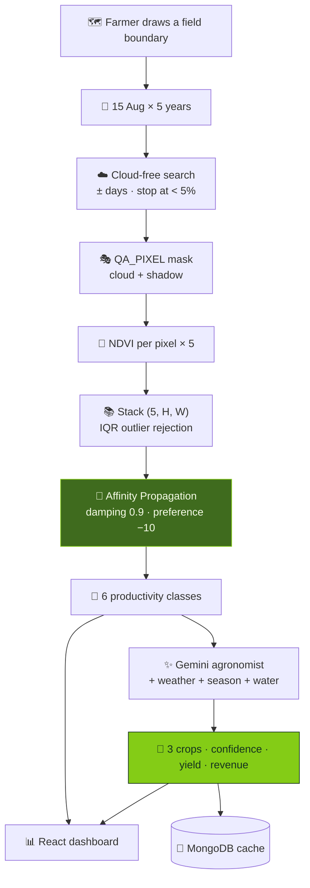

<div align="center">


<br/>

<a href="https://agri-zon.vercel.app"></a>


<br/><br/>

<a href="https://agri-zon.vercel.app"></a>

</div>


<details>
<summary><b>📑 Table of contents</b></summary>

- [📌 Overview](#-overview)
- [✨ Highlights](#-highlights)
- [🧠 Pipeline](#-pipeline)
- [🖼️ Screens & architecture](#️-screens--architecture)
- [🔬 Under the hood](#-under-the-hood)
- [🔌 API](#-api)
- [🚀 Getting started](#-getting-started)
- [📂 Project structure](#-project-structure)
- [🧭 Notes & roadmap](#-notes--roadmap)

</details>

## 📌 Overview

A smallholder's biggest decision each season — **what to plant** — is made from memory, the
neighbours, and whatever the input dealer is selling.

| Fact about the ground | What Agrizon does |
|---|---|
| 🌱 **A field isn't uniform** — a wet corner, a dead patch, a strong strip | Clusters pixels into **productivity zones** |
| 🌧️ **One season is noise** — last year's yield is last year's rain | Uses **five seasons** at the same point in the crop cycle |
| 🛰️ **The data is free but unusable** — Landsat, cloud masks, statistics | One map, one drawn boundary, one result |

## ✨ Highlights

<table>
<tr>
<td width="50%" valign="top">

### 📅 Same day, five years
Every year is sampled at **15 August (mid-Kharif)** — so pixels are compared at the same crop
stage, not by when they happened to be photographed.

</td>
<td width="50%" valign="top">

### ☁️ Clouds *and* shadows masked
Scene filter < 20%, an outward day-by-day search that stops at < 5%, then **QA_PIXEL bit masking
for cloud shadow** — which otherwise looks exactly like poor soil.

</td>
</tr>
<tr>
<td valign="top">

### 🧩 Zones without choosing k
**Affinity Propagation** decides how many zones a field has; low preference keeps them big enough
to drive a tractor across.

</td>
<td valign="top">

### 🌾 A crop portfolio, not a bet
Gemini returns **exactly 3**: a safe crop, a high-value cash crop, an alternative — matched to
zones, water source and live weather.

</td>
</tr>
</table>

## 🧠 Pipeline



## 🖼️ Screens & architecture

<div align="center">


<table>
<tr>
<td align="center" width="50%"><b>🛰️ NDVI analysis</b><br/></td>
<td align="center" width="50%"><b>🔀 Flow</b><br/></td>
</tr>
</table>

<details>
<summary><b>🏗️ Data flow, deployment and security architecture</b></summary>
<br/>

<br/><br/>

<br/><br/>

</details>

</div>

## 🔬 Under the hood

<details>
<summary><b>☁️ Cloud-free search that stops when it's good enough</b></summary>

```python
for days_diff in range(0, max_search_days):
    # search ±days_diff around the target date
    if cloud_cover < 5:
        return image, search_date, cloud_cover      # early exit
    if cloud_cover < best_cloud_cover:
        best_image, best_cloud_cover = image, cloud_cover
```

Kharif *is* the monsoon. Closest-in-time preserves crop-stage comparability, so a 3%-cloud image
two days off beats a 0% image three weeks off.

```python
qa = image.select('QA_PIXEL')
cloud_mask = qa.bitwiseAnd(1 << 3).eq(0).And(qa.bitwiseAnd(1 << 4).eq(0))   # cloud, shadow
```

</details>

<details>
<summary><b>📚 Outlier rejection from the stack's own quartiles</b></summary>

```python
Q1_avg = np.mean([np.nanpercentile(stacked_image[i][mask], 25) for i in range(5)])
Q3_avg = np.mean([np.nanpercentile(stacked_image[i][mask], 75) for i in range(5)])
```

Per-year quartiles, then averaged — one anomalous year can't drag the bounds. Pixels with any
missing year are dropped rather than imputed: every clustered pixel has five real observations.

</details>

<details>
<summary><b>🧩 Why Affinity Propagation, and these parameters</b></summary>

```python
AffinityPropagation(damping=0.9, preference=-10)
```

- **No `k`** — how many zones *this* field has is the question, not an input.
- **`preference = −10`** — few, large clusters: a management zone has to be workable.
- **`damping = 0.9`** — message passing oscillates on smooth gradients without heavy damping.

Clusters map to six **ordered** classes by mean NDVI, so the output reads as "class 5 ground".

</details>

<details>
<summary><b>🌾 The agronomist prompt</b></summary>

```
You are an expert Agronomist Advisor specializing in Tamil Nadu and Kerala farming systems.
Analyze the field data and provide EXACTLY 3 crop recommendations optimized for current conditions.
3. FIELD PRODUCTIVITY: Match crops to the field's productivity distribution
4. WATER MATCHING: Align crop water needs with the water source availability
```

Regionally specialised, conditioned on the zone distribution, and returned as validated JSON:
`crop · confidence · expectedYield · expectedRevenue · season · reasoning`.

</details>

## 🔌 API

| Endpoint | Method | Purpose |
|---|:---:|---|
| `/api/analyze-field` | `POST` | boundary in → classification + recommendations out |
| `/api/recent-analysis/{field_id}` | `GET` | cached result (Earth Engine pulls are slow and quota-limited) |
| `/api/health` | `GET` | liveness |

## 🛠️ Tech stack

<p align="center">
  
  <br/>
  
  
  
</p>

## 🚀 Getting started

```bash
# ⚙️ Backend
cd backend
python -m venv venv && source venv/bin/activate      # Windows: venv\Scripts\activate
pip install -r requirements.txt
earthengine authenticate                              # one-time, needs a GEE project
cp .env.example .env                                  # GEMINI_API_KEY, GOOGLE_CLOUD_PROJECT, MONGODB_URI
uvicorn main:app --reload --port 8000
python test_ee.py && python test_mongodb.py           # verify connections

# 🖥️ Frontend
npm install
echo "VITE_BACKEND_URL=http://localhost:8000" > .env
npm run dev
```

> 💡 **Tip:** `EARTH_ENGINE_SETUP.md` walks through registering a Google Cloud project for Earth
> Engine. Interactive API docs live at `http://localhost:8000/docs`.

## 📂 Project structure

```
📦 Agrizon
 ┣ 📂 src                                React + TS + Vite + Tailwind + shadcn/ui
 ┃ ┗ 📂 components/FieldMap.tsx          draw the boundary, overlay the zones
 ┣ 📂 backend
 ┃ ┣ 🐍 main.py                          FastAPI
 ┃ ┗ 📂 services
 ┃   ┣ 🛰️ ndvi_service.py                season dates · cloud search · masking · NDVI
 ┃   ┣ 🧩 clustering_service.py          stack · IQR · Affinity Propagation · map
 ┃   ┣ ✨ gemini_service.py              agronomist prompt + validation
 ┃   ┗ 🍃 mongodb_service.py             persistence
 ┣ 🐍 clustering.py                      the research version of the clustering
 ┗ 📄 *_SETUP.md · DEPLOYMENT_GUIDE.md · Agrizon.pdf
```

## 🧭 Notes & roadmap

<details>
<summary><b>Known limits</b></summary>

- 📅 Five years and the Kharif date are hard-coded; the prompt targets Tamil Nadu / Kerala.
- 🧠 Affinity Propagation is O(n²) memory — small fields only until tiling/downsampling lands.
- 💰 Yield and revenue are LLM estimates, not a price feed or yield model.

**Roadmap**
- [ ] Parameterised seasons (Rabi) and window length
- [ ] Tiling for large fields
- [ ] Live mandi prices for revenue
- [ ] Tests beyond the connectivity scripts

</details>


<div align="center">

<a href="https://agri-zon.vercel.app"></a>
<a href="https://portfolio-sigma-blond-57.vercel.app"></a>
<a href="https://www.linkedin.com/in/vishal-a-s04/"></a>
<a href="mailto:vishalpersonal04@gmail.com"></a>

⭐ **If this helped you, star the repo!**


</div>
