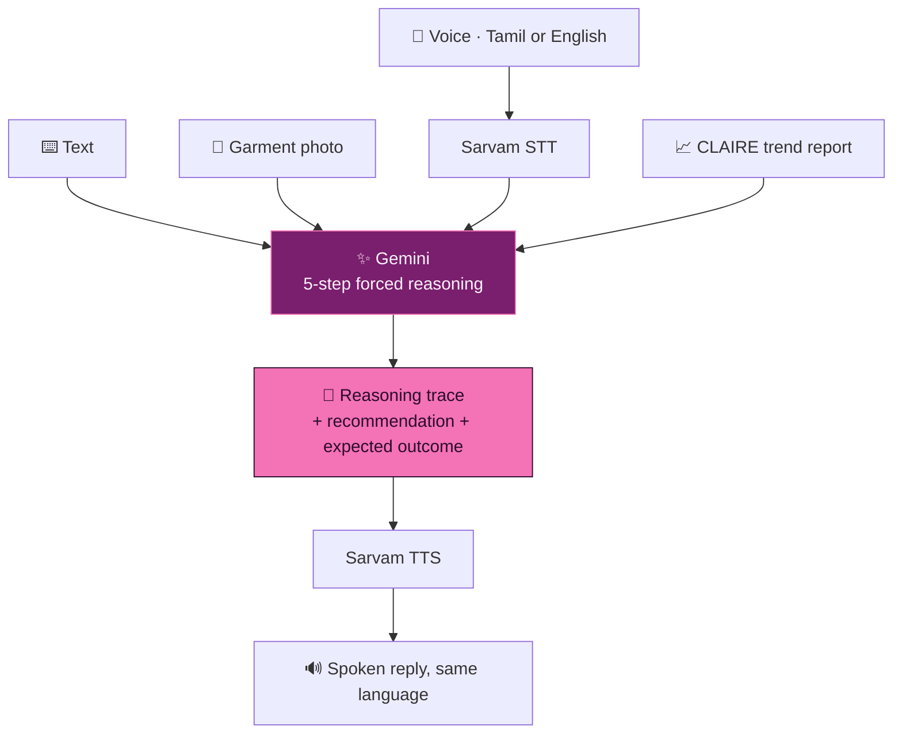

<div align="center">


<br/>


</div>


<details>
<summary><b>📑 Table of contents</b></summary>

- [📌 Overview](#-overview)
- [✨ Highlights](#-highlights)
- [🧠 How it works](#-how-it-works)
- [🧮 The 5-step reasoning](#-the-5-step-reasoning)
- [📈 The trend report](#-the-trend-report)
- [🔌 API](#-api)
- [🚀 Getting started](#-getting-started)
- [📂 Project structure](#-project-structure)
- [🧭 Notes & roadmap](#-notes--roadmap)

</details>

## 📌 Overview

Tirupur makes a very large share of India's knitwear. Every week, someone running a mid-sized
unit has to answer: **what do we cut next?** Right, and you're two months ahead of a trend. Wrong,
and you're holding 50,000 units nobody wants.

| Barrier | CLAIRE's answer |
|---|---|
| 📰 Trend reports are written for brands | Growth, volatility, momentum and supply gaps — framed for a **production** decision |
| ⌨️ Interfaces assume English and typing | **Speak in Tamil or English**, hear the reply in the same language |
| 🤷 Nobody bets a production run on an unexplained answer | A **mandatory 5-step reasoning trace** with every number cited |

> 📜 The conversational front end of the CLAIRE trend-analysis system — **patent filed,
> application 202541092811**.

## ✨ Highlights

<table>
<tr>
<td width="50%" valign="top">

### 🧮 Reasoning you can argue with
Five numbered steps with fixed opening sentences — *"From the report, I found: …"* — so citation
is structural, and a factory owner can reject a conclusion for a real reason.

</td>
<td width="50%" valign="top">

### 🪔 Tamil is a whole prompt
A complete system prompt **written in Tamil** — reasoning happens in Tamil, so register and
business vocabulary come out right, not translated.

</td>
</tr>
<tr>
<td valign="top">

### 📸 Ask with a photo
Upload a garment sample — CLAIRE describes colour, fit, fabric and design, then judges it
**against the trend data** with pricing advice.

</td>
<td valign="top">

### 🚀 Built to hand over
Gunicorn `Procfile`, pinned runtime, `/health` endpoint, CORS, and a self-contained `index.html`.

</td>
</tr>
</table>

## 🧠 How it works



## 🧮 The 5-step reasoning

| Step | Required output |
|:---:|---|
| 🔍 **1 · Understanding** | *"The core question is: [X]"* |
| 📊 **2 · Data extraction** | *"From the report, I found: [data points with sections]"* |
| 🧮 **3 · Analysis** | *"Analyzing this data: [step 1], [step 2]…"* — calculations shown |
| 💡 **4 · Business context** | *"The business implication is: [practical impact]"* |
| ✅ **5 · Recommendation** | *"My recommendation: [clear action plan]"* — short- and long-term |

> 🧾 *ALWAYS cite specific numbers from the report · ALWAYS show your reasoning steps ·
> **NEVER give advice without data support** · Think like a business consultant, not just an AI.*

## 📈 The trend report

The assistant reasons over a **keyword tree** — growth at every node, three levels deep:

```
👕 t-shirt
├── oversized t-shirt                +234%
│   ├── oversized graphic tee        +456%
│   │   └── retro gaming graphic tee +612%   ← the node you can actually cut
│   └── oversized vintage t-shirt    +178%
└── cotton t-shirt                    +67%
    └── organic cotton tee           +145%
```

| Metric | The production question it answers |
|---|---|
| 📉 **Coefficient of variation** | Stable line or fad? (`CV > 0.75` = volatile) |
| ⚡ **Spike index** | Is something happening *right now*? |
| 🏔️ **Peak-to-average** | One moment, or a real base? |
| 🚀 **7-day vs 30-day momentum** | Still accelerating — or already rolling over? |
| 📐 **Slope (monthly CAGR)** | How steep is the climb? |

> 🧵 Short-term momentum **+156%** above long-term = time to cut it. Short-term below long-term =
> you'd be shipping into a decline.

## 🔌 API

| Endpoint | Method | Purpose |
|---|:---:|---|
| `/health` | `GET` | liveness check |
| `/chat` | `POST` | question (+ optional image) → reasoning + recommendation |
| `/analyze-image` | `POST` | garment photo → description, viability, pricing |
| `/report-summary` | `GET` | executive summary of the trend report |
| `/voice-to-text` | `POST` | Sarvam STT |
| `/text-to-voice` | `POST` | Sarvam TTS |

## 🛠️ Tech stack

<p align="center">
  
  
  
  
</p>

## 🚀 Getting started

```bash
git clone https://github.com/Vishal-AS-0407/Claire_Chatbot.git
cd Claire_Chatbot
pip install -r requirements.txt
printf "GEMINI_API_KEY=...\nSARVAM_API_KEY=...\n" > .env

python finalchatbot.py                           # dev
gunicorn finalchatbot:app --bind 0.0.0.0:8000    # prod
```

> 💡 **Tip:** open `index.html` and point it at your server URL — it's a complete front end in
> one file.

## 📂 Project structure

```
📦 Claire_Chatbot
 ┣ 🐍 finalchatbot.py    Flask API — 6 endpoints, both system prompts, Sarvam + Gemini
 ┣ 🌐 index.html         self-contained front end
 ┣ 📈 report.md          the CLAIRE trend report the assistant reasons over
 ┣ 📄 requirements.txt
 ┣ ⚙️ Procfile           gunicorn entry point
 ┗ 📄 runtime.txt        python-3.13.0
```

## 🧭 Notes & roadmap

<details>
<summary><b>What's in this repo, and what isn't</b></summary>

- 📈 **`report.md` is a fixed sample report** (dated Dec 2024) — the reasoning over it is real; the
  live collection layer (Google Trends, Reddit, marketplaces) and statistical engine live in the
  wider CLAIRE system.
- 📚 The whole report goes into every prompt — fine now, will need retrieval as it grows.
- 🌐 CORS is open for the demo front end.

**Roadmap**
- [ ] Retrieval over report sections
- [ ] Live report refresh from the trend engine
- [ ] Tests + CI

</details>


<div align="center">

<a href="https://portfolio-sigma-blond-57.vercel.app"></a>
<a href="https://www.linkedin.com/in/vishal-a-s04/"></a>
<a href="https://github.com/Vishal-AS-0407"></a>
<a href="mailto:vishalpersonal04@gmail.com"></a>

⭐ **If this helped you, star the repo!**


</div>
