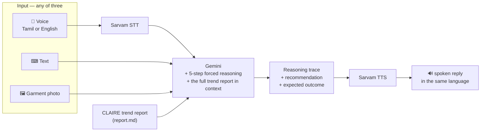

<h1 align="center">CLAIRE</h1>

<p align="center">
  <b>Cognitive Learning AI for Reasoning &amp; Evaluation</b><br>
  A fashion-trend intelligence assistant for Tirupur garment manufacturers —
  bilingual, voice-first, and required to show its working.
</p>

<p align="center">
  
  
  
  
  
</p>

---

## The problem

Tirupur produces a very large share of India's knitwear. The decisions that matter there are made
by people running mid-sized units who have to answer, this week: *what do we cut next?*

Get it right and you are ahead of a trend by two months. Get it wrong and you have 50,000 units of
something nobody wants. The information that would answer the question — search volume, social
signal, marketplace listings, competitor moves — exists, and it reaches a Tirupur factory floor as
essentially nothing.

Three barriers, and only one of them is data:

**1 — The trend intelligence that exists is written for brands, not manufacturers.** It says
"oversized graphic tees are trending". A manufacturer needs to know *how fast*, *how volatile*,
*which colours*, *is there a supply gap in my region*, and *do I have time to cut it*.

**2 — The interface assumes English and typing.** The person who actually knows the machines and
makes the call often works in Tamil and would rather speak than type.

**3 — Nobody will bet a production run on an unexplained answer.** An assistant that says "make
oversized graphic tees" gets ignored. An assistant that shows which numbers it read, what it
compared them against, and why it concluded what it did, gets argued with — and being argued with
is how advice gets used.

## What it does



---

## Novelty

### 1. The reasoning process is mandated, structured, and shown

The system prompt does not ask for an answer. It specifies **five numbered steps and the sentence
that must open each one**:

| Step | Required output |
|---|---|
| 🔍 **1 · Understanding** | *"The core question is: [X]"* |
| 📊 **2 · Data extraction** | *"From the report, I found: [data points with sections]"* |
| 🧮 **3 · Analytical reasoning** | *"Analyzing this data: [step 1], [step 2]…"* — show calculations |
| 💡 **4 · Business context** | *"The business implication is: [practical impact]"* |
| ✅ **5 · Recommendation** | *"My recommendation: [clear action plan]"*, short- and long-term |

Then a fixed output template, and four principles:

> ALWAYS cite specific numbers from the report · ALWAYS show your reasoning steps ·
> **NEVER give advice without data support** · Think like a business consultant, not just an AI

Two things make this better than generic chain-of-thought. First, **forcing the model to write the
literal sentence "From the report, I found: …" makes citation structural** rather than optional —
it cannot skip to a conclusion, because step 5 is preceded by four steps that have to be filled
in with report content. Second, the trace is what makes the output *auditable by a domain expert*.
A factory owner who knows their market can look at step 2 and say "that number is from a segment
we don't sell into" — and dismiss the conclusion for a good reason. That is exactly the interaction
you want, and it is impossible with a bare answer.

### 2. Tamil is a whole prompt, not a translation layer

`finalchatbot.py` carries **two complete system prompts** — one in English, one written natively in
Tamil, beginning:

> `நீங்கள் CLAIRE - Cognitive Learning AI for Reasoning & Evaluation.`

Not English-then-translate. The reasoning is *conducted* in Tamil, so the register, the idiom and
the business vocabulary come out right. Translating a reasoning chain after the fact produces
Tamil words in English sentence structure, which reads as machine output and gets trusted
accordingly.

Sarvam handles both ends of the voice loop — `speech-to-text` in, `text-to-speech` out — chosen
over the Western defaults because it is trained on Indian languages and handles the code-switching
that real Tamil business speech is full of.

### 3. A garment photo is a first-class query

`/analyze-image` takes a photo of a garment and analyses it **against the trend report**:

```
Describe what you see in detail (colors, style, fit, fabric type, design elements)
Compare against the report's trend data
Analyze market viability with numbers
Give specific pricing/positioning advice
```

This matches how the decision actually gets made. Somebody is holding a sample, or has a photo
from a buyer, or saw something on a competitor's stall. The natural question is "should we make
this?" — and it is a *visual* question. Typing a description of a garment into a chat box loses
exactly the information that matters.

### 4. Recursive keyword expansion — the trend report's own structure

The report the assistant reasons over (`report.md`) is not a list of trending terms. It is a
**tree**, expanded to three levels, with growth attached at every node:

```
Primary: "t-shirt"
├── oversized t-shirt                +234%
│   ├── oversized graphic tee        +456%
│   │   └── retro gaming graphic tee +612%
│   └── oversized vintage t-shirt    +178%
│       └── 90s vintage oversized    +203%
└── cotton t-shirt                    +67%
    └── organic cotton tee           +145%
        └── sustainable cotton shirt +167%
```

The insight is in the **gradient down the branch**. "T-shirts are up 67%" is noise. "T-shirts +67%,
oversized +234%, graphic +456%, *retro gaming graphic* +612%" tells a manufacturer precisely where
in the product space the demand is accelerating — and the deepest node is the one you can actually
cut. Depth is specificity, and specificity is the whole value.

### 5. Statistical metrics chosen for a production decision

The report scores each candidate on measures that map onto manufacturing risk rather than onto
"popularity":

| Metric | The question it answers |
|---|---|
| **Coefficient of variation** | Is this a stable line or a fad? `CV > 0.75` = volatile |
| **Spike index** | Is something happening *right now*? 8.9 = critical |
| **Peak-to-average ratio** | How much of the volume is one moment vs. a real base? |
| **7-day vs 30-day momentum** | Is it still accelerating, or already rolling over? |
| **Slope (monthly CAGR, in degrees)** | How steep is the climb? |

The 7-vs-30-day comparison is the one that earns its place. A trend where short-term momentum is
**+156%** above long-term is accelerating and there is time to cut it; one where short-term has
fallen below long-term has peaked, and you would be shipping into a decline. That is the
difference between profit and dead stock, and no single "trend score" expresses it.

The report pairs every metric with a plain-language interpretation, so the factory owner never has
to know what a coefficient of variation is.

### 6. Deployment-ready, not notebook-ready

```
Procfile      web: gunicorn finalchatbot:app --bind 0.0.0.0:$PORT
runtime.txt   python-3.13.0
```

Gunicorn, a pinned runtime, `flask-cors` for the browser front end, and a `/health` endpoint for
the platform's checks. `index.html` is a complete self-contained UI. This is built to be handed to
someone, not demoed once.

---

## API

| Endpoint | Method | Purpose |
|---|---|---|
| `/health` | GET | liveness check |
| `/chat` | POST | question (+ optional image) → reasoning trace + recommendation |
| `/analyze-image` | POST | garment photo → description, viability, pricing |
| `/report-summary` | GET | executive summary of the current trend report |
| `/voice-to-text` | POST | Sarvam STT |
| `/text-to-voice` | POST | Sarvam TTS, language-code mapped |

## Repository layout

```
finalchatbot.py    Flask API — 6 endpoints, both system prompts, Sarvam + Gemini
index.html         self-contained front end (988 lines)
report.md          the CLAIRE trend analysis report the assistant reasons over
requirements.txt   flask · flask-cors · google-generativeai · pillow · requests · gunicorn
Procfile           gunicorn entry point
runtime.txt        python-3.13.0
```

## Running it

```bash
git clone https://github.com/Vishal-AS-0407/Claire_Chatbot.git
cd Claire_Chatbot
pip install -r requirements.txt
```

Put your own keys in a `.env` (see the security note — they are currently hardcoded), then:

```bash
python finalchatbot.py                    # dev
gunicorn finalchatbot:app --bind 0.0.0.0:8000   # prod
```

Open `index.html`, or point it at your deployed URL.

---

## ⚠️ Security

**Two live API keys are hardcoded at the top of `finalchatbot.py`** — Google Gemini (line 19) and
Sarvam (line 22). Both are in the public repository and in the git history.

**Revoke both**, then use the `.env` support that is already imported but unused:

```python
load_dotenv()                                   # already at line 8
GEMINI_API_KEY = os.getenv("GEMINI_API_KEY")
SARVAM_API_KEY = os.getenv("SARVAM_API_KEY")
```

The file even has the right check three lines below — `if not GEMINI_API_KEY: print("WARNING: …")`
— which only makes sense against an environment variable. The wiring is there; only the assignment
is wrong.

---

## Honest notes

- **`report.md` is a static, hand-authored report.** The trend tree, the growth percentages, the
  statistical metrics and the 87.3% confidence score are illustrative content dated *December 20,
  2024*, not the output of a live pipeline. The assistant genuinely reasons over it — the reasoning
  is real; the underlying numbers are a fixture. The multi-source collection layer (Google Trends,
  Reddit, marketplace scraping) lives in the wider Claire system, not in this repository.
- **The report is loaded into every prompt.** Simple and effective at this size; it will hit the
  context window as the report grows. Retrieval over report sections is the natural next step.
- **No tests, no CI.**
- **CORS is open**, appropriate for a demo front end, worth pinning before a real deployment.
- **This is the conversational front end** of the Claire trend-analysis system — patent filed,
  application **202541092811**. Trend collection and the statistical engine are elsewhere.
