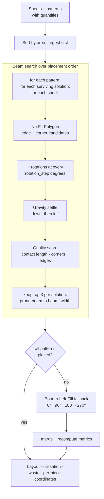

<h1 align="center">AdvanceCut</h1>

<p align="center">
  <b>2D irregular nesting for cloth cutting.</b><br>
  No-Fit Polygon placement, beam search over the cutting order, gravity settling —
  and a fallback that guarantees every piece gets placed.
</p>

<p align="center">
  
  
  
  
</p>

---

## The problem

Fabric is the largest single cost in garment manufacturing, and every square centimetre between
two cut pieces is money thrown away. A cutting-room supervisor laying out patterns by hand is
solving, by eye, one of the genuinely hard problems in combinatorial optimisation.

**2D irregular strip packing is NP-hard.** Not "slow" — there is no known efficient exact
algorithm, and there very likely is not one. Three things make the cloth version worse than the
textbook version:

1. **The pieces are not rectangles.** A sleeve is not a rectangle; neither is a collar, a gusset,
   or a yoke. Bounding-box packing — which is what most simple nesters do — throws away all the
   space in the concavities, and on garment patterns that is a large fraction of the total.
2. **Rotation is continuous.** Each piece can be placed at any angle, which turns a discrete search
   into a continuous one.
3. **Order matters enormously.** Where piece 7 can go depends entirely on where pieces 1–6 went.
   Greedy placement paints itself into corners it cannot back out of.

And there is a practical constraint that theory usually ignores: **an optimiser that leaves two
pieces unplaced is useless on a factory floor.** You cannot ship a garment that is missing a
sleeve. A 94%-utilisation layout with one piece left over is worse than an 89% layout with all of
them.

## What it does



---

## Novelty

### 1. No-Fit Polygon rather than bounding boxes

The NFP is the standard tool of serious nesting, and it is what separates this from a
rectangle packer. `NoFitPolygonCalculator` enumerates the positions at which a moving piece
**touches but does not overlap** a fixed one, from two families:

```python
# Edge placements — slide the moving piece along each edge of the fixed piece
normal = (-edge_vec[1] / edge_len, edge_vec[0] / edge_len)
for mv_vertex in moving_coords:
    for t in np.linspace(0, 1, 3):
        ...
        dx += normal[0] * 0.1        # nudge out along the edge normal
        dy += normal[1] * 0.1

# Corner placements — align every moving vertex with every fixed vertex
for fixed_vertex in fixed_coords:
    for mv_vertex in moving_coords:
        candidates.append((fixed_vertex[0] - mv_vertex[0],
                           fixed_vertex[1] - mv_vertex[1]))
```

This is what lets an L-shape nest **inside the concavity of another L-shape**, which is where the
real material savings in garment cutting come from — and which bounding-box packing cannot express
at all.

The `0.1` nudge along the outward normal is a small piece of engineering wisdom: exact touching
means floating-point-boundary intersection tests, which are unreliable. A hair of clearance makes
`shapely`'s predicates decisive.

### 2. Beam search over placement *order*, not just position

Most nesters place greedily: best position for piece 1, then piece 2, and so on. That commits to
early decisions that constrain everything after them.

```python
beam = [initial_solution]
for pattern in all_patterns:                       # sorted largest area first
    new_beam = []
    for solution in beam:                          # every surviving partial layout
        for sheet in cloth_sheets:
            for placement in possible_placements[:3]:   # top 3 candidates
                new_beam.append(extend(solution, placement))
    new_beam.sort(key=lambda s: s['score'], reverse=True)
    beam = new_beam[:self.beam_width]              # prune
```

`beam_width` partial layouts are carried forward at every step. A placement that looks second-best
now but leaves a better-shaped hole for the next piece survives to prove it. This is the standard
answer to greedy's blind spot, and the memory is bounded by construction — the beam is pruned every
iteration, so the search never explodes.

Largest-area-first is the right ordering heuristic here: big pieces have the fewest feasible
positions, so placing them while the sheet is still open, and filling the gaps with small pieces
afterwards, dominates the reverse.

### 3. Gravity settling — in two directions

After a candidate position is chosen, the piece is not left floating:

```python
GravitySimulator.apply_gravity(...)        # slide down until it hits something
GravitySimulator.apply_left_gravity(...)   # then slide left until it hits something
```

Each step advances while the piece stays inside the sheet **and** intersects nothing. Down-then-left
is the classic bottom-left compaction, and it does something a pure NFP search does not: it removes
the small gaps that accumulate from discretised candidate positions, and it keeps the *frontier* of
placed pieces compact so later pieces face one large open region rather than a scatter of unusable
slivers.

### 4. Quality scoring rewards contact, corners and edges

`QualityScorer.calculate_placement_quality` does not score by area used — every placement uses the
same area. It scores by **how well the piece is tucked in**: how much of its perimeter touches
already-placed pieces, and whether it sits against a corner or an edge of the sheet.

This is the right proxy. Contact length is a direct measure of *not leaving a gap*, and a piece
in a corner consumes a region that is hard to use for anything else. Scoring the *shape of the
remaining free space* is how a nester avoids the failure where every individual placement was
locally sensible and the sheet ends up as swiss cheese.

### 5. Three modes, because "optimal" and "shippable" are different requirements

This is the most commercially-literate decision in the project.

| Mode | Algorithm | Success rate | Use |
|---|---|---|---|
| **Quality** | pure AdvanceCut | variable, may be < 100% | research, benchmarking, seeing what the algorithm really does |
| **Guaranteed** ⭐ | AdvanceCut, then BLF for anything left | **100%** (where feasible) | production |
| **Fast** | reduced search | high | interactive iteration |

Guaranteed mode is a **four-phase hybrid**: run AdvanceCut → check for unplaced pieces → run
Bottom-Left-Fill on just those, trying 0°/90°/180°/270° → merge and recompute all metrics.

The reasoning is exactly right, and most academic nesters get it wrong: the sophisticated algorithm
optimises quality and occasionally fails to place a difficult piece; the dumb algorithm always
finds *somewhere*. Running the good one first and the dumb one only on the remainder gives you
almost all of the quality **and** a layout you can actually cut. Keeping the pure mode available,
so you can still see the unassisted algorithm's true performance, is the honest touch.

### 6. Configurable spacing, applied geometrically

```python
def add_spacing_buffer(polygon, spacing):
    return polygon.buffer(spacing, join_style=2)   # mitered corners
```

Real cutting needs seam allowance and blade clearance. Rather than shrinking every piece or
inflating the sheet, each polygon is **dilated by the spacing before collision testing** and drawn
at its true size. The geometry stays honest and the gap is guaranteed. `join_style=2` (mitre)
keeps corners sharp instead of rounding them, which matters because a rounded buffer would
overestimate clearance at exactly the tight corners where pieces nest.

### 7. Rich shape library and demo scenarios

`shapes/shape_library.py` builds rectangles, L-shapes, T-shapes, hexagons, stars and triangles as
real polygons; `shapes/demo_scenarios.py` bundles five stress cases — *Simple Rectangles*,
*Complex Shapes Showcase*, *High Density Challenge*, *Multi-Color Real World*, *Geometric Shapes
Showcase*. Stars and T-shapes are deliberately nasty: deep concavities are exactly where NFP earns
its keep over bounding boxes, so the demo set is chosen to prove the claim rather than to flatter
it.

---

## Repository layout

```
app.py                            Streamlit UI — demo mode, custom input, parameters, export
core/
  advancecut_engine.py            NFP · beam search · gravity · quality scoring · spacing
  bfl_fallback.py                 Bottom-Left-Fill, the guarantee
shapes/
  shape_library.py                rectangles, L, T, hexagon, star, triangle
  demo_scenarios.py               five prepared scenarios
visualization/
  plotly_renderer.py              interactive layout — zoom, pan, hover
  export_utils.py                 CSV · JSON · text report · coordinates

ALGORITHM_MODES.md    the three modes, in detail
SPACING_FEATURE.md    seam allowance / blade clearance
PROJECT_SUMMARY.md    architecture overview
INSTALL.md · DEPLOYMENT_GUIDE.md · QUICK_DEPLOY.md · QUICK_REFERENCE.md
run_app.bat · deploy.bat
```

## Running it

```bash
git clone https://github.com/Vishal-AS-0407/Clothcut.git
cd Clothcut
pip install -r requirements.txt
streamlit run app.py            # → http://localhost:8501
```

Or `run_app.bat` on Windows.

**Quick Demo** — pick a scenario, hit Run. **Custom Input** — define sheets and patterns yourself.

Parameters worth turning:

| Parameter | Effect |
|---|---|
| `rotation_step` (default 30°) | smaller = finer angular search, more candidates, slower |
| `beam_width` (default 2) | wider = more partial layouts survive, better results, slower |
| `pattern_spacing` (default 0) | seam allowance / blade clearance in the same units as the sheet |

Export as **CSV**, **JSON**, a **text report**, or **raw coordinates** — the last of these is the
one that matters, since it is what feeds a cutting machine.

---

## Honest notes

- **The NFP is an approximation, and says so.** `calculate_nfp_approximation` samples 3 points per
  edge (`np.linspace(0, 1, 3)`) rather than computing the exact Minkowski-difference NFP. That is a
  reasonable trade — exact NFP for arbitrary concave polygons is genuinely difficult and slow — but
  it means some valid tight placements are never generated. Raising the sample count is a one-token
  change if you want to trade time for density.
- **Complexity grows quickly.** Candidates ≈ `patterns × rotations × placed_pieces × vertices`, and
  the beam multiplies that by `beam_width`. At `rotation_step = 30°` (12 rotations) and a few dozen
  pieces it is comfortable; at 5° and hundreds of pieces it is not. The Fast mode exists for that
  reason.
- **`beam_width = 2` is a conservative default.** Worth raising for a real production layout, where
  a few extra seconds are free compared to the fabric saved.
- **No utilisation benchmark is committed.** The engine reports utilisation and waste per run, but
  there is no comparison against a published nesting benchmark (ESICUP, for example), so "how good
  is it really" is unanswered. Running it against a standard instance set would be the most
  valuable next addition.
- **No tests.**
- **`ui/` contains only an `__init__.py`** — the interface all lives in `app.py`.
- **The documentation reads as written-alongside-development** (`ALGORITHM_MODES.md` says *"YOUR
  REQUESTED FEATURE!"*). It is accurate and unusually thorough for a project this size; only the
  register gives it away.
