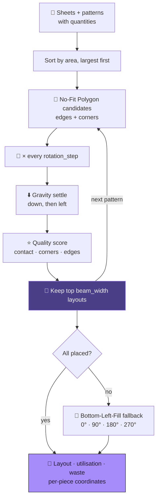

<div align="center">


<br/>


</div>


<details>
<summary><b>📑 Table of contents</b></summary>

- [📌 Overview](#-overview)
- [✨ Highlights](#-highlights)
- [🧠 The algorithm](#-the-algorithm)
- [🎛️ Three modes](#️-three-modes)
- [🔬 Under the hood](#-under-the-hood)
- [🚀 Getting started](#-getting-started)
- [📂 Project structure](#-project-structure)
- [🧭 Notes & roadmap](#-notes--roadmap)

</details>

## 📌 Overview

Fabric is the largest single cost in garment manufacturing, and a cutting-room supervisor laying
out patterns by hand is solving — by eye — an **NP-hard** problem.

| Why cloth is harder than the textbook | |
|---|---|
| 🧥 **Pieces aren't rectangles** | sleeves, collars, yokes — bounding boxes waste every concavity |
| 🔄 **Rotation is continuous** | any angle turns a discrete search into a continuous one |
| 🔢 **Order matters** | where piece 7 fits depends on pieces 1–6 — greedy paints itself into corners |
| 🏭 **Missing a piece = useless** | a 94% layout missing a sleeve loses to an 89% layout with all of them |

## ✨ Highlights

<table>
<tr>
<td width="50%" valign="top">

### 🧩 No-Fit Polygon placement
Candidate positions where a piece **touches but doesn't overlap** — so an L nests inside another
L's concavity, where the real savings are.

</td>
<td width="50%" valign="top">

### 🔦 Beam search over order
`beam_width` partial layouts survive each step — a second-best move that leaves a better hole gets
to prove itself.

</td>
</tr>
<tr>
<td valign="top">

### ⬇️ Gravity settling
Each piece slides **down, then left** until it touches — removing slivers and keeping one big open
region for the next piece.

</td>
<td valign="top">

### ✅ Guaranteed mode
AdvanceCut first, then **Bottom-Left-Fill** on whatever's left — nearly all the quality *and* a
layout you can actually cut.

</td>
</tr>
</table>

## 🧠 The algorithm



## 🎛️ Three modes

| Mode | Algorithm | Placement rate | Use it for |
|---|---|:---:|---|
| 🔬 **Quality** | pure AdvanceCut | may be < 100% | benchmarking the unassisted algorithm |
| ⭐ **Guaranteed** | AdvanceCut → BLF for leftovers | **100%** (where feasible) | production |
| ⚡ **Fast** | reduced search | high | interactive iteration |

## 🔬 Under the hood

<details>
<summary><b>🧩 No-Fit Polygon candidates</b></summary>

```python
# Edge placements — slide the moving piece along each edge of the fixed piece
normal = (-edge_vec[1] / edge_len, edge_vec[0] / edge_len)
for mv_vertex in moving_coords:
    for t in np.linspace(0, 1, 3):
        ...
        dx += normal[0] * 0.1        # nudge out along the edge normal
        dy += normal[1] * 0.1

# Corner placements — align every moving vertex with every fixed vertex
for fixed_vertex in fixed_coords:
    for mv_vertex in moving_coords:
        candidates.append((fixed_vertex[0] - mv_vertex[0],
                           fixed_vertex[1] - mv_vertex[1]))
```

The `0.1` nudge makes Shapely's boundary predicates decisive — exact touching is a floating-point
coin toss.

</details>

<details>
<summary><b>🔦 Beam search</b></summary>

```python
beam = [initial_solution]
for pattern in all_patterns:                       # largest area first
    new_beam = []
    for solution in beam:
        for sheet in cloth_sheets:
            for placement in possible_placements[:3]:
                new_beam.append(extend(solution, placement))
    new_beam.sort(key=lambda s: s['score'], reverse=True)
    beam = new_beam[:self.beam_width]              # prune — memory stays bounded
```

Big pieces have the fewest feasible spots — place them while the sheet is open, then fill gaps.

</details>

<details>
<summary><b>⭐ Scoring and spacing</b></summary>

Every placement uses the same area, so the score is about **how well it's tucked in**: perimeter
contact with placed pieces, plus sitting against a corner or sheet edge.

```python
def add_spacing_buffer(polygon, spacing):
    return polygon.buffer(spacing, join_style=2)   # mitred corners
```

Seam allowance and blade clearance: each polygon is dilated before collision tests and drawn at
true size. Mitred joins keep corners sharp, so clearance isn't overestimated where pieces nest
tightest.

</details>

## 🛠️ Tech stack

<p align="center">
  
  
  
  
  
</p>

## 🚀 Getting started

```bash
git clone https://github.com/Vishal-AS-0407/Clothcut.git
cd Clothcut
pip install -r requirements.txt
streamlit run app.py            # → http://localhost:8501   (or run_app.bat on Windows)
```

| Parameter | Default | Effect |
|---|:---:|---|
| `rotation_step` | 30° | smaller = finer angles, slower |
| `beam_width` | 2 | wider = better layouts, slower |
| `pattern_spacing` | 0 | seam allowance / blade clearance |

> 💡 **Tip:** start with **Quick Demo → Complex Shapes Showcase** — stars and T-shapes are where
> NFP beats bounding boxes. Export as CSV, JSON, a text report or **raw coordinates** for a cutting
> machine.

## 📂 Project structure

```
📦 Clothcut
 ┣ 🐍 app.py                         Streamlit UI — demo, custom input, export
 ┣ 📂 core
 ┃ ┣ 🐍 advancecut_engine.py         NFP · beam search · gravity · scoring · spacing
 ┃ ┗ 🐍 bfl_fallback.py              Bottom-Left-Fill — the guarantee
 ┣ 📂 shapes
 ┃ ┣ 🐍 shape_library.py             rectangle · L · T · hexagon · star · triangle
 ┃ ┗ 🐍 demo_scenarios.py            five stress scenarios
 ┣ 📂 visualization
 ┃ ┣ 🐍 plotly_renderer.py           zoom · pan · hover
 ┃ ┗ 🐍 export_utils.py              CSV · JSON · report · coordinates
 ┗ 📄 ALGORITHM_MODES.md · SPACING_FEATURE.md · PROJECT_SUMMARY.md · INSTALL.md
```

## 🧭 Notes & roadmap

<details>
<summary><b>Trade-offs worth knowing</b></summary>

- 🧩 The NFP is **sampled** (3 points per edge), not an exact Minkowski difference — fast, but some
  tight placements are never generated.
- 📈 Candidates grow as `patterns × rotations × placed × vertices`, times `beam_width` — comfortable
  at 30° and dozens of pieces; use Fast mode beyond that.
- 📊 No benchmark against a public nesting set (e.g. ESICUP) yet.

**Roadmap**
- [ ] Exact NFP via Minkowski sums
- [ ] ESICUP benchmark results
- [ ] DXF import for real pattern files
- [ ] Tests

</details>


<div align="center">

<a href="https://portfolio-sigma-blond-57.vercel.app"></a>
<a href="https://www.linkedin.com/in/vishal-a-s04/"></a>
<a href="https://github.com/Vishal-AS-0407"></a>
<a href="mailto:vishalpersonal04@gmail.com"></a>

⭐ **If this helped you, star the repo!**


</div>
