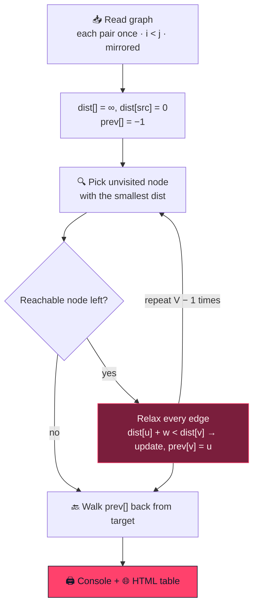

<div align="center">


<br/>


</div>


## 📌 What it is

Enter an undirected weighted graph of up to 20 nodes, a source and a target. The program prints
the adjacency matrix, runs Dijkstra, prints the path and its length — and writes
`dijkstra_result.html` with **the shortest-path edges highlighted**, opening it automatically on
Windows.

<div align="center">

</div>

```
Enter the number of nodes in the graph (up to 20): 5
Enter the weight of the path between nodes 1 and 2 (or 6969 for no path): 10
...
Shortest path from 1 to 5:
1 -> 3 -> 5
Total distance: 25.00
```

## 🧠 The algorithm



| Choice | Why |
|---|---|
| 📊 **Linear-scan minimum, O(V²)** | a heap only helps sparse graphs; on a 20-node matrix the scan is simpler and as fast |
| ↔️ **Undirected input** | each weight entered once, written to `cost[i][j]` and `cost[j][i]` |
| 🚫 **Negative weights rejected** | Dijkstra is incorrect on negative edges |
| ⏹️ **Early stop** | when no reachable unvisited node remains |

## 🚀 Getting started

```bash
git clone https://github.com/Vishal-AS-0407/Dijkstra-Algorithm.git
cd Dijkstra-Algorithm
gcc -std=c99 -o dijkstra dijkstra.c
./dijkstra
```

> 💡 **Tip:** build from source rather than using the committed `dijkstra.exe`.

## 🧭 Known issues & roadmap

<details>
<summary><b>Fixes</b></summary>

- 🔢 **Range checks validate `scanf`'s return value, not the input** — read, then validate:
  ```c
  if (scanf("%d", &nodes) != 1 || !validateInput(nodes, 1, MAX_NODES, "Invalid number of nodes"))
      return EXIT_FAILURE;
  ```
- 📄 `exportToHTML` closes the file twice — delete the trailing `fprintf`/`fclose`.
- ♾️ `6969` doubles as "no edge" and initial distance, so totals ≥ 6969 read as "no path" — use
  `INFINITY` for `dist[]` and a separate sentinel for input.
- 🎨 Zero-weight edges render as `-`; `.path-info` styles are missing; `∞` is mojibake in the
  Windows console.

**Roadmap**
- [ ] Input validation fix
- [ ] Proper infinity
- [ ] Graph drawn as SVG in the HTML report

</details>


<div align="center">

<a href="https://portfolio-sigma-blond-57.vercel.app"></a>
<a href="https://www.linkedin.com/in/vishal-a-s04/"></a>
<a href="https://github.com/Vishal-AS-0407"></a>

⭐ **If this helped you, star the repo!**


</div>
