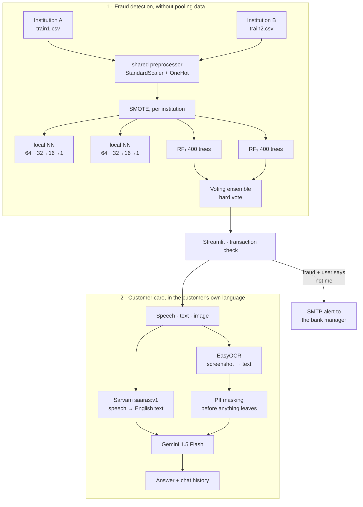

<h1 align="center">Federated Fraud Detection + Multilingual VQA Customer Care</h1>

<p align="center">
  <b>Two banks can flag the same fraud ring without either one showing the other a transaction.<br>
  And the customer on the other end can ask about it by voice, in their own language.</b>
</p>

<p align="center">
  
  
  
  
  
</p>

---

## The problem

Payment fraud has a structure that makes it uniquely awkward to model: **the evidence is split
across institutions that cannot legally show each other the evidence.**

A mule account receives from Bank A and cashes out through Bank B. Neither side sees a complete
pattern. Bank A sees an ordinary inbound transfer. Bank B sees an ordinary withdrawal. The ring is
visible only in the join — and the join is exactly what data-protection law, competitive interest
and RBI's own rules forbid. Pooling raw transactions into a central model is not an option
anybody will sign off on.

Meanwhile the *other* half of the problem is at the customer end. When a payment is blocked, a
person needs to know why. In India that person may speak Tamil, Hindi, Bengali or Kannada, may be
more comfortable speaking than typing, and may be holding a photograph of a failed-transaction
screen rather than a reference number. A support flow that assumes English text input excludes
most of the country.

Built for **DigiPay Pro**, the NPCI × IIT Bombay payments hackathon. **Runner-up.**

## What this does

Two subsystems that meet at the point of a blocked transaction.



---

## Novelty

### 1. Federation as the architecture, not as a wrapper

The design premise is that **the two institutions' raw tables never occupy the same address
space**. `FederatedLearningFraudDetection` takes four paths — two feature files, two label files
— and from there the two partitions are handled separately all the way through: separate SMOTE,
separate train/validation splits, separate neural networks, separate forests, separate saved
weights (`model1.weights.h5`, `model2.weights.h5`).

What crosses the boundary is a **fitted preprocessor**, not data:

```python
X1_preprocessed = self.preprocessor.fit_transform(self.train1)   # fit on A
X2_preprocessed = self.preprocessor.transform(self.train2)       # apply to B
joblib.dump(self.preprocessor, 'preprocessor.pkl')
```

This detail matters more than it looks. If each institution fitted its own scaler, "amount" would
mean something different on each side and the two models' outputs would not be comparable. One
`ColumnTransformer`, fitted once, shipped as an artefact, gives both parties a **shared feature
space without a shared dataset** — the same trick as a shared vocabulary in federated NLP.

### 2. Account identifiers are dropped before anything else happens

```python
columns_to_drop = ['nameOrig', 'nameDest']
df_processed = df.drop(columns=columns_to_drop, errors='ignore')
```

The first transformation in the pipeline deletes the only two columns that identify a human being.
Everything downstream — the scaler, the models, the saved artefacts — is structurally incapable of
leaking an account number, because it never saw one. Privacy by construction rather than by
policy.

(Note the tension this creates with the UI: `test.py` still *collects* `nameOrig` and `nameDest`
from the form, because that is the shape of a real transaction record, and then the preprocessor
discards them. The collection is cosmetic; the model genuinely does not use them.)

### 3. SMOTE per institution, not on the union

```python
X1_resampled, y1_resampled = self.apply_smote(X1_preprocessed, self.label1)
X2_resampled, y2_resampled = self.apply_smote(X2_preprocessed, self.label2)
```

SMOTE synthesises a minority point by interpolating between real minority neighbours. Run over the
pooled set, it would interpolate between **Bank A's fraud and Bank B's fraud** — creating synthetic
records that encode the join the whole design exists to avoid. Applying it inside each partition
keeps the synthetic points inside the boundary that produced them. Easy to get wrong; here it is
right.

### 4. Two model families per institution, deliberately

Each partition trains **both** a neural network and a random forest:

```python
tf.keras.Sequential([
    Dense(64, relu), BatchNormalization(), Dropout(0.3),
    Dense(32, relu), BatchNormalization(), Dropout(0.3),
    Dense(16, relu),
    Dense(1, sigmoid)
])                                        # Adam 1e-3, BCE, early stopping patience 10
RandomForestClassifier(n_estimators=400, random_state=42)
```

Fraud has two shapes. Some is a **threshold pattern** — an amount that empties a balance exactly,
a destination that has never been paid before — which axis-aligned tree splits capture natively.
Some is a **smooth interaction** across several magnitudes at once, which is what the dense network
is for. Dropout 0.3 twice plus batch norm plus early stopping on validation loss is heavy
regularisation, appropriate when SMOTE has just filled the training set with interpolated points
that a large network would happily memorise.

### 5. Detection and response are one loop, with the human in it

`test.py` does not stop at a label. When the model flags a transaction it shows the customer the
transaction and asks a single question — *"Did you make this payment?"* — and only a **"No"**
triggers the SMTP alert to the bank.

That is the correct place to put a human. The model's job is to shortlist; the account holder is
the only party who actually knows; the bank is alerted by a confirmed report rather than by a
probability. It collapses the fraud-report loop from days to seconds without automating away the
one decision a model should not make.

### 6. PII is masked before it reaches the LLM, not after

`final.py` runs EasyOCR over an uploaded screenshot — then masks, *then* sends:

```python
bank_acc_pattern = r'(bankacc)(\d+)'
visible_part = bank_acc_num[:4]
masked_part = '*' * (len(bank_acc_num) - 4)
```

First four digits kept so a support agent can still confirm which account is being discussed; the
rest destroyed before the text crosses the network boundary to Gemini. The ordering is the whole
point — masking the model's *reply* would be theatre, since the account number would already have
left the building.

### 7. Speech-to-text that translates in the same hop

```python
url = "https://api.sarvam.ai/speech-to-text-translate"
'model': 'saaras:v1'
```

Sarvam's `saaras` model takes Indian-language speech and returns **English text in one call** —
not transcription-then-translation. One hop instead of two means one set of errors instead of two
compounding sets, and it means the downstream LLM only ever has to reason in English. A customer
speaks Tamil into their phone; Gemini answers a well-formed English question about their
transaction.

---

## Repository layout

```
train.py           FederatedLearningFraudDetection — the whole training pipeline
test.py            Streamlit · transaction check → user confirmation → bank alert
final.py           Streamlit · multilingual VQA support chat (speech / text / image)
dataset.csv        200-row sample, 50 fraud / 150 legitimate, PaySim schema
requirements.txt
```

`dataset.csv` is a **sample**, not the training data — `train.py` expects `train1.csv`,
`train2.csv`, `label1.csv`, `label2.csv`, the two institutional partitions. The sample shows the
schema and lets you exercise `test.py`:

| column | |
|---|---|
| `step` | hour index since simulation start |
| `type` | CASH_IN · CASH_OUT · DEBIT · TRANSFER |
| `amount` | transaction value |
| `oldbalanceOrg` / `newbalanceOrig` | originator balance before / after |
| `oldbalanceDest` / `newbalanceDest` | destination balance before / after |
| `nameOrig` / `nameDest` | account ids — **dropped before modelling** |
| `isFraud` | label |

Schema follows [PaySim](https://www.kaggle.com/datasets/ealaxi/paysim1), the standard synthetic
mobile-money benchmark. To make your own partitions, split a PaySim-shaped file in two.

---

## Running it

```bash
git clone https://github.com/Vishal-AS-0407/Fraud-Detection-and-VQA-Based-Multilingual-Customer-Care-Chatbot-with-Speech-Support.git
cd Fraud-Detection-and-VQA-Based-Multilingual-Customer-Care-Chatbot-with-Speech-Support
pip install -r requirements.txt
```

**1 — Train.** Place `train1.csv`, `train2.csv`, `label1.csv`, `label2.csv` in the repo root.

```bash
python train.py      # → preprocessor.pkl, ensemble_model.pkl,
                     #   model1.weights.h5, model2.weights.h5
```

**2 — Fraud check.**

```bash
streamlit run test.py
```

**3 — Customer care chat.** Put your own keys in `final.py` (Gemini at line 13, Sarvam at
line 54 — both ship as placeholder strings).

```bash
streamlit run final.py
```

---

## ⚠️ Security — act on this before anything else

**`test.py` has a live Gmail App Password committed in `send_email()`**, together with two
personal email addresses. It is in the public repository and in the git history.

1. **Revoke the App Password now** — Google Account → Security → 2-Step Verification → App
   passwords → revoke.
2. Then fix the code. `load_dotenv()` is already called at the top of the file; it just isn't used:

```python
sender_email   = os.getenv("ALERT_SENDER")
receiver_email = os.getenv("ALERT_RECEIVER")
password       = os.getenv("ALERT_APP_PASSWORD")
```

3. Add `.env` to `.gitignore`.

Deleting the line is not sufficient on its own — the password remains in the history, so
revocation is the step that actually protects the account.

`final.py` is clean: both its keys are placeholders.

---

## Honest notes

Worth knowing before you read the code, because the repo and the hackathon submission are not the
same thing.

- **There is no homomorphic encryption in this repository.** The submitted system's privacy story
  included CKKS so that model updates could be aggregated without either party seeing the other's
  parameters. What is committed here is the **learning architecture** — partition isolation, a
  shared preprocessor, per-partition SMOTE, per-partition models. The encrypted-aggregation layer
  is not in these files. Do not read `train.py` as a CKKS implementation.
- **The federation is simulated, in one process.** Two CSV partitions, two model pairs, one
  script. It demonstrates the topology; it is not a deployment across two institutions with a
  real aggregation server.
- **The final `VotingClassifier` is fitted on concatenated data:**

  ```python
  ensemble_model.fit(np.concatenate([X1_train, X2_train]),
                     np.concatenate([y1_train, y2_train]))
  ```

  This is the one place the boundary is crossed, and it is a genuine inconsistency with the
  premise — `rf1` and `rf2` are already trained per partition, so the voting ensemble should be
  assembled from those fitted estimators rather than refitted on the union. Fixing it is a small
  change (`VotingClassifier(..., voting='soft')` over pre-fitted estimators, or a manual vote) and
  it is the first thing I would change.
- **The two trained neural networks are saved but never used at inference.** `test.py` loads only
  `ensemble_model.pkl`. The NN branch is trained, checkpointed, and then left on the shelf.
- **No metrics are printed by `train.py`.** It trains and saves; it does not evaluate. The
  performance figures from the hackathon are in the submission, not reproducible from this script
  as written.
- **`dataset.csv` is 200 rows.** It is for exercising the app, not for training.

---

<p align="center">
  <sub>Full case study, with the design decisions written out:
  <a href="https://portfolio-sigma-blond-57.vercel.app/work/fraud-detection">portfolio → decentralized fraud detection</a></sub>
</p>
