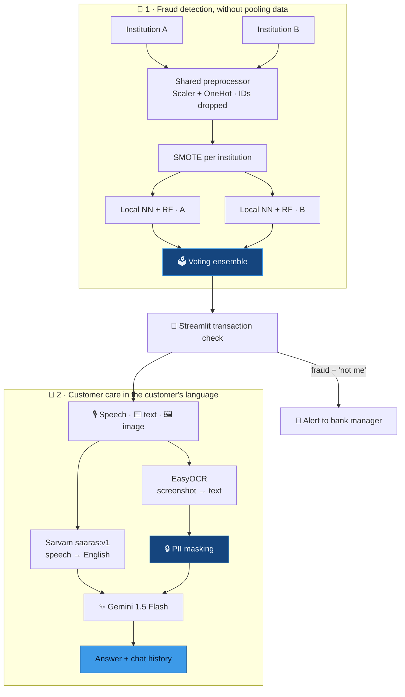

<div align="center">


<br/>


<a href="https://portfolio-sigma-blond-57.vercel.app/work/fraud-detection"></a>

</div>


<details>
<summary><b>📑 Table of contents</b></summary>

- [📌 Overview](#-overview)
- [✨ Highlights](#-highlights)
- [🧠 Architecture](#-architecture)
- [🖼️ Screenshots](#️-screenshots)
- [🔬 Under the hood](#-under-the-hood)
- [🗂️ Data](#️-data)
- [🚀 Getting started](#-getting-started)
- [📂 Project structure](#-project-structure)
- [🧭 Honest notes & roadmap](#-honest-notes--roadmap)

</details>

## 📌 Overview

Payment fraud hides in the **join between institutions**. A mule account receives from Bank A
and cashes out through Bank B — each side sees something ordinary, and the law forbids them from
pooling the evidence.

This project attacks both ends of that problem:

| | Subsystem | What it does |
|:---:|---|---|
| 🏦 | **Federated fraud detection** | Each institution trains on its own partition; only a fitted preprocessor crosses the boundary |
| 💬 | **Multilingual VQA customer care** | A blocked customer can **speak** in their language or **upload a screenshot** and get an answer |

> 🏆 Built for **DigiPay Pro**, the NPCI × IIT Bombay payments hackathon — **Runner-up**.

## ✨ Highlights

<table>
<tr>
<td width="50%" valign="top">

### 🧭 Shared feature space, no shared data
One `ColumnTransformer` is fitted once and shipped as an artefact — "amount" means the same
thing on both sides without either side seeing the other's rows.

</td>
<td width="50%" valign="top">

### 🧬 SMOTE inside each boundary
Oversampling runs **per institution**, so synthetic fraud is never interpolated between Bank
A's and Bank B's records.

</td>
</tr>
<tr>
<td valign="top">

### 🙋 A human in the loop
A flagged payment asks the customer *"Did you make this payment?"* — only a **No** emails the
bank. The model shortlists; the account holder decides.

</td>
<td valign="top">

### 🔒 Mask first, then send
EasyOCR reads the screenshot, account numbers are masked to their first 4 digits, **then** the
text goes to Gemini — masking the reply would be theatre.

</td>
</tr>
</table>

## 🧠 Architecture



## 🖼️ Screenshots

<div align="center">

**System overview**


<table>
<tr>
<td align="center" width="50%"><b>📊 Model summary</b><br/><br/></td>
<td align="center" width="50%"><b>🤖 Chatbot interface</b><br/><br/></td>
</tr>
</table>

</div>

## 🔬 Under the hood

<details>
<summary><b>🧭 One preprocessor, fitted once</b></summary>

```python
X1_preprocessed = self.preprocessor.fit_transform(self.train1)   # fit on A
X2_preprocessed = self.preprocessor.transform(self.train2)       # apply to B
joblib.dump(self.preprocessor, 'preprocessor.pkl')
```

If each institution fitted its own scaler, the two models' outputs would not be comparable. One
fitted transformer gives a **shared feature space without a shared dataset** — the same trick as
a shared vocabulary in federated NLP.

</details>

<details>
<summary><b>🪪 Identifiers dropped before anything else</b></summary>

```python
columns_to_drop = ['nameOrig', 'nameDest']
df_processed = df.drop(columns=columns_to_drop, errors='ignore')
```

Everything downstream is structurally incapable of leaking an account number, because it never
saw one — privacy by construction, not by policy.

</details>

<details>
<summary><b>🌲 Two model families per institution</b></summary>

```python
tf.keras.Sequential([
    Dense(64, relu), BatchNormalization(), Dropout(0.3),
    Dense(32, relu), BatchNormalization(), Dropout(0.3),
    Dense(16, relu), Dense(1, sigmoid)
])                                        # Adam 1e-3, BCE, early stopping (patience 10)
RandomForestClassifier(n_estimators=400, random_state=42)
```

Threshold fraud (an amount that empties a balance exactly) is what tree splits catch natively;
smooth interactions across several magnitudes are what the network is for. Heavy regularisation,
because SMOTE has just filled the set with interpolated points a big network would memorise.

</details>

<details>
<summary><b>🔒 PII masking before the LLM</b></summary>

```python
bank_acc_pattern = r'(bankacc)(\d+)'
visible_part = bank_acc_num[:4]
masked_part = '*' * (len(bank_acc_num) - 4)
```

Four digits stay so support can confirm which account is meant; the rest is gone before the text
crosses the network.

</details>

<details>
<summary><b>🗣️ Speech → English in one hop</b></summary>

```python
url = "https://api.sarvam.ai/speech-to-text-translate"
'model': 'saaras:v1'
```

Transcribe-and-translate in a single call: one set of errors instead of two compounding ones,
and the LLM only ever reasons in English.

</details>

## 🗂️ Data

`dataset.csv` is a **200-row sample** (50 fraud / 150 legitimate) in the
[PaySim](https://www.kaggle.com/datasets/ealaxi/paysim1) schema — enough to exercise the app.
Training expects two partitions: `train1.csv`, `train2.csv`, `label1.csv`, `label2.csv`.

| Column | Meaning |
|---|---|
| `step` | hour index since simulation start |
| `type` | CASH_IN · CASH_OUT · DEBIT · TRANSFER |
| `amount` | transaction value |
| `oldbalanceOrg` / `newbalanceOrig` | originator balance before / after |
| `oldbalanceDest` / `newbalanceDest` | destination balance before / after |
| `nameOrig` / `nameDest` | account IDs — **dropped before modelling** |
| `isFraud` | label |

## 🛠️ Tech stack

<p align="center">
  
  
  
  
  
</p>

## 🚀 Getting started

```bash
git clone https://github.com/Vishal-AS-0407/Fraud-Detection-and-VQA-Based-Multilingual-Customer-Care-Chatbot-with-Speech-Support.git
cd Fraud-Detection-and-VQA-Based-Multilingual-Customer-Care-Chatbot-with-Speech-Support
pip install -r requirements.txt
```

| Step | Command | Produces |
|:---:|---|---|
| 1️⃣ Train | `python train.py` | `preprocessor.pkl`, `ensemble_model.pkl`, `model{1,2}.weights.h5` |
| 2️⃣ Fraud check | `streamlit run test.py` | transaction check + bank alert |
| 3️⃣ Support chat | `streamlit run final.py` | voice / text / image chat |

> 💡 **Tip:** put your own Gemini and Sarvam keys in `final.py`, and your alert email settings in
> a `.env` file (`ALERT_SENDER`, `ALERT_RECEIVER`, `ALERT_APP_PASSWORD`) — never in code.

## 📂 Project structure

```
📦 Fraud-Detection-and-VQA-...
 ┣ 🐍 train.py           FederatedLearningFraudDetection — the training pipeline
 ┣ 🐍 test.py            Streamlit · transaction check → "was this you?" → bank alert
 ┣ 🐍 final.py           Streamlit · multilingual VQA support chat
 ┣ 📄 dataset.csv        200-row PaySim-schema sample
 ┗ 📄 requirements.txt
```

## 🧭 Honest notes & roadmap

<details>
<summary><b>What the repo is, and isn't</b></summary>

- 🔐 **No homomorphic encryption here.** The hackathon submission described CKKS-encrypted
  aggregation; this repository holds the **learning architecture** (partition isolation, shared
  preprocessor, per-partition SMOTE and models), not the encryption layer.
- 🧪 **Federation is simulated in one process** — it shows the topology, not a two-bank deployment.
- 🗳️ The final `VotingClassifier` is refitted on the concatenated partitions — the one place the
  boundary is crossed. It should vote over the already-trained `rf1`/`rf2` instead.
- 💤 The two neural networks are saved but not used at inference (`test.py` loads only the
  ensemble).
- 📏 `train.py` trains and saves but doesn't print metrics.

**Roadmap**
- [ ] Vote over pre-fitted per-partition estimators
- [ ] Use the NN branch at inference (soft vote)
- [ ] Evaluation report in `train.py`
- [ ] Real aggregation server + encrypted updates

</details>


<div align="center">

**📖 Read the full design story →** [portfolio · Sealed](https://portfolio-sigma-blond-57.vercel.app/work/fraud-detection)

<a href="https://www.linkedin.com/in/vishal-a-s04/"></a>
<a href="https://github.com/Vishal-AS-0407"></a>
<a href="mailto:vishalpersonal04@gmail.com"></a>

⭐ **If this helped you, star the repo!**


</div>
