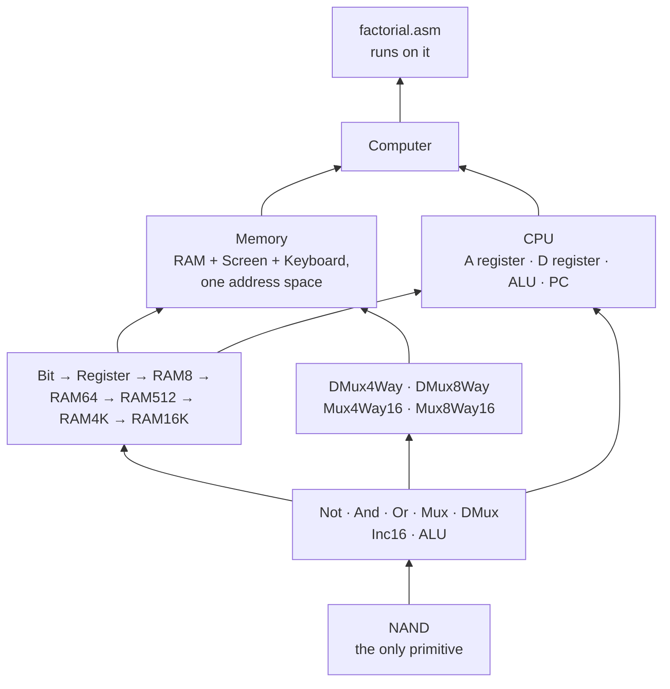

<h1 align="center">The Hack Computer</h1>

<p align="center">
  <b>A working 16-bit computer, built up from NAND gates in HDL —<br>
  memory hierarchy, CPU, control logic, and an assembly program that runs on it.</b>
</p>

<p align="center">
  
  
  
</p>

---

## What this is

The hardware half of *The Elements of Computing Systems* (Nisan & Schocken): starting from a single
primitive — **NAND** — build every gate, then every chip, then a CPU, then a computer that executes
machine code.

The point of the exercise is that after it, nothing in a processor is magic. You have built the
program counter. You know why `jmp` is three bits.

## What is here



**16 chips**, each with its `.hdl` implementation, its `.tst` test script, its `.cmp` expected
output and its `.out` actual output:

| Sequential | Routing | Top level |
|---|---|---|
| `Bit` · `Register` | `DMux4Way` · `DMux8Way` | `CPU` |
| `RAM8` · `RAM64` · `RAM512` | `Mux4Way16` · `Mux8Way16` | `Memory` |
| `RAM4K` · `RAM16K` · `PC` | `Inc16` | `Computer` |

Plus `factorial.asm` — a Hack assembly program, and `computerfactorial.tst` to run it on the
machine you just built.

---

## The two chips worth reading

### `CPU.hdl` — the whole instruction set in about twenty lines

Every Hack instruction is decoded here, and each line is one architectural decision.

**Instruction type.** Bit 15 is the opcode: `0` = A-instruction (a literal to load), `1` =
C-instruction (a computation).

```hdl
Not(in=instruction[15], out=ni);
Mux16(a=outtM, b=instruction, sel=ni, out=i);
Or(a=ni, b=instruction[5], out=intoA);
ARegister(in=i, load=intoA, out=A, out[0..14]=addressM);
```

The A register loads **either** the instruction itself (as a constant, when it is an A-instruction)
**or** the ALU output (when a C-instruction's destination bits say so). One `Mux16` and one `Or`
express both.

**The A/M switch.** Bit 12 decides whether the ALU's second operand comes from the A register or
from memory at address A:

```hdl
And(a=instruction[15], b=instruction[12], out=AorM);
Mux16(a=A, b=inM, sel=AorM, out=AM);
```

Gated by bit 15, so an A-instruction can never accidentally trigger a memory read.

**The ALU.** This is the elegant part of the whole architecture — the six control bits are wired
*directly* from the instruction, no decoding at all:

```hdl
ALU(x=D, y=AM,
    zx=instruction[11], nx=instruction[10],
    zy=instruction[9],  ny=instruction[8],
    f=instruction[7],   no=instruction[6],
    out=outtM, out=outM, zr=zr, ng=ng);
```

The Hack instruction format was designed so that the comp field *is* the ALU control word. That is
why there is no microcode: the instruction encoding and the datapath were designed together.

**The jump logic.** Three condition bits, three tests, OR'd together:

```hdl
Not(in=ng, out=pos);  Not(in=zr, out=nzr);
And(a=instruction[15], b=instruction[0], out=jgt);
And(a=pos, b=nzr, out=posnzr);       // > 0 means: not negative AND not zero
And(a=jgt, b=posnzr, out=ld1);

And(a=instruction[15], b=instruction[1], out=jeq);   And(a=jeq, b=zr,  out=ld2);
And(a=instruction[15], b=instruction[2], out=jlt);   And(a=jlt, b=ng,  out=ld3);

Or(a=ld1, b=ld2, out=ldt);  Or(a=ld3, b=ldt, out=ld);
PC(in=A, load=ld, inc=true, reset=reset, out[0..14]=pc);
```

Every jump mnemonic — `JGT`, `JEQ`, `JGE`, `JLT`, `JNE`, `JLE`, `JMP` — falls out of the seven
combinations of those three bits, with no extra hardware. And `PC(load=ld, inc=true)` encodes the
fetch cycle in one line: **load the jump target if a condition fired, otherwise increment.** Every
`And` is gated on `instruction[15]`, so an A-instruction can never jump.

### `Memory.hdl` — memory-mapped I/O, in six lines

```hdl
DMux4Way(in=load, sel=address[13..14], a=loadram1, b=loadram2, c=loadscreen, d=loadkbd);
Or(a=loadram1, b=loadram2, out=loadram);
RAM16K(in=in, load=loadram, address=address[0..13], out=ramout);
Screen(in=in, load=loadscreen, address=address[0..12], out=scrout);
Keyboard(out=kbout);
Mux4Way16(a=ramout, b=ramout, c=scrout, d=kbout, sel=address[13..14], out=out);
```

The top two address bits select the device, and the address space is deliberately uneven — RAM gets
**two** of the four quarters (hence the `Or` merging `loadram1` and `loadram2`, and the duplicated
`a=ramout, b=ramout` on the way out), Screen gets one, Keyboard gets one.

This is memory-mapped I/O in its purest form: writing to address 16384 puts a pixel on the screen,
and reading 24576 gives you the key being pressed, **using the same instructions as any other
memory access.** No I/O ports, no special opcodes. The keyboard is read-only, which is why it takes
no `load`.

### `factorial.asm` — proof it runs

```asm
@R0        // n
D=M
@a
M=D
@temp
M=D
@f
M=1
@product
M=0
(loop)
@f
D=M
@product
M=M+D      // repeated addition — Hack has no multiply instruction
@temp
M=M-1
D=M
@loop
D;JGT
```

Written in the machine's own language, with **multiplication built out of repeated addition**
because the Hack ALU has no multiplier. That constraint is the point: it is what makes the
distinction between what the hardware does and what software must supply concrete.

---

## Running it

Needs the [Nand2Tetris software suite](https://www.nand2tetris.org/software) — Java, no install.

```
1. Open the Hardware Simulator
2. File → Load Chip → computer/<Chip>.hdl
3. File → Load Script → computer/<Chip>.tst
4. Run
```

Every chip has a `.tst` script and a `.cmp` golden file, so the simulator compares output against
expectation automatically. The committed `.out` files are the results of those runs.

To execute the program on the finished machine, load `Computer.hdl` and run
`computerfactorial.tst`.

---

## Notes

- **Bottom-up dependency order.** `Bit` → `Register` → `RAM8` → `RAM64` → `RAM512` → `RAM4K` →
  `RAM16K`: each memory chip is built from eight of the one below, addressed by three more bits.
  Building `RAM16K` directly would be 16,384 flip-flops written by hand; built recursively it is
  eight lines. The same recursion produces `Mux8Way16` from `Mux4Way16` and `DMux8Way` from
  `DMux4Way`.
- **The chips not committed here** — `Not`, `And`, `Or`, `Mux16`, `ALU`, `Screen`, `Keyboard` — are
  Nand2Tetris projects 01–02, supplied as builtins by the simulator. This repository is
  **project 03 (sequential logic) and project 05 (computer architecture)**, which are the two that
  contain the CPU.
- **`.out` files are simulator output** and could be regenerated. They are committed as the record
  that the tests passed.
- **The repository name says "Using NAND Gate"**, which is the right framing: NAND is the only
  primitive, and everything above is composition.
