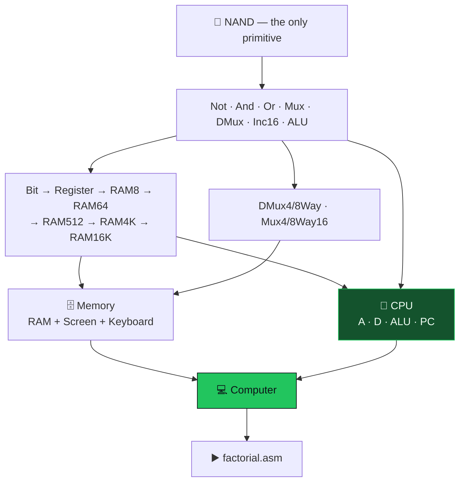

<div align="center">


<br/>


</div>


## 📌 What this is

The hardware half of *The Elements of Computing Systems* (Nisan & Schocken): start from one
primitive — **NAND** — and build every chip up to a CPU that runs machine code. Afterwards, nothing
in a processor is magic. You built the program counter. You know why `jmp` is three bits.

## 🧠 The build



| ⏱️ Sequential | 🔀 Routing | 🏗️ Top level |
|---|---|---|
| `Bit` · `Register` · `PC` | `DMux4Way` · `DMux8Way` | `CPU` |
| `RAM8` · `RAM64` · `RAM512` | `Mux4Way16` · `Mux8Way16` | `Memory` |
| `RAM4K` · `RAM16K` | `Inc16` | `Computer` |

Each chip ships with its `.hdl`, a `.tst` script, a `.cmp` golden file and the `.out` result.

## 🔬 The chips worth reading

<details open>
<summary><b>🧠 <code>CPU.hdl</code> — the ALU control word <i>is</i> the instruction</b></summary>

```hdl
ALU(x=D, y=AM,
    zx=instruction[11], nx=instruction[10],
    zy=instruction[9],  ny=instruction[8],
    f=instruction[7],   no=instruction[6],
    out=outtM, out=outM, zr=zr, ng=ng);
```

Six control bits wired straight from the instruction — no decoder, no microcode. The encoding and
the datapath were designed together.

```hdl
And(a=instruction[15], b=instruction[0], out=jgt);
And(a=pos, b=nzr, out=posnzr);          // > 0 = not negative AND not zero
And(a=jgt, b=posnzr, out=ld1);
...
PC(in=A, load=ld, inc=true, reset=reset, out[0..14]=pc);
```

Three condition bits give all seven jumps (`JGT` … `JMP`), and `PC(load=ld, inc=true)` is the whole
fetch cycle: **jump if a condition fired, otherwise increment**. Every gate is ANDed with bit 15, so
an A-instruction can never jump or read memory.

</details>

<details>
<summary><b>🗄️ <code>Memory.hdl</code> — memory-mapped I/O in six lines</b></summary>

```hdl
DMux4Way(in=load, sel=address[13..14], a=loadram1, b=loadram2, c=loadscreen, d=loadkbd);
Or(a=loadram1, b=loadram2, out=loadram);
RAM16K(in=in, load=loadram, address=address[0..13], out=ramout);
Screen(in=in, load=loadscreen, address=address[0..12], out=scrout);
Keyboard(out=kbout);
Mux4Way16(a=ramout, b=ramout, c=scrout, d=kbout, sel=address[13..14], out=out);
```

RAM gets two quarters of the address space, Screen one, Keyboard one. Writing 16384 lights a pixel;
reading 24576 reads a key — with the same instructions as any memory access.

</details>

<details>
<summary><b>▶️ <code>factorial.asm</code> — multiply by repeated addition</b></summary>

```asm
(loop)
@f
D=M
@product
M=M+D      // Hack has no multiply instruction
@temp
M=M-1
D=M
@loop
D;JGT
```

The constraint is the lesson: what the hardware does vs what software must supply.

</details>

## 🚀 Running it

Needs the [Nand2Tetris software suite](https://www.nand2tetris.org/software) (Java, no install).

| Step | Action |
|:---:|---|
| 1️⃣ | Open the **Hardware Simulator** |
| 2️⃣ | *File → Load Chip* → `computer/<Chip>.hdl` |
| 3️⃣ | *File → Load Script* → `computer/<Chip>.tst` |
| 4️⃣ | **Run** — output is compared against `.cmp` automatically |

> 💡 **Tip:** load `Computer.hdl` and run `computerfactorial.tst` to execute the program on the
> machine you built.

<details>
<summary><b>📝 Notes</b></summary>

- 🔁 Memory is recursive: each RAM chip is eight of the one below plus three address bits —
  `RAM16K` is eight lines, not 16,384 flip-flops.
- 🧱 `Not`, `And`, `Or`, `Mux16`, `ALU`, `Screen`, `Keyboard` are projects 01–02 (simulator
  builtins); this repo holds **project 03 (sequential) and 05 (architecture)**.

</details>


<div align="center">

<a href="https://portfolio-sigma-blond-57.vercel.app"></a>
<a href="https://www.linkedin.com/in/vishal-a-s04/"></a>
<a href="https://github.com/Vishal-AS-0407"></a>

⭐ **If this helped you, star the repo!**


</div>
