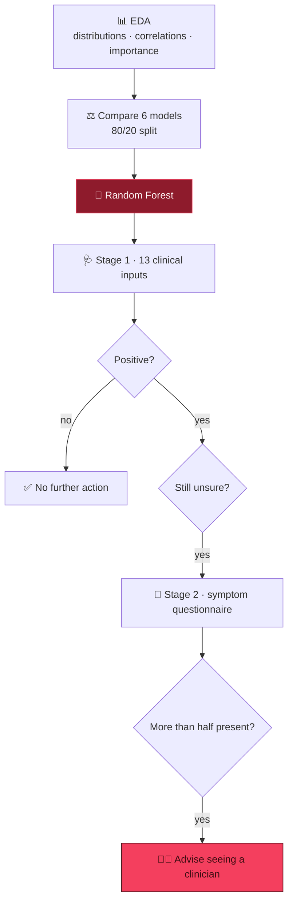

<div align="center">


<br/>


</div>


## 📌 Overview

Most heart-disease features — cholesterol, ST depression, thalassemia, major vessels — need a
blood draw or an exercise ECG. So the interesting question isn't *can we classify* (yes, ~85–90%)
but **what do you do with a positive prediction?**

This notebook compares six classifiers, then wraps the best one in a **two-stage triage tool**:
clinical measurements first, and a self-reported symptom questionnaire **only when it matters**.

## 🧠 How it works



> 🩺 Symptoms are **cheap and subjective**; measurements are **expensive and objective**. Asking
> for subjective evidence only when the objective model is uncertain is how a clinician works —
> and a blunt majority rule is auditable in a way a second model wouldn't be.

## 📊 Results

| Model | Accuracy |
|---|:---:|
| 🌲 **Random Forest** | **90.16%** |
| 📈 Logistic Regression | 85.25% |
| 🎲 Naive Bayes | 85.25% |
| ➖ Linear SVM | 81.97% |
| 🌿 Decision Tree | 81.97% |
| 📍 KNN (k = 7) | 67.21% |

> 🔎 **KNN's 67% is a finding, not a failure:** `chol` (200–400) dwarfs `oldpeak` (0–6) in
> unscaled Euclidean distance. The gap to the tree models shows exactly why distance-based
> methods need scaling.

<details>
<summary><b>🗂️ Dataset — UCI Cleveland, 303 × 13 (165 positive / 138 negative)</b></summary>

| | | | |
|---|---|---|---|
| `age` | `sex` | `cp` chest-pain type | `trestbps` resting BP |
| `chol` cholesterol | `fbs` fasting sugar | `restecg` resting ECG | `thalach` max heart rate |
| `exang` exercise angina | `oldpeak` ST depression | `slope` ST slope | `ca` major vessels |
| `thal` thalassemia | **`target`** | | |

Chest-pain codes are plotted with real labels (*Typical Angina … Asymptomatic*) — and
*Asymptomatic* is, counter-intuitively, the highest-risk bar.

</details>

## 🛠️ Tech stack

<p align="center">
  
  
  
  
</p>

## 🚀 Getting started

```bash
git clone https://github.com/Vishal-AS-0407/Heart-Disease-Prediction-and-Symptom-Analysis.git
cd Heart-Disease-Prediction-and-Symptom-Analysis
pip install -r requirements.txt matplotlib seaborn
jupyter notebook "Feature analysis and Prediction.ipynb"
```

> 💡 **Tip:** the last cell is the interactive tool — it prompts for the 13 values, predicts, and
> offers the questionnaire on a positive result.

```
📦 Heart-Disease-Prediction-and-Symptom-Analysis
 ┣ 📓 Feature analysis and Prediction.ipynb   EDA · 6 models · two-stage tool
 ┣ 📄 heart.csv                               303 × 14
 ┗ 📄 requirements.txt
```

## 🧭 Evaluation notes & next steps

<details>
<summary><b>How I'd make the comparison rigorous</b></summary>

- 🎲 The tree models' `random_state` was chosen by test accuracy, so 90.16% is a best-of-seeds
  figure; the other four were scored once.
- 📏 The test set is 61 rows — each prediction moves accuracy by 1.64 points.
- ❤️ For screening, **recall on the positive class** matters more than accuracy.

**Next steps**
- [ ] 5-fold CV with mean ± std for all six models
- [ ] `StandardScaler` in a pipeline (lets KNN / SVM compete fairly)
- [ ] Confusion matrix, recall, ROC-AUC
- [ ] Use the same split for the comparison and the tool

> 🩺 Not a diagnostic tool — its final state is "consult a healthcare professional".

</details>


<div align="center">

<a href="https://portfolio-sigma-blond-57.vercel.app"></a>
<a href="https://www.linkedin.com/in/vishal-a-s04/"></a>
<a href="https://github.com/Vishal-AS-0407"></a>

⭐ **If this helped you, star the repo!**


</div>
