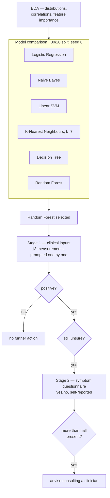

<h1 align="center">Heart Disease Prediction &amp; Symptom Analysis</h1>

<p align="center">
  <b>Six classifiers compared on the UCI Cleveland dataset, then a two-stage interactive tool:<br>
  clinical measurements first, and a symptom questionnaire only when the first stage says it matters.</b>
</p>

<p align="center">
  
  
  
</p>

---

## The problem

The clinical features that predict heart disease — resting blood pressure, serum cholesterol,
fasting blood sugar, ST depression, thalassemia status, number of major vessels — all come from a
clinic visit. Most of them require a blood draw or an exercise ECG.

That creates an ordering problem. Screening everybody is expensive; screening nobody misses
disease. And a model that outputs a single probability from thirteen clinical measurements has
already assumed the expensive part happened.

The design question is therefore not "can we classify heart disease" (a well-studied dataset says
yes, at around 85–90%). It is **what do you do with a positive prediction on 303 rows of data.**

## What it does

Two stages, deliberately ordered:



---

## Novelty

### 1. The second stage is gated, not automatic

The interesting design choice is that the symptom questionnaire **does not always run**. It runs
only when the model predicts positive *and* the user says they are still unsure:

```python
unsure = input("Are you still unsure? Enter 'yes' if you want to proceed to symptoms analysis: ")
```

This is a sensible triage shape. Symptoms — chest discomfort, breathlessness, fatigue — are
**cheap and subjective**; clinical measurements are **expensive and objective**. Running the
objective model first and reaching for subjective evidence only when a decision is genuinely
uncertain is how a clinician actually works, and it avoids the failure mode where self-reported
anxiety symptoms dominate a prediction that should have been driven by the ST depression reading.

The final rule is deliberately blunt — **more than half the symptoms present → advise seeing a
professional** — and blunt is correct here. The tool's job is to route someone to a doctor, not to
diagnose them, and a simple majority rule is auditable in a way that a second model would not be.

### 2. Six models, all reported, including the ones that lost

| Model | Accuracy |
|---|---:|
| **Random Forest** | **90.16%** |
| Logistic Regression | 85.25% |
| Naive Bayes | 85.25% |
| Linear SVM | 81.97% |
| Decision Tree | 81.97% |
| K-Nearest Neighbours (k=7) | 67.21% |

Publishing the whole table rather than just the winner is worth something. The KNN result in
particular is informative: **67% is a genuine finding, not a failure.** The features are on wildly
different scales — `age` in years, `chol` in mg/dL (200–400), `oldpeak` in millimetres (0–6) — and
KNN uses raw Euclidean distance, so cholesterol dominates the metric and everything else is noise.
The 18-point gap between KNN and the tree models is a clean demonstration of why distance-based
methods need scaling and tree-based ones do not.

That the two linear models tie exactly at 85.25% is also telling: on 61 test rows that is the same
52 correct, and it suggests both are finding the same near-linear decision boundary — which is
what you would expect from this dataset.

### 3. EDA that decodes the categorical codes

```python
a.set_xticklabels(['Typical Angina', 'Atypical Angina', 'Non-Anginal Pain', 'Asymptomatic'])
```

The `cp` column arrives as 0/1/2/3. Plotting it with the actual chest-pain categories on the axis
turns a bar chart into something a clinician can read — and the "Asymptomatic" bar is the one worth
looking at, because it is counter-intuitively the *highest-risk* category in this dataset.

---

## Dataset

**UCI Cleveland Heart Disease** — `heart.csv`, **303 rows × 13 features + target**.

Nearly balanced: **165 positive / 138 negative** (54% / 46%), which is why plain accuracy is a
defensible metric here in a way it would not be on a skewed set.

| | | | |
|---|---|---|---|
| `age` | `sex` | `cp` chest-pain type | `trestbps` resting BP |
| `chol` serum cholesterol | `fbs` fasting blood sugar | `restecg` resting ECG | `thalach` max heart rate |
| `exang` exercise-induced angina | `oldpeak` ST depression | `slope` ST slope | `ca` major vessels (0–3) |
| `thal` thalassemia | **`target`** presence of disease | | |

## Repository layout

```
Feature analysis and Prediction.ipynb    EDA · six models · the interactive two-stage tool
heart.csv                                303 × 14
requirements.txt
```

## Running it

```bash
git clone https://github.com/Vishal-AS-0407/Heart-Disease-Prediction-and-Symptom-Analysis.git
cd Heart-Disease-Prediction-and-Symptom-Analysis
pip install -r requirements.txt
jupyter notebook "Feature analysis and Prediction.ipynb"
```

Run the cells in order. The final cell is the interactive tool — it prompts for each of the 13
clinical values, predicts, and offers the symptom questionnaire if the prediction is positive.

---

## Honest notes

- **The 90.16% is inflated, and by a knowable mechanism.** The Decision Tree and Random Forest
  scores were obtained by looping over `random_state` and keeping whichever seed scored best **on
  the test set**:

  ```python
  max_accuracy = 0
  for x in range(...):
      rf = RandomForestClassifier(random_state=x)
      rf.fit(X_train, Y_train)
      current_accuracy = round(accuracy_score(rf.predict(X_test), Y_test) * 100, 2)
      if current_accuracy > max_accuracy:
          max_accuracy, best_x = current_accuracy, x
  ```

  That is model selection on the test set, so 90.16% is the *maximum over seeds*, not an unbiased
  estimate. The four models that did **not** get this treatment — Logistic Regression, Naive Bayes,
  SVM, KNN — were scored once, so the comparison is not like-for-like either: Random Forest got
  many attempts and the others got one.

  Two fixes, both small. Select the seed on a validation split, or better, drop the seed search
  entirely and report **5-fold cross-validated accuracy with a standard deviation** for all six
  models. On 303 rows a single 61-row test set has a standard error of roughly ±4.5 points anyway,
  which is wider than most of the gaps in that table — so cross-validation is not a nicety here,
  it is the only way the ranking means anything.

- **The test set is 61 rows.** Every model's accuracy moves by 1.64 points per single prediction.
  The difference between 85.25% and 81.97% is *two patients*.

- **Accuracy is the only metric reported.** For a screening tool, **recall on the positive class is
  what matters** — a false negative sends someone home. A confusion matrix, precision/recall and
  ROC-AUC would say far more about whether this is usable than accuracy does.

- **Two different splits are used in the notebook** — `random_state=0` for the model comparison and
  `random_state=42` for the interactive model — so the deployed classifier is not literally the one
  the table scored.

- **No feature scaling anywhere.** Harmless for the tree models, and the direct cause of KNN's 67%.
  Adding a `StandardScaler` in a pipeline would let KNN and SVM compete fairly.

- **`requirements.txt` lists `pandas` and `scikit-learn`**; the notebook also uses `matplotlib` and
  `seaborn`.

- **One notebook output leaks a local directory listing** (`.android`, `.bash_history`, `.conda`…)
  from a stray `os.listdir()`. Harmless, but worth clearing before the notebook is read by anyone.

- **This is not a diagnostic tool.** The design is honest about that — its terminal state is
  "consult a healthcare professional", which is the right output for a 303-row model.
