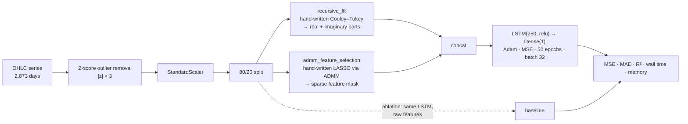

<h1 align="center">Hybrid Time-Series Framework</h1>

<p align="center">
  <b>FFT spectral features + ADMM sparse feature selection, in front of an LSTM —<br>
  with both the FFT and the ADMM solver written from scratch, and an ablation to prove they help.</b>
</p>

<p align="center">
  
  
  
</p>

---

## The problem

Financial time series are the hard case for deep learning. The signal-to-noise ratio is terrible,
the series is non-stationary, and an LSTM handed raw OHLC columns will happily learn the noise.

Two things are missing from the raw representation, and this project adds one each:

1. **Periodic structure is invisible in the time domain.** Weekly effects, quarterly cycles and
   longer oscillations are real and an LSTM reading a sequence of prices has to discover them from
   scratch, from very few examples. Handing the model the frequency decomposition directly is
   cheaper than making it learn a Fourier transform.
2. **Not every input column earns its place.** With correlated OHLC features, more inputs means more
   parameters, more overfitting and no more information. Something has to decide which features
   survive — and it should be a principled sparse selector, not intuition.

## What it does



---

## Novelty

### 1. A Cooley–Tukey FFT written from first principles

Not `np.fft.fft` — the radix-2 decimation-in-time recursion, implemented:

```python
def recursive_fft(x):
    n = len(x)
    if n <= 1:
        return x
    X_even = recursive_fft(x[::2])
    X_odd  = recursive_fft(x[1::2])
    factor = np.exp(-2j * np.pi * np.arange(n) / n)
    return np.concatenate([X_even + factor[:n // 2] * X_odd,
                           X_even + factor[n // 2:] * X_odd])
```

The last line is the butterfly, and it is worth reading twice. The textbook form is
`[E + f·O, E − f·O]`; this uses `factor[n//2:]` for the second half instead of negating. Those are
the same thing, because `e^{-2πi(k+n/2)/n} = −e^{-2πik/n}` — the twiddle factor's own symmetry does
the negation. It is a correct and slightly elegant way to write it.

The wrapper pads to the next power of two with a bit trick — `1 << (n - 1).bit_length()` — which
radix-2 requires, then keeps the real and imaginary parts as two separate feature columns rather
than a magnitude. That is the right call: **phase carries the alignment information** that
magnitude throws away, and for a series where *when* a cycle peaks matters, discarding phase
discards half the signal.

### 2. LASSO by ADMM, also from scratch

```python
def admm_feature_selection(X, y, rho=1.0, max_iter=100):
    beta = z = u = np.zeros(n_features)
    for _ in range(max_iter):
        beta = np.linalg.inv(X.T @ X + rho * np.eye(n_features)) @ (X.T @ y + rho * (z - u))
        z    = soft_thresholding(beta + u, 1 / rho)
        u    = u + beta - z
    return np.abs(z) > 0
```

This is a textbook-correct Alternating Direction Method of Multipliers for the LASSO, and all three
steps are doing exactly what they should:

- **β-update** — a ridge-regularised least-squares solve. The `+ ρI` is what makes `XᵀX` invertible
  even when features are collinear, which OHLC columns very much are.
- **z-update** — soft thresholding, `sign(x)·max(0, |x| − λ)`. This is the proximal operator of the
  L1 norm, and it is the step that actually produces zeros.
- **u-update** — dual ascent on the scaled dual variable, driving β and z into agreement.

The split is the whole point of ADMM: the smooth part (least squares) and the non-smooth part (L1)
are handled by separate updates, each of which has a closed form. Writing it out rather than
calling `sklearn.linear_model.Lasso` demonstrates the machinery rather than the API.

`np.abs(z) > 0` then reads the selected feature mask straight off the sparse variable.

### 3. A real ablation, measured on four axes

The notebook trains **the same LSTM twice** — once on FFT + ADMM features, once on the raw scaled
columns — and compares:

| | With FFT + ADMM | Baseline |
|---|---:|---:|
| MSE | **347,210** | 487,391 |
| MAE | **441.86** | 590.68 |
| **R²** | **0.342** | 0.076 |
| Input shape | (2298, 1, 7) | (2298, 1, 5) |

**R² improves 4.5×.** Both wall-clock time and memory footprint are also recorded and plotted, so
the cost side of the trade is visible too — which is unusual and good, since a preprocessing step
that quadruples training time for a marginal gain is not obviously worth it, and here you can see
that it is.

Running the ablation at all is the thing most projects skip. A single number for a hybrid model
tells you nothing; the delta against the same architecture on raw features tells you everything.

---

## Data

`Data Set.csv` — **2,873 trading days** of Bajaj Auto (NSE), from 26 May 2008.

`High` · `Prev Close` · `Open` · `Low` · `Close` · `Last` · `VWAP` · `Date`

Target is `High`; it is removed from the feature matrix (`column_to_remove = 0`) so the model
cannot read its own answer.

## Repository layout

```
Code.ipynb      the whole pipeline: preprocessing, FFT, ADMM, both LSTMs, the ablation, the plots
Data Set.csv    2,873 rows of OHLC
Report.docx     the written report
PPT.pptx        the presentation
```

## Running it

```bash
git clone https://github.com/Vishal-AS-0407/Hybrid-Time-Series-FrameWork.git
cd Hybrid-Time-Series-FrameWork
pip install pandas numpy scipy scikit-learn tensorflow matplotlib
jupyter notebook Code.ipynb
```

The first cell reads `BAJAJ-AUTO1.csv`; the committed file is `Data Set.csv`. Rename one or the
other.

---

## Honest notes

These are worth stating plainly, because the two hand-written algorithms are genuinely good work
and the evaluation around them has problems that would need fixing before the numbers meant
anything outside the notebook.

- **The train/test split is random, on a time series.**

  ```python
  train_test_split(X, y, test_size=0.2, random_state=42)     # shuffle=True by default
  ```

  This puts days from 2019 in the training set and days from 2012 in the test set. For a
  *forecasting* task that is look-ahead leakage and it inflates both scores. The fix is one
  argument — `shuffle=False` — or better, a chronological cut. Expect both R² values to fall.

- **Scaling is fitted before the split.** `scaler.fit_transform` runs over the whole frame, so test
  statistics leak into the training representation. `fit` on train, `transform` on test.

- **The FFT is taken across samples, not across time within a sample.**
  `compute_fft_features(X_train[:, 0])` transforms one column of the *shuffled* training matrix.
  After a random shuffle the row order is a permutation, so the resulting "frequency" content is
  not the series' frequency content. Combined with the point above, this is the single change that
  would most improve the work: **window the series first** (a sliding window of, say, 30 days),
  FFT *within* each window, and give the LSTM a genuine spectral view of each sample's recent past.
  The `recursive_fft` implementation is correct and ready; only what it is applied to needs to
  change.

- **Same-day columns are in the feature set.** `Low`, `Close` and `VWAP` for day *t* are used to
  predict `High` for day *t*. That is not forecasting, it is same-bar interpolation — and it makes
  R² = 0.34 oddly *low* rather than suspiciously high, which suggests the FFT columns are adding
  noise that the model is fighting. Predicting `High[t+1]` from day *t* would make the task honest
  and the number meaningful.

- **`y` is unscaled while `X` is scaled.** The target is in raw rupees (hundreds), the inputs are
  z-scores. The MSE of ~347,000 is in rupees², which is why it looks enormous. Scaling the target
  (and inverse-transforming for reporting) would help the optimiser and make the loss readable.

- **ADMM's `soft_thresholding(beta + u, 1 / rho)`** uses `λ = 1` implicitly. Exposing λ as a
  parameter and sweeping it would show the sparsity/accuracy trade-off, which is the interesting
  plot the ablation is missing.

- **`space_complexity` is measured with `sys.getsizeof`** on the arrays, which returns the
  container size rather than the model's memory footprint. `nbytes` on the arrays plus the model's
  parameter count would be closer to the intended measurement.
