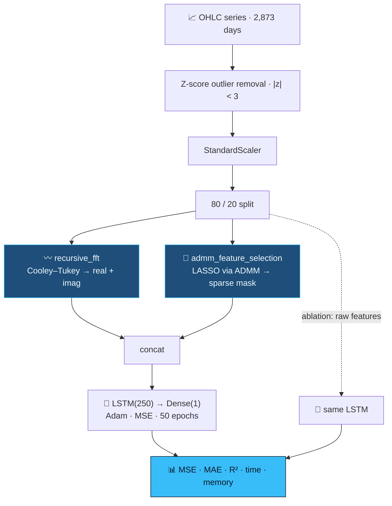

<div align="center">


<br/>


</div>


<details>
<summary><b>📑 Table of contents</b></summary>

- [📌 Overview](#-overview)
- [🧠 Pipeline](#-pipeline)
- [📊 Ablation](#-ablation)
- [🔬 The two algorithms](#-the-two-algorithms)
- [🗂️ Data](#️-data)
- [🚀 Getting started](#-getting-started)
- [🧭 Evaluation notes & next steps](#-evaluation-notes--next-steps)

</details>

## 📌 Overview

Financial series are the hard case for deep learning — low signal-to-noise, non-stationary, and an
LSTM fed raw OHLC columns happily learns the noise. Two things are missing from the raw view:

| Missing | Added |
|---|---|
| 〰️ **Periodic structure** — weekly, quarterly cycles are invisible in the time domain | **FFT features** (real + imaginary, so phase survives) |
| 🧹 **Feature discipline** — correlated OHLC columns add parameters, not information | **ADMM LASSO** selects a sparse feature set |

Both algorithms are **implemented from first principles** — no `np.fft`, no `sklearn.Lasso`.

## 🧠 Pipeline



## 📊 Ablation

The **same LSTM**, trained twice:

| Metric | 〰️ FFT + ADMM | Baseline |
|---|:---:|:---:|
| MSE | **347,210** | 487,391 |
| MAE | **441.86** | 590.68 |
| **R²** | **0.342** | 0.076 |
| Input shape | (2298, 1, 7) | (2298, 1, 5) |

> 📈 **R² improves 4.5×.** Wall-clock time and memory are measured and plotted too, so the cost of
> the preprocessing is visible alongside the gain.

## 🔬 The two algorithms

<details open>
<summary><b>〰️ Cooley–Tukey FFT</b></summary>

```python
def recursive_fft(x):
    n = len(x)
    if n <= 1:
        return x
    X_even = recursive_fft(x[::2])
    X_odd  = recursive_fft(x[1::2])
    factor = np.exp(-2j * np.pi * np.arange(n) / n)
    return np.concatenate([X_even + factor[:n // 2] * X_odd,
                           X_even + factor[n // 2:] * X_odd])
```

The butterfly uses `factor[n//2:]` instead of negating — identical, because
`e^{-2πi(k+n/2)/n} = −e^{-2πik/n}`. Input is padded with `1 << (n - 1).bit_length()`, and real and
imaginary parts are kept as separate columns: **phase carries when a cycle peaks**.

</details>

<details open>
<summary><b>🎯 LASSO via ADMM</b></summary>

```python
def admm_feature_selection(X, y, rho=1.0, max_iter=100):
    beta = z = u = np.zeros(n_features)
    for _ in range(max_iter):
        beta = np.linalg.inv(X.T @ X + rho * np.eye(n_features)) @ (X.T @ y + rho * (z - u))
        z    = soft_thresholding(beta + u, 1 / rho)
        u    = u + beta - z
    return np.abs(z) > 0
```

| Step | Does |
|---|---|
| **β-update** | ridge-regularised least squares — `+ρI` keeps collinear OHLC invertible |
| **z-update** | soft thresholding, the L1 proximal operator — produces the zeros |
| **u-update** | scaled dual ascent — drives β and z into agreement |

</details>

## 🗂️ Data

`Data Set.csv` — **2,873 trading days** of Bajaj Auto (NSE) from 26 May 2008:
`High · Prev Close · Open · Low · Close · Last · VWAP · Date`. Target is `High`, removed from the
features.

## 🛠️ Tech stack

<p align="center">
  
  
  
</p>

## 🚀 Getting started

```bash
git clone https://github.com/Vishal-AS-0407/Hybrid-Time-Series-FrameWork.git
cd Hybrid-Time-Series-FrameWork
pip install pandas numpy scipy scikit-learn tensorflow matplotlib
jupyter notebook Code.ipynb
```

> 💡 **Tip:** the first cell reads `BAJAJ-AUTO1.csv` — point it at `Data Set.csv`. The written
> `Report.docx` and `PPT.pptx` are in the repo too.

## 🧭 Evaluation notes & next steps

<details>
<summary><b>What I'd change to make the numbers forecast-grade</b></summary>

The two hand-written algorithms are correct; the evaluation around them needs tightening:

- 🔀 The split is random on a time series — use `shuffle=False` or a chronological cut.
- 📏 The scaler is fit before the split — fit on train only.
- 〰️ The FFT runs across shuffled rows — **window the series** (e.g. 30 days) and FFT within each
  window for a true spectral view of each sample's past.
- 📅 Same-day `Low/Close/VWAP` predict same-day `High` — predict `High[t+1]` instead.
- 📐 Scale the target too, and expose λ in ADMM to plot the sparsity/accuracy trade-off.

**Next steps**
- [ ] Sliding-window FFT features
- [ ] Chronological split + next-day target
- [ ] λ sweep for ADMM

</details>


<div align="center">

<a href="https://portfolio-sigma-blond-57.vercel.app"></a>
<a href="https://www.linkedin.com/in/vishal-a-s04/"></a>
<a href="https://github.com/Vishal-AS-0407"></a>
<a href="mailto:vishalpersonal04@gmail.com"></a>

⭐ **If this helped you, star the repo!**


</div>
