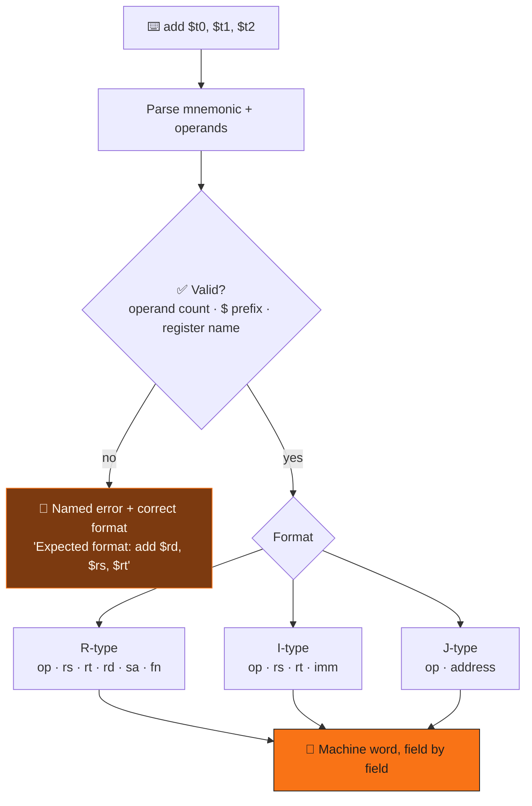

<div align="center">


<br/>


</div>


## 📌 What it is

MIPS is what architecture courses teach on because its encoding is regular enough to work out by
hand — which still means memorising three formats, 32 registers and their aliases, and every
opcode. Type an instruction, and this prints the **fields of the machine word separately** —
opcode, `rs`, `rt`, `rd`, shift, function — so you see the encoding's *structure*, not a 32-bit
blob.

<div align="center">

</div>

## 🧠 How an instruction becomes bits



> 💬 **The idea worth keeping:** every error names the instruction and shows the correct form. A
> bare *"syntax error"* teaches nothing; *"Expected format: `lw $rt, offset($rs)`"* teaches it the
> moment it's needed. `$t10` is caught with an explanation, not silently mis-encoded.

## 📋 Coverage

| Format | Instructions |
|---|---|
| 🟧 **R-type** | `add` `addu` `sub` `subu` `and` `or` `xor` `nor` `slt` `sltu` `sll` `srl` `sra` `sllv` `srlv` `srav` `mult` `multu` `div` `divu` `mfhi` `mflo` `jr` `jalr` |
| 🟦 **I-type** | `addi` `subi` `slti` `li` `lw` `sw` `beq` `bne` `bgt` `bge` `blt` `ble` |
| 🟩 **J-type** | `j` `jlar` |

Immediates in decimal, hex (`0x…`) or binary (`0b…`); all 32 registers by name — `$zero`, `$at`,
`$v0–1`, `$a0–3`, `$t0–9`, `$s0–7`, `$k0–1`, `$gp`, `$sp`, `$fp`, `$ra`.

## 🚀 Getting started

```bash
git clone https://github.com/Vishal-AS-0407/MIPS-to-Binary-converter.git
cd MIPS-to-Binary-converter
python main.py
```

> 💡 **Tip:** mnemonics are lowercase, as in most assemblers.

## 🧭 Known issues & roadmap

<details>
<summary><b>Fixes, in order of impact</b></summary>

| # | Issue | Fix |
|:---:|---|---|
| 1 | Register fields print in **decimal** (`{:05d}`) | `{:05b}` in `rType`, `iType`, `iTypeLabel` |
| 2 | `lw`/`sw` call `parseLwSwOffset` (undefined) | rename to `check_Offset` and split on `(` before `int()` |
| 3 | `sll`/`srl`/`sra` pass `"00000"` as a register | a shift variant validating only `rd`, `rt` |
| 4 | `j` prints the label, not an address | look it up like the branches do |
| 5 | `subi`, `li`, `blt`… are pseudo-ops with invented opcodes | expand them (`addi` with −imm, `lui`+`ori`, `slt`+`beq`) |
| 6 | Duplicate `and` / `sub` / `jr` branches | a dispatch dict — halves `main.py` |

```python
def check_Offset(operand):                    # "8($t1)" or "-4($sp)"
    i = operand.index("(")
    return int(operand[:i]), operand[i + 1: operand.index(")")]
```

**Roadmap**
- [ ] Binary field output
- [ ] Two-pass assembler over a whole `.asm` file
- [ ] `if __name__ == "__main__":` guard

</details>


<div align="center">

<a href="https://portfolio-sigma-blond-57.vercel.app"></a>
<a href="https://www.linkedin.com/in/vishal-a-s04/"></a>
<a href="https://github.com/Vishal-AS-0407"></a>

⭐ **If this helped you, star the repo!**


</div>
