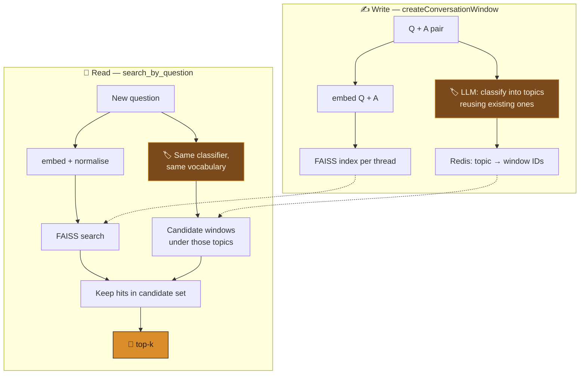

<div align="center">


<br/>


<a href="https://portfolio-sigma-blond-57.vercel.app/work/memora"></a>

</div>


<details>
<summary><b>📑 Table of contents</b></summary>

- [📌 Overview](#-overview)
- [✨ Highlights](#-highlights)
- [🧠 How it works](#-how-it-works)
- [🔬 Under the hood](#-under-the-hood)
- [🧰 API](#-api)
- [🚀 Getting started](#-getting-started)
- [📂 Project structure](#-project-structure)
- [🧭 Known issues & roadmap](#-known-issues--roadmap)

</details>

## 📌 Overview

Give a chatbot a vector store and it retrieves *semantically similar* past turns — right most of
the time, and **quietly wrong** the rest.

> 🗄️ You talk about **database indexing**. Later you ask about **book indexing**. Cosine
> similarity has no idea one is Postgres and the other is a paperback — so the assistant answers a
> question about bibliographies with your B-tree conversation.

The more a long-running assistant remembers, the more near-neighbours every query has. **Memora**
tags every conversation turn with topics as it happens, and retrieves only from the slice that
shares the question's topic. Domains are separated *before* vectors are consulted.

## ✨ Highlights

<table>
<tr>
<td width="50%" valign="top">

### 🔁 Self-stabilising topics
The classifier sees the thread's **existing topics** and reuses them where they fit — so `food`
doesn't splinter into `cooking`, `recipes`, `culinary`.

</td>
<td width="50%" valign="top">

### 🗂️ Redis as an inverted index
Each thread is one hash; each topic is a field holding window IDs. Candidate lookup is a couple of
`hget`s — no scan, no second database.

</td>
</tr>
<tr>
<td valign="top">

### 🛑 Embedding mismatch is an error
The embedding model's name is stored per thread and **asserted on every read and write** —
mixing vector spaces fails loudly instead of silently.

</td>
<td valign="top">

### 🔌 Bring your own model
LLM and embedder are **injected**. Gemini in the examples; OpenAI, Ollama or a local
sentence-transformer are one constructor argument away.

</td>
</tr>
</table>

## 🧠 How it works



> 🧩 **Two-stage retrieval:** a symbolic topic filter narrows the candidates, then vector
> similarity ranks within them. Empty topic match → falls back to all windows.

```
Thread_<uuid>  ┬─ all_windows           → ["w1","w2","w3", ...]
               ├─ embedding_model_used  → "models/gemini-embedding-exp-03-07"
               ├─ "food"                → ["w2","w7"]
               └─ "sports"              → ["w1","w3","w7"]     ← w7: an athlete's diet is both
```

## 🔬 Under the hood

<details>
<summary><b>🔁 Topics generated relative to the ones that exist</b></summary>

```python
prompt = f"""
Classify the following conversation into very generic topic names
(like sports, food, math, movies etc). They can either be new, or be an
overlap of already existing topics.
already existing topics: {alreadyExistingTopics}
Q: {question}
A: {answer}
"""
response = self._llm.with_structured_output(GenerateTopics).invoke(prompt)
```

Open enough that a new subject gets a new topic; convergent enough that a familiar one snaps to
the label already in use. "Very generic" keeps buckets big enough to be useful.

</details>

<details>
<summary><b>🎯 The query uses the write-side classifier</b></summary>

```python
question_topics = self.generateOrMatchTopicsViaLangchain(
    question=question_text,
    answer="",                                   # ← no answer yet
    existingTopics=existing_topics or "No topics stored yet."
)
```

An empty `answer` reuses the same classifier against the same vocabulary — so the query's topics
are guaranteed to key into the index.

</details>

<details>
<summary><b>🧱 Structured output protects the taxonomy</b></summary>

```python
class GenerateTopics(BaseModel):
    topics_list: list[str]
```

One `Sure! Here are the topics:` parsed as a topic would become a permanent Redis key and be fed
back into every later prompt. The schema makes that impossible.

</details>

<details>
<summary><b>🛑 The embedding-model assertion</b></summary>

```python
assert self._embedding_model_name == self.getThreadsEmbeddingModelName(threadId=thread_id), \
    f"Different Embedding model's used, revert back to the initial one ..."
```

Mixed embedding spaces return neighbours that *look* like results and mean nothing. Memora refuses.

</details>

<details>
<summary><b>🔗 Per-thread indexes and referral links</b></summary>

- Each thread owns `vecdb_storage/<thread>/index.faiss` + `metadata.json` — deleting a
  conversation is deleting a folder.
- A window can carry `referral_ids` pointing at earlier windows — the seed of a memory **graph**
  ("this answer builds on that one"). Stored and returned; not yet traversed.

</details>

## 🧰 API

```python
from memory_system import MemoraBrain
from langchain_google_genai import ChatGoogleGenerativeAI, GoogleGenerativeAIEmbeddings

brain = MemoraBrain(
    langchain_llm=ChatGoogleGenerativeAI(model="gemini-2.0-flash", temperature=0),
    langchain_embedding_model=GoogleGenerativeAIEmbeddings(model="models/gemini-embedding-exp-03-07"),
    host="localhost", port=6379, db=0, vecdb_base_path="vecdb_storage",
)

thread_id = brain.createThread()                      # → "Thread_<uuid>"
brain.createConversationWindow(
    query_text="What is Python?",
    answer_text="A high-level programming language known for its simplicity.",
    thread_id=thread_id, user_name="Alice", generate_topics=True,
)
brain.search_by_question("Tell me about programming languages", thread_id, top_k=3)
brain.getThreadTopics(thread_id)                      # → ["programming", ...]
```

| Method | Returns |
|---|---|
| `createThread()` | new thread ID |
| `createConversationWindow(...)` | `{window_id, thread_id, vector_id, topics}` |
| `search_by_question(q, thread, top_k)` | ranked windows with `similarity_score` |
| `search_by_text(text, limit)` | substring matches across windows |
| `getThreadTopics(thread)` | the thread's topic vocabulary |
| `getThreadDetails(thread)` | the full thread hash |

## 🛠️ Tech stack

<p align="center">
  
  
  
  
</p>

## 🚀 Getting started

```bash
docker run -d -p 6379:6379 redis:latest        # Redis on localhost:6379
git clone https://github.com/Vishal-AS-0407/Memora.git
cd Memora
pip install -r requirements.txt langchain-google-genai
echo "GOOGLE_API_KEY=your-key" > .env
python demo.py                    # scripted walkthrough
python chatbot_with_memory.py     # interactive chat with memory
```

> 💡 **Tip:** on Windows without Docker, [Memurai](https://www.memurai.com/) is a drop-in Redis.
> `memory_system.py`'s live implementation starts at `import redis` (line 425) — the top half is an
> earlier version kept as comments.

## 📂 Project structure

```
📦 Memora
 ┣ 🐍 memory_system.py         MemoraBrain — Redis + FAISS + LangChain
 ┣ 🐍 chatbot_with_memory.py   conversational wrapper over MemoraBrain
 ┣ 🐍 demo.py                  scripted walkthrough
 ┗ 📄 requirements.txt
```

## 🧭 Known issues & roadmap

<details>
<summary><b>What I'd fix next</b></summary>

- 📐 **Stored vectors aren't L2-normalised** (the query is), so `similarity_score` is
  `‖v‖·cos θ`, not cosine. One line before `index.add` fixes it:
  ```python
  faiss.normalize_L2(embedding)
  ```
- 🐢 Search pulls the whole index then filters by topic — fine at thousands, a full scan at
  millions. Per-topic indexes or an `IDSelector` scale better.
- 💸 Every write and query costs one LLM call for classification — cache repeated questions.
- 🧹 `chatbot_with_memory.py` / `demo.py` predate the current API; `memory_system.py` is the
  reference.

**Roadmap**
- [ ] Normalise on write
- [ ] Per-topic FAISS indexes
- [ ] Hierarchical compaction — old windows in a topic collapse into a summary window
- [ ] Traverse `referral_ids` as a memory graph
- [ ] TTL / eviction

</details>


<div align="center">

**📖 Read the full design story →** [portfolio · The Catalogue](https://portfolio-sigma-blond-57.vercel.app/work/memora)

<a href="https://www.linkedin.com/in/vishal-a-s04/"></a>
<a href="https://github.com/Vishal-AS-0407"></a>
<a href="mailto:vishalpersonal04@gmail.com"></a>

⭐ **If this helped you, star the repo!**


</div>
