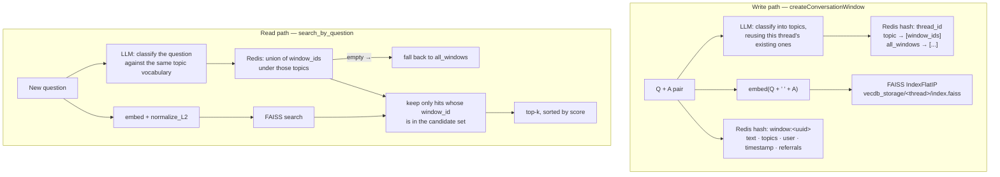

<h1 align="center">Memora</h1>

<p align="center">
  <b>Domain-wise hierarchical memory for LLMs.</b><br>
  Conversations are tagged by topic as they happen, and a later question retrieves only the slice
  that shares its topic — so a multi-domain chat does not cross-talk.
</p>

<p align="center">
  
  
  
  
</p>

---

## The problem

Give a chatbot a vector store and it will retrieve *semantically similar* past turns. That is the
right answer roughly two-thirds of the time and quietly wrong the rest.

The failure has a shape. You talk to an assistant about **database indexing**. Later you ask about
**book indexing**. Embeddings put those close together — both are "indexing", both are about
ordered lookup, and cosine similarity has no idea one is Postgres and the other is a paperback.
The assistant confidently retrieves your B-tree conversation and answers a question about
bibliographies with it.

The same failure in a longer form: a single long-running assistant that knows about your work,
your health and your hobbies will, at 5,000 turns, retrieve the wrong life. Flat semantic memory
degrades exactly as the memory becomes valuable — because the more you store, the more
near-neighbours every query has.

Three sub-problems fall out of that:

1. **Retrieval needs a symbolic filter, not just a metric.** Something has to know that "database"
   and "book" are different domains even when the vectors say otherwise.
2. **The topic vocabulary cannot be fixed in advance.** You do not know what a user will talk
   about. A closed taxonomy is wrong on day two.
3. **Embeddings are not interchangeable.** A store built with one embedding model and queried with
   another returns garbage that *looks* like results — no error, just silently wrong neighbours.

## What this does



**Two-stage retrieval.** A symbolic topic filter narrows the candidate set; vector similarity ranks
within it. Cosine similarity never gets the chance to confuse two domains, because the domains were
separated before it was consulted.

---

## Novelty

### 1. Topics are generated *relative to the topics that already exist*

This is the idea the whole system turns on. The classifier is not asked "what is this about" — it
is shown the thread's current topic vocabulary and asked to reuse it where it fits:

```python
prompt = f"""
Classify the following conversation into very generic topic names
(like sports, food, math, movies etc). They can either be new, or be an
overlap of already existing topics.
already existing topics: {alreadyExistingTopics}
Q: {question}
A: {answer}
Only return a list separated by commas.
"""
response = self._llm.with_structured_output(GenerateTopics).invoke(prompt)
```

Without the `already existing topics` line, the same subject drifts across labels — `cooking`,
`recipes`, `food preparation`, `culinary` — and the topic index shatters into synonyms that never
match each other. Feeding the existing vocabulary back in makes the taxonomy **self-stabilising**:
it stays open (a genuinely new subject gets a new topic) while converging (a familiar subject snaps
to the label already in use).

"Very generic" is doing work too. Fine-grained topics would give one window per topic and the
filter would degenerate to exact-match. Coarse topics keep the buckets big enough to be useful.

### 2. The *query* is classified with the same classifier as the stored turns

```python
question_topics = self.generateOrMatchTopicsViaLangchain(
    question=question_text,
    answer="",                                   # ← no answer yet
    existingTopics=existing_topics or "No topics stored yet."
)
```

Passing an empty `answer` is a small, deliberate trick: it reuses the *write-side* classifier at
read time, against the same evolving vocabulary, so the query's topics are drawn from exactly the
label set the store is indexed by. A separately-prompted query classifier would produce labels that
do not key into the index.

### 3. Structured output, so the taxonomy cannot be corrupted by prose

```python
class GenerateTopics(BaseModel):
    topics_list: list[str]

self._llm.with_structured_output(GenerateTopics).invoke(prompt)
```

Pydantic-constrained decoding rather than "return a comma-separated list and hope". A single
`Sure! Here are the topics:` preamble parsed as a topic would insert a permanent garbage key into
the thread's Redis hash and poison every subsequent classification, since the corrupted vocabulary
is fed back into the next prompt. The schema makes that failure impossible.

### 4. Redis as an inverted index, not just a cache

Each thread is a single Redis hash, and topics are **fields** in it:

```
Thread_<uuid>  ┬─ all_windows           → ["w1","w2","w3", ...]
               ├─ embedding_model_used  → "models/gemini-embedding-exp-03-07"
               ├─ "food"                → ["w2","w7"]
               └─ "sports"              → ["w1","w3","w7"]
```

`getThreadTopics` is `hkeys` minus the two reserved fields. Candidate lookup for a query is a
couple of `hget`s. This is a classic inverted index built out of a hash — O(1) per topic, no scan,
no second database. `w7` appearing under both `food` and `sports` is the point: a window about
an athlete's diet is genuinely both, and belongs in both buckets.

### 5. A vector index per thread, not one global index

```python
vecdb_path = os.path.join(self.vecdb_base_path, thread_id)   # vecdb_storage/Thread_<uuid>/
index = faiss.IndexFlatIP(dim)
```

Each thread gets its own `index.faiss` and `metadata.json`. Deleting a conversation is `rm -rf` on
a directory rather than a rebuild. The index dimension is taken from the first embedding actually
produced (`dim=len(embedding)`), so switching embedding models means a new thread rather than a
config change — which is enforced:

### 6. Embedding-model consistency is an assertion, not a note in the README

```python
assert self._embedding_model_name == self.getThreadsEmbeddingModelName(threadId=thread_id), \
    f"Different Embedding model's used, revert back to the initial one [i.e this model --> {...}]"
```

The model name is written into the thread's hash at creation and checked on **every write and
every search**. Mixing embedding spaces is the classic silent failure in vector search — no
exception, no dimension error if the sizes happen to match, just neighbours that mean nothing.
Memora refuses instead.

### 7. Model-agnostic by construction

```python
def __init__(self, langchain_llm, langchain_embedding_model, host='localhost', port=6379, ...)
```

The LLM and the embedding model are **injected**, not constructed. Nothing in `MemoraBrain`
imports a provider. Gemini in the examples, but OpenAI, Ollama or a local sentence-transformer are
a constructor argument away — and the consistency assertion above means switching is safe rather
than silently destructive.

### 8. Referral IDs — an explicit edge between windows

```python
"referral_ids": ','.join(referral_ids) if referral_ids else ''
```

Beyond topic and vector similarity, a window can point at other windows. This is the seed of a
memory *graph*: "this answer builds on that earlier one", recorded as a link rather than inferred
from cosine distance. It is stored and returned; nothing traverses it yet.

---

## Repository layout

```
memory_system.py         the MemoraBrain class — Redis + FAISS + LangChain
chatbot_with_memory.py   MemoraChatbot — a conversational wrapper over MemoraBrain
demo.py                  scripted walkthrough of the memory operations
requirements.txt
```

> `memory_system.py` is 935 lines, of which **the first ~424 are an earlier version, commented
> out**. The live implementation starts at `import redis` on line 425. Worth knowing before you
> read it top to bottom.

## API

```python
from memory_system import MemoraBrain
from langchain_google_genai import ChatGoogleGenerativeAI, GoogleGenerativeAIEmbeddings

brain = MemoraBrain(
    langchain_llm=ChatGoogleGenerativeAI(model="gemini-2.0-flash", temperature=0),
    langchain_embedding_model=GoogleGenerativeAIEmbeddings(
        model="models/gemini-embedding-exp-03-07"),
    host="localhost", port=6379, db=0,
    vecdb_base_path="vecdb_storage",
)

thread_id = brain.createThread()                      # → "Thread_<uuid>"

brain.createConversationWindow(
    query_text="What is Python?",
    answer_text="A high-level programming language known for its simplicity.",
    thread_id=thread_id,
    user_name="Alice",            # optional
    referral_ids=None,            # optional — links to related windows
    generate_topics=True,         # optional
)
# → {window_id, thread_id, vector_id, topics}

brain.search_by_question("Tell me about programming languages", thread_id, top_k=3)
# → [{question, answer, topics, timestamp, username, similarity_score, vector_id}, ...]

brain.search_by_text("machine learning", limit=10)    # substring scan over all windows
brain.getThreadTopics(thread_id)                      # → ["food", "sports", ...]
brain.getThreadDetails(thread_id)                     # → the full thread hash
```

## Running it

**1 — Redis on `localhost:6379`.**

```bash
docker run -d -p 6379:6379 redis:latest
redis-cli ping        # → PONG
```

**2 — Install.**

```bash
git clone https://github.com/Vishal-AS-0407/Memora.git
cd Memora
pip install -r requirements.txt
pip install langchain-google-genai        # not in requirements.txt but required
```

**3 — Key.** `GOOGLE_API_KEY=...` in a `.env` beside the scripts.

**4 — Run.**

```bash
python demo.py                  # scripted walkthrough
python chatbot_with_memory.py   # interactive chat with memory
```

---

## Honest notes

- **Stored vectors are never normalised, but the query is.** `insert_into_vecdb` calls
  `index.add(embedding)` directly, while `search_by_question` calls
  `faiss.normalize_L2(question_embedding)` first. With `IndexFlatIP` that makes the score
  `‖v‖·cos(θ)` rather than `cos(θ)` — a **long** stored vector outranks a **relevant** one. The
  code comment already states the intent (*"use IndexFlatIP (inner product) + normalize vectors"*);
  the write side just never got the second half. One line fixes it:

  ```python
  if embedding.ndim == 1:
      embedding = np.array([embedding], dtype=np.float32)
  faiss.normalize_L2(embedding)        # ← add this before index.add
  ```

  The results are still ordered sensibly in practice because embedding norms cluster tightly, but
  the reported `similarity_score` is not cosine similarity and should not be read as one.
- **`index.search(question_embedding, index.ntotal)` retrieves the entire index**, then filters by
  topic in Python. Correct, and fine at a few thousand windows; at a million it is a full scan per
  query. The scalable form is one FAISS index per topic, or an `IDSelector`.
- **`requirements.txt` is missing `langchain-google-genai`**, which `demo.py` and the examples
  import. Install it separately.
- **The original README documented files that are not in the repository** — `kavya_test.py`,
  `latest_check.py`, `me_check.py`, `helper/`, `.env`, `dump.rdb`, `vecdb_storage/` — and pointed
  at a local Windows path. This rewrite documents only the three scripts that are actually here.
- **`chatbot_with_memory.py` and `demo.py` were written against an earlier API** and use methods
  the live class no longer exposes in the same shape. `memory_system.py` is the file to read.
- **Every write costs an LLM call.** Topic classification runs on each stored turn and each query.
  That is the price of the symbolic layer; caching classifications for repeated questions is the
  obvious optimisation.
- **No eviction, no summarisation, no TTL.** Memory grows without bound. Hierarchical *compaction*
  — old windows in a topic collapsed into a summary window — is the natural next feature and the
  one the topic index already makes easy.

---

<p align="center">
  <sub>Full case study, with the design decisions written out:
  <a href="https://portfolio-sigma-blond-57.vercel.app/work/memora">portfolio → Memora</a></sub>
</p>
