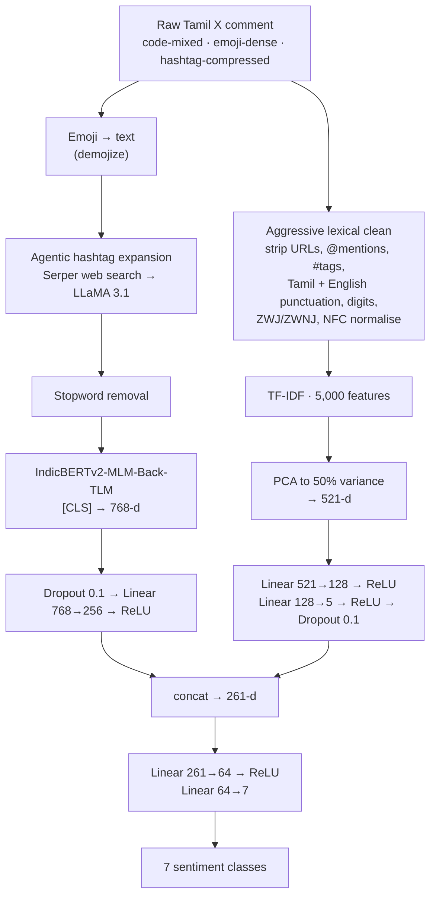

<h1 align="center">Synapse @ DravidianLangTech, NAACL 2025</h1>

<p align="center">
  <b>Multiclass political sentiment analysis of Tamil X (Twitter) comments,<br>
  by fusing IndicBERTv2 with lexical representations.</b>
</p>

<p align="center">
  
  
  <a href="https://doi.org/10.18653/v1/2025.dravidianlangtech-1.122"></a>
  
  
</p>

---

## The problem

The shared task asks for one label out of seven — **Substantiated, Sarcastic, Opinionated,
Positive, Negative, Neutral, None of the above** — on political comments from Tamil X. Every part
of that sentence is harder than it sounds.

**The classes overlap by construction.** A sarcastic comment is also opinionated. A substantiated
one is usually also positive or negative about something. The boundary between *Opinionated* and
*Neutral* is a judgement call even for a fluent annotator. This is why a macro-F1 of 0.38 wins a
shared task here, where the same number would be a failure on a sentiment benchmark with three
clean classes.

**The label set is severely imbalanced.** From the 4,352 training rows:

| Label | Count | Share |
|---|---:|---:|
| Opinionated | 1,361 | 31.3% |
| Sarcastic | 790 | 18.2% |
| Neutral | 637 | 14.6% |
| Positive | 575 | 13.2% |
| Substantiated | 412 | 9.5% |
| Negative | 406 | 9.3% |
| None of the above | 171 | **3.9%** |

The rarest class has **eight times fewer examples** than the most common one. Macro-F1 weights all
seven equally, so the 171 rows matter exactly as much as the 1,361.

**Tamil is low-resource and the text is code-mixed.** Comments switch between Tamil and English
mid-sentence. Multilingual subword tokenizers shred rare political vocabulary into fragments that
carry no meaning.

**And the hashtags are where the politics lives.** `#DMKFailsTN` is a complete political position
in one token. To a subword tokenizer it is `#`, `DMK`, `Fails`, `TN` — or worse, `##MKF`, `##ails`.
The single most informative feature in the comment arrives as noise.

## The approach

Two moves, both aimed at recovering signal that the tokenizer destroys.



---

## Novelty

### 1. Retrieval-augmented hashtag expansion — an agent, not a lookup table

This is the headline idea, and it is more than "call an LLM". `Agent.py` runs a two-stage pipeline
per hashtag:

```python
search_query = f"{hashtag} Tamil politics meaning context"
search_results = self.search_serper(search_query)      # live Google results, top 3
context = " ".join(r.get('snippet', '') for r in search_results)
# ...then hand the retrieved context to LLaMA 3.1 with a tightly-constrained prompt
```

The LLM is **not** asked to recall Tamil politics from its weights — it is asked to *summarise
retrieved evidence* into one line, under explicit rules:

> 1. Must be ONE line only · 2. If it's a Tamil word, provide the expansion · 3. If it's a
> person's name, add their role · 4. If it's a party name, add "(Political Party)" · 6. Maximum
> 10–12 words

That matters because Tamil regional politics is exactly the kind of thing a general model
half-knows and will confidently fabricate. Grounding in live search results turns
`#Mike_VoiceOfPeople` into *"Mic, the symbol representing the voice of the people"* — which is a
fact about the 2024 Tamil Nadu election, not a guess.

The output is a curated map baked into `pre_processing.ipynb`, so inference does not need network
access:

```python
hashtag_map = {
    "#DMKFailsTN": "Dravida Munnetra Kazhagam fails Tamil Nadu",
    "#NTK":        "Naam Tamilar Katchi (Political Party)",
    "#MKStalin":   "MK Stalin, Chief Minister of Tamil Nadu",
    "#த":          "Tamil (Short form for Tamil-related content)",
    ...
}
```

Note the last entry. Single-character Tamil hashtags — `#த`, `#மக`, `#ச`, `#ந`, `#வ` — are
completely opaque to any tokenizer and to most humans outside Tamil Nadu. The agent recovers them.

### 2. The two branches disagree about hashtags on purpose

This is the detail worth stealing. The **dense branch keeps the expanded hashtags** — they are now
readable phrases and IndicBERTv2 can contextualise them. The **sparse branch throws them away
entirely**:

```python
text = re.sub(r'@\w+', '', text)
text = re.sub(r'#\w+', '', text)     # in the TF-IDF path only
```

A TF-IDF vector over hashtags would be dominated by a handful of campaign tags that correlate with
*topic* rather than *sentiment*. Stripping them leaves the lexical channel to do the one thing it
is uniquely good at: catching rare political vocabulary that the subword tokenizer fragments.
Each branch is fed the representation it handles best, rather than both being fed the same soup.

### 3. Fusion with a deliberately narrow lexical bottleneck

```python
self.tfidf_fc1 = nn.Linear(tfidf_dim, 128)   # 521 → 128
self.tfidf_fc2 = nn.Linear(128, 5)           # 128 → 5      ← five dimensions
self.bert_fc   = nn.Linear(768, 256)         # 768 → 256
self.combined_fc = nn.Linear(256 + 5, 64)
```

The lexical channel is squeezed to **five** dimensions before it meets 256 from BERT. That looks
severe until you consider what happens otherwise: with 4,352 training rows and a 521-dimensional
sparse vector, an unconstrained fusion head memorises the training set through the TF-IDF side and
ignores the transformer. The bottleneck forces the lexical branch to contribute a *summary* — a
handful of orthogonal lexical axes — rather than a lookup key.

### 4. Unicode handling written for Tamil, not inherited from an English pipeline

```python
text = re.sub(r'[௦-௯0-9]', '', text)   # Tamil AND English digits
text = text.replace('‌', '').replace('‍', '')     # ZWNJ / ZWJ
text = re.sub(f'[{"।॥॰"}]', ' ', text)                      # Indic punctuation
text = unicodedata.normalize(...)
```

Zero-width joiners are the quiet killer in Indic NLP: the same visible word can have two byte
sequences, which become two different TF-IDF features. Almost every English-derived pipeline
misses this.

### 5. Incremental batch sizing with a reshuffle every epoch

```python
for epoch in range(10):
    batch_size = 16 if epoch < 2 else 32 if epoch < 4 else 48 if epoch < 6 else 64
    train_dataloader = create_dataloaders(train_data, tokenizer, batch_size, seed=100 + epoch)
```

Small noisy batches early, when the model needs to escape the majority-class basin that a 3.9%
class invites; large stable batches late, when it needs to converge. The dataloader is rebuilt
each epoch with an **incrementing seed**, so the shuffle differs every pass rather than repeating
one fixed permutation.

### 6. Inverse-frequency class weighting

```python
weights = {label: total_entries / class_counts[label] for label in class_counts}
loss_fn = nn.CrossEntropyLoss(weight=weights)
```

*None of the above* gets ≈25× the loss weight of *Opinionated*. Chosen over resampling because
duplicating 171 rows into 1,361 teaches the model those 171 sentences, not that class.

### 7. The checkpoint was chosen by ablation, not by reputation

Four IndicBERTv2 pretraining variants were trained end-to-end and compared. The gap is enormous —
larger than most architectural changes would buy:

| Variant | Macro-F1 (dev) |
|---|---:|
| **IndicBERTv2-MLM-Back-TLM** | **0.383** |
| IndicBERTv2-MLM-Sam-TLM | 0.376 |
| IndicBERTv2-SS | 0.338 |
| IndicBERTv2-MLM-only | 0.290 |

Back-translation pretraining wins by 9.3 points over plain MLM. Every variant's notebook is
committed, so the ablation is reproducible rather than asserted.

---

## Results

**Rank 1 of 25 submitting teams** (139 registrants), official test leaderboard:

| Rank | Team | Macro-F1 |
|---:|---|---:|
| **1** | **Synapse** | **0.3773** |
| 2 | KCRL | 0.3710 |
| 3 | byteSizedLLM | 0.3497 |
| 4 | Eureka-CIOL | 0.3187 |
| 5 | Wictory | 0.3115 |

---

## Repository layout

```
Agent.py                                            hashtag expansion agent — Serper + LLaMA 3.1
pre_processing.ipynb                                emoji → text, hashtag map, stopwords, EDA
TF_IDF_vectorization_PCA.ipynb                      Tamil-aware clean → TF-IDF(5000) → PCA(0.50)

Synapse_model_training_using_IndicBERTv2_Back_TLM.ipynb    ← the submitted model
Synapse_model_training_using_IndicBERTv2_MLM_Sam_TLM.ipynb
Synapse_model_training_using_IndicBERTv2_SS.ipynb          ← the four-way ablation
Synapse_model_training_using_IndicBERTv2_MLM_only.ipynb

data/
  PS_train.csv                  4,352 rows · content, labels
  PS_dev.csv                      544 rows
  PS_test.csv                     544 rows · Id, content, labels
  PS_*_tfidf_reduced.csv        the same splits with the 521-d PCA vector attached
  *_preprocessed.csv            post-emoji, post-hashtag-expansion text

Synapse_Tamil_run1.csv                              the submitted predictions
```

## Training configuration

| | |
|---|---|
| Encoder | `ai4bharat/IndicBERTv2-MLM-Back-TLM` |
| Max sequence length | 256 |
| Optimiser | AdamW, lr 2e-5 |
| Loss | Cross-entropy, inverse-frequency class weights |
| Dropout | 0.1 on both branches |
| Epochs | 10 |
| Batch size | 16 → 32 → 48 → 64, stepped |
| Eval batch | 128 |
| Seed | 164 (`set_seed`, `torch.manual_seed`, `torch.cuda.manual_seed`) |

---

## Running it

```bash
git clone https://github.com/Vishal-AS-0407/NAACL_DravidianLangTech_2025.git
cd NAACL_DravidianLangTech_2025
pip install -r requirements.txt      # transformers, torch, scikit-learn, pandas, emoji
```

**1 — Expand the hashtags** (optional; the resulting map is already committed). Put your keys in
`Agent.py` — they ship as placeholder strings — and give it an `hash.xlsx` with a `hashtag` column:

```bash
python Agent.py                      # → hash_analyzed.xlsx
```

**2 — Preprocess.** Run `pre_processing.ipynb`, then `TF_IDF_vectorization_PCA.ipynb`. The second
writes the `*_tfidf_reduced.csv` files the model reads.

**3 — Train.** Open `Synapse_model_training_using_IndicBERTv2_Back_TLM.ipynb`. It is written for
Colab and reads from `/content/`; change those paths to `data/` to run locally.

---

## Honest notes

- **This repo is a team artefact.** Submitted as team **Synapse** for
  DravidianLangTech@NAACL 2025. This copy is a fork of the team repository.
- **Macro-F1 0.3773 is the official test-set score** from the shared-task leaderboard. The 0.383
  in the ablation table is a *dev* score, which is why the two differ — don't read the gap as a
  discrepancy.
- **The training loop evaluates on the test set each epoch.** That is normal practice for a shared
  task where the leaderboard is the evaluation, but it means the per-epoch numbers printed in the
  notebooks are not a clean held-out estimate. The submitted run is the one that counts.
- **The notebooks are Colab-shaped** — absolute `/content/` paths, `!pip install` cells. They are
  the artefacts as submitted, not repackaged into a CLI.
- **`Agent.py` needs two API keys** (HuggingFace Inference, Serper) and sleeps 5 s between
  hashtags, so a full pass over a few hundred tags takes a while.

---

## Citation

```bibtex
@inproceedings{synapse2025dravidianlangtech,
  title     = {Synapse@DravidianLangTech 2025: Multiclass Political Sentiment Analysis
               in Tamil X (Twitter) Comments: Leveraging Feature Fusion of IndicBERTv2
               and Lexical Representations},
  booktitle = {Proceedings of the Fifth Workshop on Speech, Vision, and Language
               Technologies for Dravidian Languages (DravidianLangTech)},
  series    = {NAACL 2025},
  pages     = {716--720},
  year      = {2025},
  publisher = {Association for Computational Linguistics},
  doi       = {10.18653/v1/2025.dravidianlangtech-1.122}
}
```

[Paper on OpenReview](https://openreview.net/forum?id=3emk1VVVKQ)

---

<p align="center">
  <sub>Full case study, with the design decisions written out:
  <a href="https://portfolio-sigma-blond-57.vercel.app/work/dravidian-sentiment">portfolio → Tamil political sentiment</a></sub>
</p>
