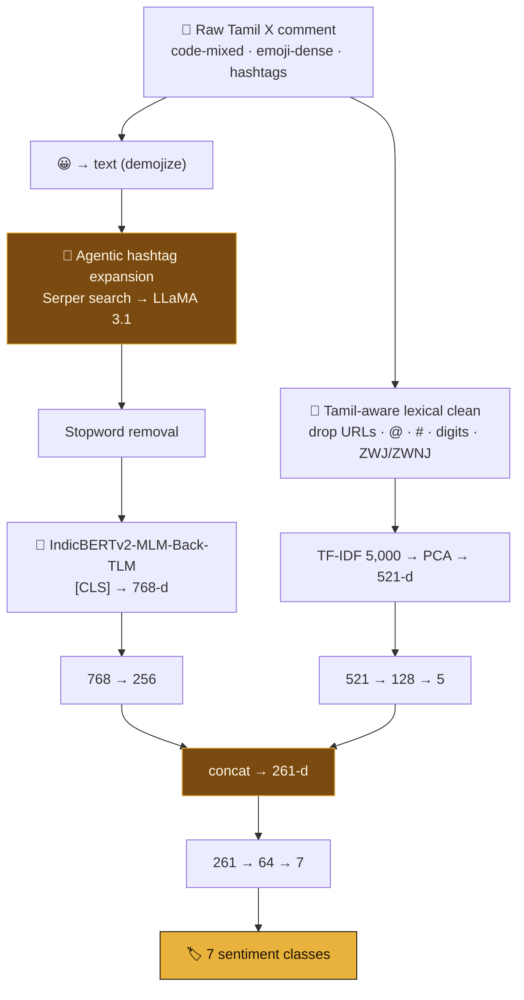

<div align="center">


<br/>


<a href="https://doi.org/10.18653/v1/2025.dravidianlangtech-1.122"></a>

<a href="https://portfolio-sigma-blond-57.vercel.app/work/dravidian-sentiment"></a>

</div>


<details>
<summary><b>📑 Table of contents</b></summary>

- [📌 Overview](#-overview)
- [🧩 Why it's hard](#-why-its-hard)
- [✨ Highlights](#-highlights)
- [🧠 Architecture](#-architecture)
- [🏆 Results](#-results)
- [🔬 Under the hood](#-under-the-hood)
- [🚀 Getting started](#-getting-started)
- [📂 Project structure](#-project-structure)
- [📄 Citation](#-citation)
- [🧭 Honest notes](#-honest-notes)

</details>

## 📌 Overview

The **DravidianLangTech @ NAACL 2025** shared task: give one of seven labels — *Substantiated,
Sarcastic, Opinionated, Positive, Negative, Neutral, None of the above* — to political comments
from Tamil X (Twitter).

Team **Synapse** fused **IndicBERTv2** embeddings with a deliberately narrow **TF-IDF** channel,
and used a **retrieval-augmented agent** to turn opaque hashtags into readable phrases.
It placed **first of 25 submitting teams** (139 registered).

## 🧩 Why it's hard

| Challenge | What it means in practice |
|---|---|
| 🔀 **Classes overlap** | A sarcastic comment is also opinionated — so 0.38 macro-F1 *wins* here |
| ⚖️ **Severe imbalance** | 1,361 *Opinionated* vs 171 *None of the above* — **8× gap**, equal weight in macro-F1 |
| 🌐 **Low-resource, code-mixed** | Tamil and English switch mid-sentence; rare political words get shredded |
| #️⃣ **Hashtags carry the politics** | `#DMKFailsTN` is a full position — to a tokenizer it's `##MKF` `##ails` |

<details>
<summary><b>📊 Full label distribution (4,352 training rows)</b></summary>

| Label | Count | Share |
|---|---:|---:|
| Opinionated | 1,361 | 31.3% |
| Sarcastic | 790 | 18.2% |
| Neutral | 637 | 14.6% |
| Positive | 575 | 13.2% |
| Substantiated | 412 | 9.5% |
| Negative | 406 | 9.3% |
| None of the above | 171 | **3.9%** |

</details>

## ✨ Highlights

<table>
<tr>
<td width="50%" valign="top">

### 🔎 An agent, not a lookup table
Each hashtag is **searched live (Serper)**, and LLaMA 3.1 summarises the *retrieved evidence* in
one line — so `#Mike_VoiceOfPeople` becomes a fact about the 2024 election, not a guess.

</td>
<td width="50%" valign="top">

### ✂️ Branches disagree on purpose
The dense branch **keeps** the expanded hashtags; the TF-IDF branch **strips** them — so lexical
features catch rare vocabulary instead of campaign topics.

</td>
</tr>
<tr>
<td valign="top">

### 🗜️ A 5-dimension bottleneck
TF-IDF is squeezed **521 → 128 → 5** before it meets BERT's 256 — it contributes a summary,
not a lookup key the head can memorise.

</td>
<td valign="top">

### 🧪 Checkpoint chosen by ablation
Four IndicBERTv2 variants trained end-to-end. **Back-TLM beats plain MLM by 9.3 points** —
every notebook is committed.

</td>
</tr>
</table>

## 🧠 Architecture



<details>
<summary><b>🖼️ Original workflow and model diagrams</b></summary>

<p align="center">
  
  <br/><br/>
  
</p>

</details>

## 🏆 Results

**Official test leaderboard — 25 submitting teams, 139 registrants**

| Rank | Team | Macro-F1 |
|:---:|---|:---:|
| 🥇 | **Synapse (ours)** | **0.3773** |
| 🥈 | KCRL | 0.3710 |
| 🥉 | byteSizedLLM | 0.3497 |
| 4 | Eureka-CIOL | 0.3187 |
| 5 | Wictory | 0.3115 |

**Encoder ablation (dev set)**

| Variant | Macro-F1 |
|---|:---:|
| ✅ **IndicBERTv2-MLM-Back-TLM** | **0.383** |
| IndicBERTv2-MLM-Sam-TLM | 0.376 |
| IndicBERTv2-SS | 0.338 |
| IndicBERTv2-MLM-only | 0.290 |

## 🔬 Under the hood

<details>
<summary><b>🔎 Retrieval-augmented hashtag expansion</b></summary>

```python
search_query = f"{hashtag} Tamil politics meaning context"
search_results = self.search_serper(search_query)      # live Google results, top 3
context = " ".join(r.get('snippet', '') for r in search_results)
# ...then LLaMA 3.1 summarises the retrieved context under strict rules
```

The prompt rules: *one line only · expand Tamil words · add a person's role · tag parties as
"(Political Party)" · 10–12 words max.* The result is baked into `pre_processing.ipynb`, so
inference needs no network:

```python
hashtag_map = {
    "#DMKFailsTN": "Dravida Munnetra Kazhagam fails Tamil Nadu",
    "#NTK":        "Naam Tamilar Katchi (Political Party)",
    "#MKStalin":   "MK Stalin, Chief Minister of Tamil Nadu",
    "#த":          "Tamil (Short form for Tamil-related content)",
}
```

Single-character Tamil hashtags (`#த`, `#மக`, `#ச`) are opaque to every tokenizer — the agent
recovers them.

</details>

<details>
<summary><b>🗜️ The fusion head</b></summary>

```python
self.tfidf_fc1 = nn.Linear(tfidf_dim, 128)   # 521 → 128
self.tfidf_fc2 = nn.Linear(128, 5)           # 128 → 5   ← five dimensions
self.bert_fc   = nn.Linear(768, 256)         # 768 → 256
self.combined_fc = nn.Linear(256 + 5, 64)
```

With 4,352 rows and a 521-d sparse vector, an unconstrained head memorises the training set
through TF-IDF and ignores the transformer. Five dimensions force a summary.

</details>

<details>
<summary><b>🔤 Unicode handling written for Tamil</b></summary>

```python
text = re.sub(r'[௦-௯0-9]', '', text)               # Tamil AND English digits
text = text.replace('‌', '').replace('‍', '')   # ZWNJ / ZWJ
text = re.sub(f'[{"।॥॰"}]', ' ', text)              # Indic punctuation
```

Zero-width joiners give one visible word two byte sequences — two TF-IDF features. Most
English-derived pipelines miss this.

</details>

<details>
<summary><b>⚖️ Imbalance: stepped batches + class weights</b></summary>

```python
for epoch in range(10):
    batch_size = 16 if epoch < 2 else 32 if epoch < 4 else 48 if epoch < 6 else 64
    train_dataloader = create_dataloaders(train_data, tokenizer, batch_size, seed=100 + epoch)

weights = {label: total_entries / class_counts[label] for label in class_counts}
loss_fn = nn.CrossEntropyLoss(weight=weights)
```

Small noisy batches early to escape the majority-class basin, large stable ones late to converge,
a fresh shuffle each epoch. *None of the above* gets ≈ 25× the loss weight of *Opinionated* —
chosen over resampling, which would only teach the model those 171 sentences.

</details>

<details>
<summary><b>⚙️ Training configuration</b></summary>

| Setting | Value |
|---|---|
| Encoder | `ai4bharat/IndicBERTv2-MLM-Back-TLM` |
| Max sequence length | 256 |
| Optimiser | AdamW, lr 2e-5 |
| Loss | Cross-entropy, inverse-frequency weights |
| Dropout | 0.1 on both branches |
| Epochs | 10 |
| Batch size | 16 → 32 → 48 → 64 |
| Seed | 164 |

</details>

## 🛠️ Tech stack

<p align="center">
  
  
  
  
</p>

## 🚀 Getting started

```bash
git clone https://github.com/Vishal-AS-0407/NAACL_DravidianLangTech_2025.git
cd NAACL_DravidianLangTech_2025
pip install -r requirements.txt
```

| Step | What | Output |
|:---:|---|---|
| 1️⃣ | `python Agent.py` *(optional — the map is committed)* | `hash_analyzed.xlsx` |
| 2️⃣ | Run `pre_processing.ipynb` → `TF_IDF_vectorization_PCA.ipynb` | `*_tfidf_reduced.csv` |
| 3️⃣ | Run `Synapse_model_training_using_IndicBERTv2_Back_TLM.ipynb` | predictions |

> 💡 **Tip:** `Agent.py` needs your own HuggingFace and Serper keys (placeholders ship in the
> file). The notebooks are Colab-shaped — change `/content/` paths to `data/` to run locally.

## 📂 Project structure

```
📦 NAACL_DravidianLangTech_2025
 ┣ 🐍 Agent.py                          hashtag expansion agent — Serper + LLaMA 3.1
 ┣ 📓 pre_processing.ipynb              emoji → text, hashtag map, stopwords, EDA
 ┣ 📓 TF_IDF_vectorization_PCA.ipynb    Tamil-aware clean → TF-IDF(5000) → PCA
 ┣ 📓 Synapse_..._Back_TLM.ipynb        ⭐ the submitted model
 ┣ 📓 Synapse_..._MLM_Sam_TLM.ipynb  ┓
 ┣ 📓 Synapse_..._SS.ipynb           ┣  the four-way ablation
 ┣ 📓 Synapse_..._MLM_only.ipynb     ┛
 ┣ 📂 data                              train 4,352 · dev 544 · test 544 (+ TF-IDF versions)
 ┗ 📄 Synapse_Tamil_run1.csv            the submitted predictions
```

## 📄 Citation

```bibtex
@inproceedings{synapse2025dravidianlangtech,
  title     = {Synapse@DravidianLangTech 2025: Multiclass Political Sentiment Analysis
               in Tamil X (Twitter) Comments: Leveraging Feature Fusion of IndicBERTv2
               and Lexical Representations},
  booktitle = {Proceedings of the Fifth Workshop on Speech, Vision, and Language
               Technologies for Dravidian Languages (DravidianLangTech)},
  series    = {NAACL 2025},
  pages     = {716--720},
  year      = {2025},
  publisher = {Association for Computational Linguistics},
  doi       = {10.18653/v1/2025.dravidianlangtech-1.122}
}
```

📎 [Paper on OpenReview](https://openreview.net/forum?id=3emk1VVVKQ)

## 🧭 Honest notes

<details>
<summary><b>Read before comparing numbers</b></summary>

- 👥 **Team work.** Submitted as team **Synapse**; this repo is a fork of the team repository.
- 📏 **0.3773 is the official test score**; 0.383 in the ablation is a *dev* score — the gap is
  not a discrepancy.
- 🔁 The training loop evaluates on the test set each epoch (normal for a leaderboard task), so
  per-epoch notebook numbers aren't a clean held-out estimate. The submitted run is what counts.
- 🐢 `Agent.py` sleeps 5 s between hashtags — a few hundred tags take a while.

</details>


<div align="center">

**📖 Read the full design story →** [portfolio · Muzhakkam](https://portfolio-sigma-blond-57.vercel.app/work/dravidian-sentiment)

<a href="https://www.linkedin.com/in/vishal-a-s04/"></a>
<a href="https://scholar.google.com/citations?user=fPK6EDAAAAAJ&hl=en"></a>
<a href="mailto:vishalpersonal04@gmail.com"></a>

⭐ **If this helped you, star the repo!**


</div>
