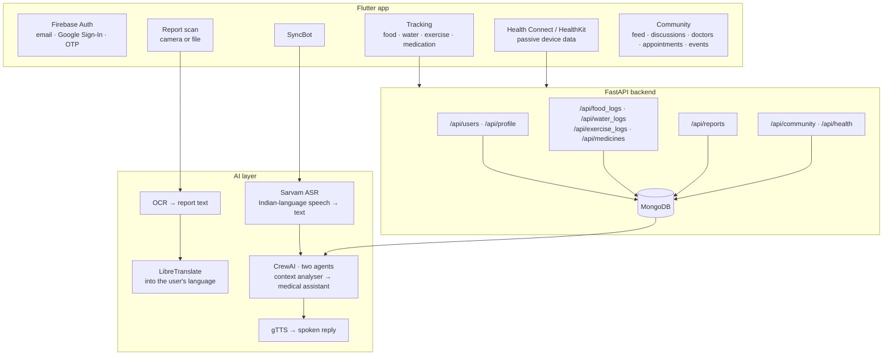

<h1 align="center">NurtureSync</h1>

<p align="center">
  <b>A health companion for people managing thyroid and diabetes —<br>
  built to be usable by someone who speaks Tamil, cannot read their own lab report,
  and is holding a phone in one hand.</b>
</p>

<p align="center">
  
  
  
  
  
  
</p>

<p align="center">
  <a href="https://www.youtube.com/watch?v=rx3fVMRsWhA">▶ Demo video</a>
</p>

---

## The problem

Thyroid and diabetes are **chronic** conditions, which means the clinical event is not the
diagnosis — it is the next four decades of daily decisions. What did I eat. Did I take the
medicine. How much did I move. What does this number on this piece of paper mean.

Three things break in the gap between a clinic and a kitchen, and they are the three this app is
built around:

**1 — The report is in a language the patient does not read.** A lab report is English, printed,
and full of reference ranges. In India that is a barrier for a very large number of the people who
need it most. The information is *in their hand* and still inaccessible.

**2 — Logging is the feature everybody builds and nobody uses.** Ask a person to open an app, tap
through four screens and type what they ate — every day, for thirty years — and the honest
completion rate approaches zero. The input method has to be as cheap as speaking.

**3 — Generic advice is worse than none.** "Eat healthy, exercise regularly" is what every health
app says and what no patient acts on. Advice is only actionable when it refers to *what this
person actually did yesterday*.

---

## What it does



---

## Novelty

### 1. Two agents, because context and answer are different jobs

`voiceassistant.py` runs a **sequential CrewAI crew of two**, and the split is the point:

```python
context_interpreter = Agent(
    role="Medical Context Analyzer",
    goal="Analyze patient's medical history, reports, and past interactions to provide "
         "comprehensive context for current query", ...)

medical_assistant = Agent(
    role="Medical Voice Assistant",
    goal="Provide personalized medical responses based on patient's history and current query", ...)
```

Agent one never answers the question. It reads the patient's logged food, exercise, medication and
report history and produces **a written statement of what is relevant right now**. Agent two
answers using that.

Handing an LLM a raw dump of six months of food logs plus a question gets an answer that ignores
the logs — the signal is buried. Making the retrieval-and-relevance step its own agent, with its
own output, means the context is *summarised and inspectable* before it becomes an answer.

### 2. The response prompt bans hedging — deliberately, and with an example

This is the most opinionated line in the repository, and it is worth reading closely:

> *"The output should be simple and crisp, that answers the user query. You should not use phrases
> like 'likely' and 'consult' and 'further information is needed'. For example, if the past user
> data contains that they ate cholesterol-rich food yesterday and today they have chest pain, you
> need to tell them that it is caused due to that and provide simple actionable insights like drink
> rasam or go for jogging etc."*

Two things are going on.

The **design argument** is strong: an assistant that answers every question with "this could be
many things, please consult a doctor" is not an assistant. It is a liability disclaimer with a
chat interface, and users stop opening it within a week. The instruction forces the model to
commit, and the worked example is a good piece of prompt engineering — it demonstrates the
*shape* of a wanted answer rather than describing it. "Drink rasam" is also culturally located in
a way that generic health advice never is, which is exactly the register a South Indian user will
act on.

The **risk** is equally real, and I would not ship this prompt unchanged: banning "consult"
outright removes the escalation path for the cases that need it. Chest pain is, unfortunately, the
example the prompt chose. The right version keeps the anti-hedging instruction for lifestyle
questions and carves out a hard escalation list for red-flag symptoms.

Worth stating plainly because the instinct behind it is right and the boundary needs drawing.

### 3. Ten Indian languages, with a wake word

```python
languages = {"Hindi": "hi", "Tamil": "ta", "Telugu": "te", "Kannada": "kn",
             "Malayalam": "ml", "Gujarati": "gu", "Marathi": "mr",
             "Bengali": "bn", "Punjabi": "pa", "English": "en"}
```

The full loop is **speak → understand → reason → reply in the same language, aloud**:

- **Sarvam** for ASR, chosen over Whisper because it is trained specifically on Indian languages
  and accents.
- **CrewAI in English**, so the reasoning happens where the models are strongest.
- **googletrans** back into the user's language, then **gTTS** to speak it.

And `assets/hey_dolly.ppn` is a **Porcupine custom wake-word model** — the app can be woken by
voice, hands-free. For a user who is cooking, or elderly, or has diabetic retinopathy, "hands-free
and eyes-free" is not a convenience feature. It is the difference between using the app and not.

### 4. Report OCR *and translation* as one flow

`report_service.dart` / `translation_service.dart` scan a printed lab report, extract the text, and
render it in the user's language. Not a summary — the report, readable.

This is the highest-leverage feature in the app and the least glamorous. It closes the gap between
"the patient physically possesses their results" and "the patient knows their results", which is
where an enormous amount of chronic-disease non-adherence actually lives.

### 5. Passive data, so the tracking burden falls

`health: ^12.0.1` wires up **Health Connect (Android) and HealthKit (iOS)**. Steps, heart rate and
sleep arrive without anybody logging anything. Manual logging is reserved for what a phone
genuinely cannot observe — meals, water, medication doses — and even those are voice-first.

Every gram of logging burden removed is retention, and retention is the entire game in a condition
measured in decades.

### 6. Community as a first-class feature, not a forum bolted on

Six screens — feed, discussions, posts, doctors, appointments, events — with their own backend
routes and models. Chronic illness is isolating, and adherence correlates with peer contact more
strongly than with app quality. Building appointments and a doctor directory into the same app as
the logs means the person arriving at a consultation brings their data with them.

### 7. A clean feature-first Flutter architecture

```
lib/
  core/            theme (colors, text styles) + shared widgets
  features/
    auth/          splash · login · signup · forgot password
    health_info/   onboarding · intro · congrats
    health_track/  screens/ + widgets/ + services/
    community/     feed · discussion · post · doctor · appointment · events
    chatbot/       syncbot.dart
  services/        firebase_auth_service · health_service
  config.dart      backend URL, injected at build time
```

Foldered by **feature**, not by type — so everything about medication tracking is in one place
rather than scattered across `screens/`, `models/` and `services/`. And the backend URL is a
compile-time environment value, not a constant:

```dart
const String backendUrl = String.fromEnvironment('BACKEND_URL',
                                                 defaultValue: 'http://127.0.0.1:5000');
```

The backend mirrors it: nine routers, nine model files, one concern each.

---

## Backend API

```
/api/users           /api/profile        /api/health
/api/food_logs       /api/water_logs     /api/exercise_logs
/api/medicines       /api/reports        /api/community
```

FastAPI + MongoDB, 1,800 lines across `routes/` and `models/`. Endpoint documentation is in
`documentation/API end points.pdf`.

## Datasets

`Datasets/` carries the corpora behind the personalised plans — diabetes prediction (India),
obesity prediction, sleep health and lifestyle, fitness tracker logs, drug side-effects
(drugs.com), fast-food and macro nutrition tables, weight change.

## Running it

**Backend**

```bash
cd backend
pip install -r requirements.txt
# create backend/.env with your own MONGO_URI
uvicorn main:app --host 0.0.0.0 --port 8000 --reload
```

**App**

```bash
flutter pub get
flutter run --dart-define=BACKEND_URL=http://<your-host>:8000
```

Firebase config (`google-services.json`, `firebase_options.dart`) must be regenerated for your own
project — see the security note.

**Voice assistant** (standalone Streamlit prototype)

```bash
pip install streamlit pyaudio requests gtts playsound googletrans crewai
python -m streamlit run voiceassistant.py
```

---

## 🔴 Security — this is the urgent one

This repository has **live credentials committed, including database access**. Please treat this
as the first task, ahead of anything else in this README.

| File | What is exposed | Action |
|---|---|---|
| `backend/.env` | **MongoDB connection string with username and password** | **Rotate the database password immediately.** This grants read/write to the whole health database. |
| `client_secret_683416806905-*.json` × 2 | **Google OAuth client secrets** | Delete both clients in Google Cloud Console → Credentials, create new ones |
| `android/app/google-services.json` | Firebase project config | Lower risk (it is designed to ship in the APK) — but confirm Firestore/Storage **security rules** are restrictive, because that file assumes they are |
| `voiceassistant.py` line 60 | Sarvam API subscription key | Revoke and reissue |
| `voiceassistant.py` line 82 | Google Gemini API key — **the same key also appears in the `WISP` repo** | Revoke once; it covers both |

Then:

```bash
printf '\nbackend/.env\nclient_secret_*.json\nandroid/app/google-services.json\n' >> .gitignore
git rm --cached backend/.env client_secret_*.json android/app/google-services.json
```

Deleting the files does **not** remove them from git history. Rotation is what actually protects
the accounts; the `.gitignore` change only prevents a repeat.

This matters more here than in the other repositories because the exposed credential is a database
holding **health data about identifiable people**.

---

## Honest notes

- **`allow_origins=["*"]` with `allow_credentials=True`** in `backend/main.py`. The comment already
  says *"Change this to specific origins in production"*. This combination is rejected by modern
  browsers and, where it is honoured, permits any site to make credentialed requests. Pin the
  origins.
- **`uvicorn.run(..., reload=True)` inside `if __name__ == "__main__"`** — the reloader needs an
  import string (`"main:app"`) rather than an app object, and will warn or fail. Run it via the
  `uvicorn` CLI as shown above.
- **The voice assistant is a separate Streamlit prototype**, not wired into the Flutter app. The
  in-app chatbot is `lib/features/chatbot/syncbot.dart`.
- **The README's tech stack listed LibreTranslate and Playwright web scraping**; the committed
  voice path uses Sarvam + googletrans + gTTS, and there is no Playwright in the repo. This rewrite
  describes the committed code.
- **Datasets are committed as zips** (~64 MB of repo). Fine, but it makes cloning slow; Git LFS or
  a download script would be kinder.
- **No tests.** `test/` exists and is effectively empty.
- **This is not a medical device.** It is a tracking and information tool. The prompt-hedging note
  above is the place where that boundary needs the most care.

---

## Recognition

Built at the **NASSCOM Foundation**, funded by **Cisco**. **Top 25 of 1,200+ teams**, ThingQbator
Cohort 7.

[Demo video](https://www.youtube.com/watch?v=rx3fVMRsWhA) ·
[Pitch deck](https://www.canva.com/design/DAGdmDG1jzk/Y0b2WRfXwRhKwlIj8OSAxg/view)
