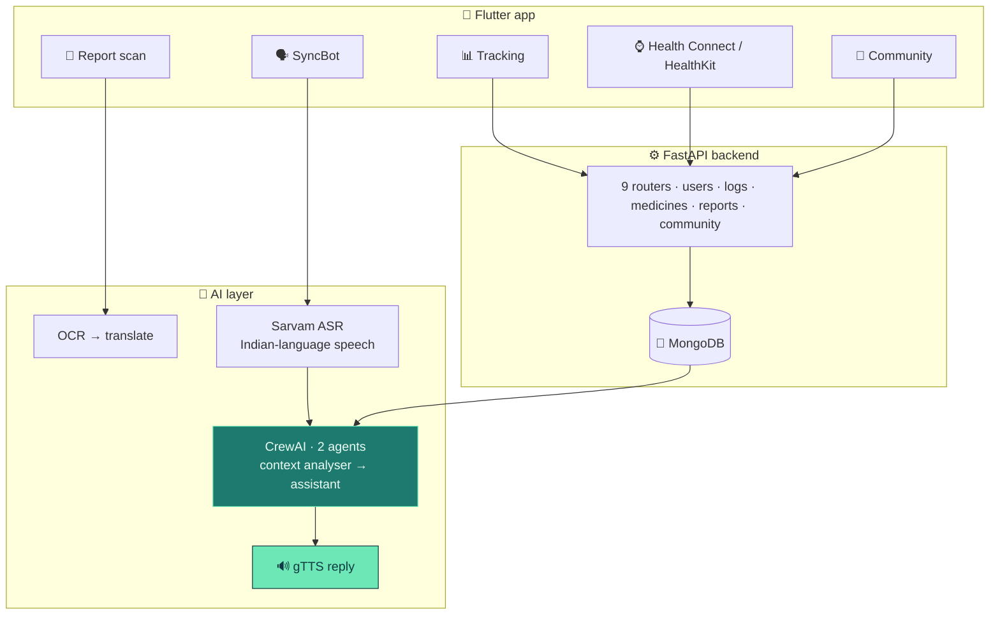

<div align="center">


<br/>


</div>


<div align="center">

### 🎬 Demo & pitch

<a href="https://www.youtube.com/watch?v=rx3fVMRsWhA"></a>
<a href="https://www.canva.com/design/DAGdmDG1jzk/Y0b2WRfXwRhKwlIj8OSAxg/view"></a>

</div>

<details>
<summary><b>📑 Table of contents</b></summary>

- [📌 Overview](#-overview)
- [✨ Features](#-features)
- [🧠 Architecture](#-architecture)
- [🔬 Under the hood](#-under-the-hood)
- [🔌 Backend API](#-backend-api)
- [🚀 Getting started](#-getting-started)
- [📂 Project structure](#-project-structure)
- [🧭 Notes & roadmap](#-notes--roadmap)

</details>

## 📌 Overview

Thyroid and diabetes are **chronic** — the clinical event isn't the diagnosis, it's the next four
decades of daily decisions. Three things break between the clinic and the kitchen:

| Gap | NurtureSync's answer |
|---|---|
| 📄 The lab report is in English and full of ranges | **Scan it** → read it in your own language |
| ✍️ Nobody logs meals in an app for thirty years | **Speak** it — and let Health Connect / HealthKit log the rest |
| 🗯️ "Eat healthy, exercise" — advice nobody acts on | Advice that refers to **what you actually did yesterday** |

> 🏆 Built at the **NASSCOM Foundation**, funded by **Cisco** — **Top 25 of 1,200+ teams**,
> ThingQbator Cohort 7.

## ✨ Features

<table>
<tr>
<td width="33%" valign="top">

### 🗣️ SyncBot
Speak in any of **10 Indian languages**, wake it with **"Hey Dolly"**, hear the reply aloud.

</td>
<td width="33%" valign="top">

### 📄 Report reader
OCR a printed lab report and translate it — the report itself, readable.

</td>
<td width="33%" valign="top">

### 📊 Tracking
Food · water · exercise · medication, plus passive steps, heart rate and sleep.

</td>
</tr>
<tr>
<td valign="top">

### 🤝 Community
Feed, discussions, doctor directory, appointments, events — six screens, own backend routes.

</td>
<td valign="top">

### 🔐 Sign-in
Firebase Auth — email, Google Sign-In, OTP.

</td>
<td valign="top">

### 🧾 Personal plans
Built on datasets for diabetes (India), obesity, sleep, fitness, drug side-effects, nutrition.

</td>
</tr>
</table>

## 🧠 Architecture



## 🔬 Under the hood

<details>
<summary><b>🤖 Two agents — context and answer are different jobs</b></summary>

```python
context_interpreter = Agent(
    role="Medical Context Analyzer",
    goal="Analyze patient's medical history, reports, and past interactions to provide "
         "comprehensive context for current query", ...)

medical_assistant = Agent(
    role="Medical Voice Assistant",
    goal="Provide personalized medical responses based on patient's history and current query", ...)
```

Agent one never answers. It reads six months of logs and writes **what's relevant right now**.
Agent two answers from that — so the context is summarised and inspectable, not buried.

</details>

<details>
<summary><b>💬 A prompt that bans hedging (and where that needs a boundary)</b></summary>

> *"You should not use phrases like 'likely' and 'consult'… if the past user data contains that
> they ate cholesterol-rich food yesterday… provide simple actionable insights like drink rasam
> or go for jogging."*

An assistant that answers everything with "please consult a doctor" stops being opened within a
week; the worked example shows the *shape* of a good answer, in a register a South Indian user
will act on. The next version keeps that for lifestyle questions and adds a hard escalation list
for red-flag symptoms.

</details>

<details>
<summary><b>🗣️ Ten languages and a wake word</b></summary>

```python
languages = {"Hindi": "hi", "Tamil": "ta", "Telugu": "te", "Kannada": "kn",
             "Malayalam": "ml", "Gujarati": "gu", "Marathi": "mr",
             "Bengali": "bn", "Punjabi": "pa", "English": "en"}
```

**Sarvam** ASR (trained on Indian accents) → reasoning in English → **googletrans** back →
**gTTS** aloud. `assets/hey_dolly.ppn` is a **Porcupine** custom wake word — hands-free and
eyes-free for someone cooking, elderly, or with diabetic retinopathy.

</details>

<details>
<summary><b>🧱 Feature-first Flutter layout</b></summary>

```
lib/
  core/            theme + shared widgets
  features/
    auth/          splash · login · signup · forgot password
    health_info/   onboarding · intro · congrats
    health_track/  screens/ + widgets/ + services/
    community/     feed · discussion · post · doctor · appointment · events
    chatbot/       syncbot.dart
  services/        firebase_auth_service · health_service
  config.dart      backend URL, injected at build time
```

```dart
const String backendUrl = String.fromEnvironment('BACKEND_URL',
                                                 defaultValue: 'http://127.0.0.1:5000');
```

</details>

## 🔌 Backend API

| Route | Purpose |
|---|---|
| `/api/users` · `/api/profile` | accounts and health profile |
| `/api/food_logs` · `/api/water_logs` · `/api/exercise_logs` | daily tracking |
| `/api/medicines` | medication schedule |
| `/api/reports` | scanned lab reports |
| `/api/community` · `/api/health` | community + device data |

FastAPI + MongoDB — full endpoint docs in `documentation/API end points.pdf`.

## 🛠️ Tech stack

<p align="center">
  
  <br/>
  
  
  
  
</p>

## 🚀 Getting started

```bash
# ⚙️ Backend
cd backend
pip install -r requirements.txt
echo "MONGO_URI=your-connection-string" > .env
uvicorn main:app --host 0.0.0.0 --port 8000 --reload

# 📱 App
flutter pub get
flutter run --dart-define=BACKEND_URL=http://<your-host>:8000

# 🗣️ Voice assistant prototype
pip install streamlit pyaudio requests gtts playsound googletrans crewai
python -m streamlit run voiceassistant.py
```

> 💡 **Tip:** regenerate Firebase config (`google-services.json`, `firebase_options.dart`) for
> your own Firebase project, and keep every key in environment variables.

## 📂 Project structure

```
📦 Nurture-Sync
 ┣ 📂 lib                    Flutter app, foldered by feature
 ┣ 📂 backend
 ┃ ┣ 🐍 main.py              FastAPI app
 ┃ ┣ 📂 routes               9 routers
 ┃ ┗ 📂 models               9 models
 ┣ 📂 assets                 icons, images, hey_dolly.ppn wake word
 ┣ 📂 Datasets               diabetes · obesity · sleep · fitness · drugs · nutrition
 ┣ 📂 documentation          API end points.pdf
 ┗ 🐍 voiceassistant.py      standalone Streamlit voice prototype
```

## 🧭 Notes & roadmap

<details>
<summary><b>Known gaps</b></summary>

- 🌐 CORS is `allow_origins=["*"]` with credentials — pin origins for production.
- 🔌 The voice assistant is a separate Streamlit prototype; the in-app bot is `syncbot.dart`.
- 📦 Datasets are committed as zips (~64 MB) — Git LFS would make cloning faster.
- 🧪 `test/` is empty.
- 🩺 A tracking and information tool, **not a medical device**.

**Roadmap**
- [ ] Wire the CrewAI voice loop into SyncBot
- [ ] Red-flag symptom escalation list
- [ ] Pin CORS origins
- [ ] Widget + API tests

</details>


<div align="center">

<a href="https://portfolio-sigma-blond-57.vercel.app"></a>
<a href="https://www.linkedin.com/in/vishal-a-s04/"></a>
<a href="https://github.com/Vishal-AS-0407"></a>
<a href="mailto:vishalpersonal04@gmail.com"></a>

⭐ **If this helped you, star the repo!**


</div>
