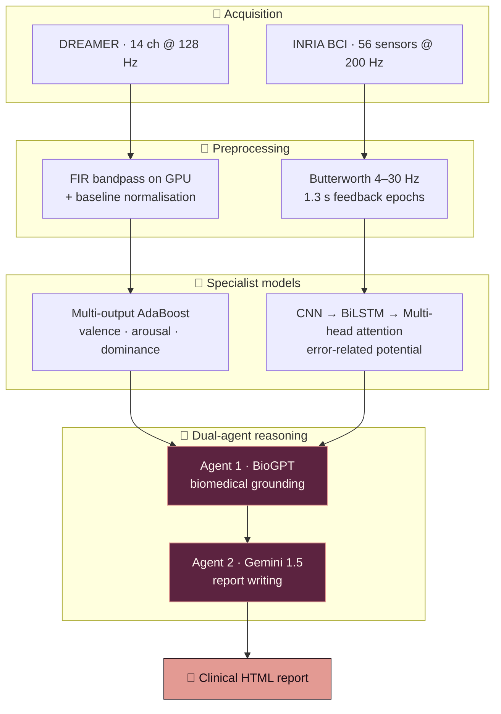

<div align="center">


<br/>

<a href="https://doi.org/10.1109/ICBSII65145.2025.11013139"></a>


<a href="https://portfolio-sigma-blond-57.vercel.app/work/eeg-emotion"></a>

</div>


<details>
<summary><b>📑 Table of contents</b></summary>

- [📌 Overview](#-overview)
- [✨ Highlights](#-highlights)
- [🧠 Architecture](#-architecture)
- [📊 Results](#-results)
- [🖼️ Outputs](#️-outputs)
- [🔬 Under the hood](#-under-the-hood)
- [🗂️ Datasets](#️-datasets)
- [🚀 Getting started](#-getting-started)
- [📂 Project structure](#-project-structure)
- [📄 Citation](#-citation)
- [🧭 Limitations & roadmap](#-limitations--roadmap)

</details>

## 📌 Overview

An EEG headset can say a lot about how someone is doing — but a classifier's output is a
**valence / arousal / dominance** triple and an **error-potential** flag. To the person wearing the
headset, `(0.82, 0.91, 0.31, ERP = 1)` means nothing.

This system closes that gap. Two specialist models read the brain signals, and a **dual-agent LLM
layer** reconciles them **in language** — producing a clinical-style report on emotional state,
cognitive load, rest, diet, and when to see a professional.

> 🏆 Published as *Single-Modality Emotion Detection: EEG-Based Feature Engineering and
> Interpretability* — **IEEE ICBSII 2025, Best Paper Award** (first author).

## ✨ Highlights

<table>
<tr>
<td width="50%" valign="top">

### 📐 Baseline-ratio features
Every feature is divided by the **same subject's resting baseline** — cancelling skull, electrode
and resting-rhythm differences so one model generalises across 23 people.

</td>
<td width="50%" valign="top">

### 🔢 Entropy, not just band power
Shannon and Rényi entropy beside θ / α / β power separate a *busy* signal from a *structured*
one — two states band power reports identically. **196 features per trial.**

</td>
</tr>
<tr>
<td valign="top">

### ⚡ Feature extraction on the GPU
Filtering, FFT, histograms and entropy written in **CuPy** — 5,796 filter-and-featurise passes
become a coffee break, and the same path serves live acquisition.

</td>
<td valign="top">

### 🤝 Two LLM agents, two jobs
**BioGPT** grounds the numbers in biomedical literature; **Gemini** writes the report — told that
its grounding is *evidence, not scripture*.

</td>
</tr>
</table>

## 🧠 Architecture



> 🧩 **The two branches are never fused at the tensor level.** A 14-channel emotion recording and a
> 56-sensor error-potential recording are not commensurable — so each model stays expert at its own
> job, and their outputs meet at the report layer, where the reasoning is written in sentences you
> can read and check.

## 📊 Results

| Metric | Value |
|---|:---:|
| 😊 Valence accuracy | **98.6%** |
| 🔥 Arousal accuracy | **96.6%** |
| 🦁 Dominance accuracy | **95.7%** |
| ⚡ Inference latency | **9.78 ms** |
| 📡 Input | 14 channels @ 128 Hz |

Sub-10 ms is the difference between a system that runs **continuously against a live headset** and
one that only works in batch after the fact.

## 🖼️ Outputs

<div align="center">

**Overall pipeline**


**Generated reports**


</div>

## 🔬 Under the hood

<details>
<summary><b>📐 Baseline-ratio feature extraction</b></summary>

```python
B = preprocessing_gpu(baseline, [])     # 14 features from the resting segment
S = preprocessing_gpu(stimulus, [])     # the same 14 from the stimulus
Extrod = safe_divide_cuda(np.array(S), np.array(B))
```

`safe_divide_cuda` falls back to the raw value where the baseline is zero, so a dead channel
degrades gracefully instead of producing infinities.

| Group | Features (per channel) |
|---|---|
| Spectral | peak PSD in θ (4–8 Hz), α (8–13 Hz), β (13–30 Hz) |
| Statistical | mean, variance, std, RMS, max / min amplitude, kurtosis, skewness |
| Ratio | β power as a fraction of θ + α + β |
| Information-theoretic | **Shannon entropy, Rényi entropy (α = 2)** |

</details>

<details>
<summary><b>🎯 VAD as one multi-output problem</b></summary>

```python
MultiOutputClassifier(
    AdaBoostClassifier(n_estimators=165, learning_rate=0.5, algorithm='SAMME.R'))
```

Valence, arousal and dominance are predicted **jointly**, so they stay psychologically consistent
instead of drifting into a combination no human has ever been in.

</details>

<details>
<summary><b>🧬 The error-potential network</b></summary>

```
Conv1d 14→64 → Conv1d 64→128 → Conv1d 128→256     learn the waveform's shape
        ↓
BiLSTM 256→64 · 3 layers · dropout 0.7            both directions of the time course
        ↓
MultiheadAttention · 128 dim · 8 heads            which moment in 1.3 s mattered
        ↓
Linear 128→1
```

AdamW (1e-3, wd 1e-5) · `BCEWithLogitsLoss` · cosine annealing to 1e-6 over 50 epochs ·
gradient accumulation ×4 · mixed precision — an effective batch of 128 on a consumer GPU.
14 of the 56 BCI sensors are kept (fronto-central sites, where error negativity appears), matching
DREAMER's input width.

</details>

<details>
<summary><b>🤖 The safety line in the agent prompt</b></summary>

BioGPT runs with 5-beam search, `no_repeat_ngram_size=3` and repetition penalty 1.3. Its output is
handed to Gemini with an explicit warning:

> *"there may be some noise and unwanted data in this and also some of the context may be missing
> so use this as reference"*

That line stops a literature model's hallucination from being laundered into something that reads
like a clinical finding.

</details>

## 🗂️ Datasets

| Dataset | What it gives | Link |
|---|---|---|
| 🎬 **DREAMER** | 23 subjects × 18 clips, 14-ch EEG @ 128 Hz, self-rated VAD + baseline | [Zenodo](https://zenodo.org/record/546113) |
| 🧪 **INRIA BCI Challenge** | 56 sensors @ 200 Hz, feedback events labelled correct / error | [Kaggle](https://www.kaggle.com/c/inria-bci-challenge) |

## 🛠️ Tech stack

<p align="center">
  
  
  
  
  
</p>

## 🚀 Getting started

```bash
git clone https://github.com/Vishal-AS-0407/Patient-Mental-Health-Monitoring-Using-EEG.git
cd Patient-Mental-Health-Monitoring-Using-EEG
pip install numpy pandas scipy scikit-learn joblib torch cupy-cuda12x transformers google-generativeai
```

| Step | Command | Produces |
|:---:|---|---|
| 1️⃣ Preprocess | `python Dreamer/dreamerpre.py` · `python BCI/bcipre.py` | `Dreamer1.csv`, `epochs.npy` |
| 2️⃣ Train | `python Dreamer/drtrain.py` · `python BCI/bcitrain.py` | `.pkl`, `model.pth` |
| 3️⃣ Report | `python LLM/Biogpt.py` → `LLM/gemini.py` → `LLM/htmlgen.py` | `generated_report.html` |

> 💡 **Tip:** no GPU? Swap `cupy` for `numpy` in the DREAMER preprocessing. Put your own Gemini key
> in `LLM/gemini.py` (it ships as `"Your Key"`). The committed `requirements.txt` is a full machine
> freeze — the line above is all this project needs.

## 📂 Project structure

```
📦 Patient-Mental-Health-Monitoring-Using-EEG
 ┣ 📂 Dreamer
 ┃ ┣ 🐍 dreamerpre.py      GPU feature extraction → 196 features / trial
 ┃ ┣ 🐍 drtrain.py         multi-output AdaBoost over VAD
 ┃ ┗ 🐍 testdr.py          single-sample prediction
 ┣ 📂 BCI
 ┃ ┣ 🐍 bcipre.py          channel selection, 4–30 Hz filter, 1.3 s epochs
 ┃ ┣ 🐍 bcitrain.py        CNN–BiLSTM–attention: train + evaluate
 ┃ ┗ 🐍 bcitest.py         inference
 ┣ 📂 LLM
 ┃ ┣ 🐍 Biogpt.py          agent 1 — biomedical grounding
 ┃ ┣ 🐍 gemini.py          agent 2 — report generation
 ┃ ┗ 🐍 htmlgen.py         report → styled HTML
 ┗ 📄 Report.pdf           a full worked example
```

## 📄 Citation

```bibtex
@inproceedings{vishal2025eeg,
  title     = {Single-Modality Emotion Detection: EEG-Based Feature Engineering and Interpretability},
  author    = {Vishal A S and others},
  booktitle = {2025 International Conference on Bio Signals, Images and Instrumentation (ICBSII)},
  pages     = {1--9},
  year      = {2025},
  publisher = {IEEE},
  doi       = {10.1109/ICBSII65145.2025.11013139},
  note      = {Best Paper Award}
}
```

## 🧭 Limitations & roadmap

<details>
<summary><b>Honest notes, and what comes next</b></summary>

- **The paper's numbers come from the published pipeline.** The committed DREAMER script is an
  earlier baseline that fits and scores on the same CSV — its printed accuracy is a training
  accuracy. The ERP branch uses a proper held-out 80/20 split.
- [ ] Add a held-out evaluation to `drtrain.py`.
- [ ] Wire both model outputs straight into `gemini.py` (it currently asks for them interactively).
- [ ] Trim `requirements.txt` to the packages above.
- [ ] Live headset streaming demo.

> 🩺 Research code that generates guidance text — not a medical device.

</details>


<div align="center">

**📖 Read the full design story →** [portfolio · Paper](https://portfolio-sigma-blond-57.vercel.app/work/eeg-emotion)

<a href="https://www.linkedin.com/in/vishal-a-s04/"></a>
<a href="https://scholar.google.com/citations?user=fPK6EDAAAAAJ&hl=en"></a>
<a href="mailto:vishalpersonal04@gmail.com"></a>

⭐ **If this helped you, star the repo!**


</div>
