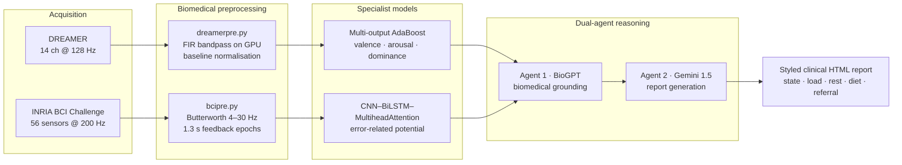

<h1 align="center">Patient Mental Health Monitoring Using EEG</h1>

<p align="center">
  <b>Single-modality emotion detection from EEG, and a dual-agent LLM layer that turns the numbers into a report a person can act on.</b>
</p>

<p align="center">
  <a href="https://doi.org/10.1109/ICBSII65145.2025.11013139"></a>
  
  
  
</p>

---

## The problem

An EEG headset can tell you a great deal about how someone is doing. The trouble is what comes
out the other end of a classifier: a **valence / arousal / dominance** triple and an
**error-related potential** flag. To the person wearing the headset, `(0.82, 0.91, 0.31, ERP=1)`
means nothing at all.

Three things make this hard:

1. **No single public dataset covers both emotion and error potentials.** The two that exist use
   incompatible rigs — DREAMER records 14 channels at 128 Hz; the INRIA BCI Challenge set records
   56 passive sensors at 200 Hz. Anything unified has to bridge two preprocessing regimes without
   pretending the two signals are the same kind of thing.
2. **Emotion is not three independent problems.** Valence, arousal and dominance are correlated
   for a given subject in a given moment. Three separately-trained binary classifiers will happily
   emit a combination that no human being has ever been in.
3. **The last mile is language, not machine learning.** A clinician wants a narrative. A student
   wants to know whether to keep studying. Neither wants a probability vector.

## What this does

Two specialist models, one per dataset, and a reasoning layer on top that reconciles them **in
language rather than in feature space**.



The key structural decision is that **the two branches are never fused at the tensor level.**
A 14-channel emotion recording and a 56-sensor error-potential recording are not commensurable,
and concatenating them would produce a model whose behaviour nobody could explain. Instead each
branch is trained to be good at its own job, and their outputs are correlated at the report layer
— where the cross-signal reasoning is written in sentences and can be read, checked and argued
with.

---

## Novelty

Six things here are not the standard EEG-emotion recipe.

### 1. Baseline-ratio features rather than raw features

`dreamerpre.py` does not extract features from the stimulus signal. It extracts the **same 14
features from the baseline segment and from the stimulus segment, and keeps the ratio**:

```python
B = preprocessing_gpu(baseline, [])     # 14 features
S = preprocessing_gpu(stimulus, [])     # the same 14
Extrod = safe_divide_cuda(np.array(S), np.array(B))
```

Every subject has a different skull, a different electrode impedance and a different resting
rhythm. Dividing through by that subject's own baseline removes most of it, which is what lets a
model trained across 23 subjects generalise at all. `safe_divide_cuda` falls back to the raw
stimulus value where the baseline is zero, so a dead channel degrades rather than producing
infinities.

### 2. Information-theoretic features alongside spectral ones

Most EEG pipelines stop at band power. This one computes, per channel:

| Group | Features |
|---|---|
| Spectral | peak PSD in θ (4–8 Hz), α (8–13 Hz), β (13–30 Hz) |
| Statistical | mean, variance, std. dev., RMS, max/min amplitude, kurtosis, skewness |
| Ratio | β-band power as a fraction of total θ+α+β power |
| **Information-theoretic** | **Shannon entropy, Rényi entropy (α = 2)** |

14 features × 14 channels = **196-dimensional** per-trial vector. The entropy terms are what
separate a signal that is *busy* from a signal that is *structured* — two states that band power
alone reports identically.

### 3. The whole feature extractor runs on the GPU

Filtering, FFT, histogramming and entropy are all written against **CuPy**, not NumPy:

```python
def signal_filter_gpu(signal_data, freq_range, fs=128):
    signal_cuda = cp.asarray(signal_data)
    h = signal.firwin(101, np.array(freq_range) / (fs / 2), window='hamming')
    return cp.convolve(signal_cuda, cp.asarray(h), mode='same')
```

The extraction loop runs 23 subjects × 18 clips × 14 channels = **5,796 filter-and-featurise
passes**. On the CPU this is the bottleneck of the whole project; on the GPU it is a coffee break.
This is also what makes the sub-10 ms inference figure in the paper reachable — the same code path
serves live acquisition.

### 4. VAD as one multi-output problem, not three classifiers

```python
multi_output_classifier = MultiOutputClassifier(
    AdaBoostClassifier(n_estimators=165, learning_rate=0.5, algorithm='SAMME.R')
)
```

Valence, arousal and dominance are predicted **jointly**, so the three dimensions stay internally
consistent for one subject rather than drifting apart into a combination that is psychologically
incoherent.

### 5. A CNN–BiLSTM–attention stack for the error potential

The ERP branch is deliberately deeper, because an error-related potential is a *temporal* event
and its shape matters:

```
Conv1d(14 → 64) → BN → ReLU
Conv1d(64 → 128) → BN → ReLU        three 1-D convolution blocks learn the waveform shape
Conv1d(128 → 256) → BN → ReLU
        ↓
BiLSTM(256 → 64, 3 layers, dropout 0.7)   both directions of the time course
        ↓
MultiheadAttention(embed 128, 8 heads)    which moment in the 1.3 s window actually mattered
        ↓
Linear(128 → 1)
```

Trained with AdamW (lr 1e-3, weight decay 1e-5), `BCEWithLogitsLoss`, cosine-annealed to 1e-6 over
50 epochs, batch 32, **gradient accumulation ×4** and **mixed-precision autocast** — so an
effective batch of 128 fits on a consumer GPU. Xavier init on the convolutions, Kaiming on the
LSTM. Evaluated on a held-out 20% split with accuracy, F1, ROC-AUC, precision and recall.

### 6. Two LLM agents with different jobs

This is the part that makes the system usable, and it is deliberately **two** agents, not one.

- **Agent 1 — grounding.** `Biogpt.py` runs `microsoft/biogpt`, a model pretrained on biomedical
  literature, over a structured prompt asking specifically how arousal, valence, dominance and
  error potentials interact. Beam search (5 beams), `no_repeat_ngram_size=3`, repetition penalty
  1.3, min 900 tokens — tuned to produce *substance* rather than a paragraph of hedging.
- **Agent 2 — generation.** `gemini.py` takes that grounding text **plus** the subject's own
  context (age, workplace, recent trauma, recent positive events) and writes the report.

The prompt hands the BioGPT output to Gemini with an explicit epistemic warning:

> *"there may be some noise and unwanted data in this and also some of the context may be missing
> so use this as reference"*

That single line is the safety architecture. The generation agent is told that its grounding is
**evidence, not scripture** — which is what stops a literature model's hallucination from being
laundered into something that reads like a clinical finding.

`htmlgen.py` renders the result as a styled HTML report covering emotional state, cognitive load,
rest and dietary guidance, and when to see a clinician. A rendered sample is committed at
`LLM/generated_report.html`.

---

## Results

Reported in the paper (**Single-Modality Emotion Detection: EEG-Based Feature Engineering and
Interpretability**, IEEE ICBSII 2025, pp. 1–9 — **Best Paper Award**, first author):

| Metric | Value |
|---|---|
| Valence accuracy | **98.6%** |
| Arousal accuracy | **96.6%** |
| Dominance accuracy | **95.7%** |
| Inference latency | **9.78 ms** |
| Input | 14 channels @ 128 Hz |

Sub-10 ms matters more than it looks: it is the difference between a system that can run
continuously against a live headset and one that can only be run in batch after the fact.

---

## Repository layout

```
Dreamer/
  dreamerpre.py    GPU feature extraction → Dreamer1.csv (196 features/trial)
  drtrain.py       multi-output AdaBoost over VAD → multi_label_ada_boost_model.pkl
  testdr.py        single-sample prediction from the saved model
BCI/
  bcipre.py        channel selection, 4–30 Hz Butterworth, 1.3 s epoching → epochs.npy
  bcitrain.py      CNN–BiLSTM–MultiheadAttention, train + evaluate + save
  bcitest.py       inference over the saved checkpoint
LLM/
  Biogpt.py        agent 1 — biomedical grounding      → biogpt.txt
  gemini.py        agent 2 — report generation         → geminioutput.txt
  htmlgen.py       report → styled HTML                → generated_report.html
Report.pdf         a full worked example of the output
```

Note on the BCI channel selection — `bcipre.py` keeps 14 of the 56 sensors:

```python
selected_channels = [3, 6, 8, 16, 24, 42, 54, 55, 50, 32, 22, 12, 14, 4]
```

This is not arbitrary: it takes the count down to DREAMER's 14 so the two branches share an input
width, and it concentrates on the fronto-central sites where the error-related negativity actually
appears.

---

## Datasets

| Dataset | What it gives | Where |
|---|---|---|
| **DREAMER** | 23 subjects × 18 audiovisual clips, 14-channel EEG @ 128 Hz, with self-rated valence / arousal / dominance and a matched baseline segment per clip | [Zenodo 546113](https://zenodo.org/record/546113) |
| **INRIA BCI Challenge** | 56 passive EEG sensors @ 200 Hz, feedback events labelled correct/incorrect (error-related potentials) | [Kaggle](https://www.kaggle.com/c/inria-bci-challenge) |

Neither is redistributed here. Download them yourself and place `DREAMER.mat` at the repo root and
the BCI CSVs under `train/`.

---

## Running it

```bash
git clone https://github.com/Vishal-AS-0407/Patient-Mental-Health-Monitoring-Using-EEG.git
cd Patient-Mental-Health-Monitoring-Using-EEG
pip install -r requirements.txt
```

> **Heads-up on `requirements.txt`.** The committed file is a full `pip freeze` of the development
> machine — 300+ packages, UTF-16 encoded, and it includes everything from `ultralytics` to
> `twilio`. It will install, but it installs an entire research environment. What this project
> actually needs is:
>
> ```
> numpy pandas scipy scikit-learn joblib
> torch torchaudio            # ERP branch
> cupy-cuda12x                # GPU feature extraction (falls back: swap cp → np)
> transformers                # BioGPT
> google-generativeai         # Gemini
> ```

**1 — Preprocess.** GPU required for the DREAMER path as written (`cp.cuda.Device(0).use()`);
substitute `numpy` for `cupy` throughout if you are on CPU.

```bash
python Dreamer/dreamerpre.py     # → Dreamer1.csv
python BCI/bcipre.py             # → epochs.npy, infos.npy
```

**2 — Train.**

```bash
python Dreamer/drtrain.py        # → multi_label_ada_boost_model.pkl
python BCI/bcitrain.py           # → model.pth, prints acc / F1 / AUC / P / R
```

**3 — Generate the report.** Put your Gemini key in `LLM/gemini.py` (it ships as the literal
string `"Your Key"` — replace it, and do not commit the real one).

```bash
python LLM/Biogpt.py             # → biogpt.txt
python LLM/gemini.py             # interactive: asks for VAD, ERP and personal context
python LLM/htmlgen.py            # → generated_report.html
```

---

## Honest notes

I would rather you know this before you read the code than after.

- **The repo is an artefact of the work, not a reproduction of the paper.** The accuracy and
  latency figures above come from the published IEEE version. The committed DREAMER branch is an
  earlier, simpler baseline: `drtrain.py` fits and scores on the *same* CSV with no held-out
  split, and `testdr.py` prints a prediction for one sample rather than an evaluation. **The
  accuracy it prints is a training accuracy and should not be quoted.**
- **The ERP branch is honest** — proper 80/20 split at seed 42, evaluated on the held-out portion.
- **`requirements.txt` is a machine dump.** See the box above.
- **`gemini.py` contains a placeholder API key** and reads its inputs interactively rather than
  from the model outputs. Wiring the two branches straight into it is the obvious next commit.
- **This is not a medical device.** It is research code that generates guidance text. The report
  ends at "consider consulting a professional" for a reason.

---

## Citation

```bibtex
@inproceedings{vishal2025eeg,
  title     = {Single-Modality Emotion Detection: EEG-Based Feature Engineering
               and Interpretability},
  author    = {Vishal A S and others},
  booktitle = {2025 International Conference on Bio Signals, Images and
               Instrumentation (ICBSII)},
  pages     = {1--9},
  year      = {2025},
  publisher = {IEEE},
  doi       = {10.1109/ICBSII65145.2025.11013139},
  note      = {Best Paper Award}
}
```

---

## Where this could go

Applications the design already supports, in rough order of how close they are:

- **Study and work scheduling** — cognitive load and mental readiness are exactly the signals that
  say "stop now" or "you have another hour in you".
- **Clinical triage support** — not a diagnosis, but a structured, timestamped record of state
  that a clinician can read in thirty seconds.
- **Performance coaching** — sport, therapy and rehabilitation all need the same loop: measure
  state, adjust load, measure again.

---

<p align="center">
  <sub>Full case study, with the design decisions written out:
  <a href="https://portfolio-sigma-blond-57.vercel.app/work/eeg-emotion">portfolio → EEG emotion detection</a></sub>
</p>
