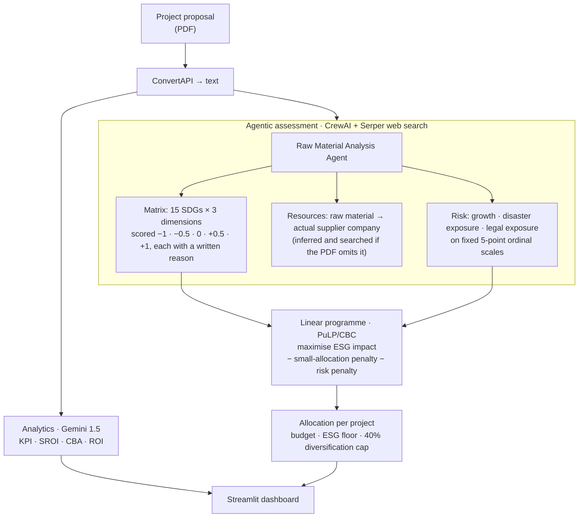

<h1 align="center">Qubit — Green Finance Optimisation</h1>

<p align="center">
  <b>Score a project proposal against all 15 Sustainable Development Goals across three dimensions,<br>
  then let a constrained optimiser decide where the money actually goes.</b>
</p>

<p align="center">
  
  
  
  
  
</p>

> **Prototype.** This repository holds the first-round implementation — part of a larger system
> built by team **QuBit**. It is committed as an artefact, not as a product.

---

## The problem

A bank has a green-finance mandate and a fixed pot of money. Twenty proposals arrive. Which ones
get funded, and how much each?

Everyone in the room has an opinion and nobody has a method. The two obvious approaches are both
wrong:

- **Rank by ESG score and fund top-down.** This concentrates the entire portfolio into two or
  three projects, which is unacceptable risk, and it treats "ESG" as one number when it is
  fifteen goals across three dimensions that routinely pull against each other. A solar plant
  scores brilliantly on *climate action* and badly on *reduced inequalities* if it displaces a
  village.
- **Split it evenly.** This funds projects that should not be funded, and underfunds the ones that
  should.

Underneath sits a harder problem: **where does the score come from?** A project proposal is a PDF.
Somebody has to read it, work out what raw materials it needs, find out who supplies them, judge
how those suppliers actually extract the material, and convert that into a defensible number for
each of fifteen goals. That is a week of analyst time per proposal, and it is why green finance
mandates get spent on whoever writes the most persuasive PDF.

## What this does



---

## Novelty

### 1. The 15 × 3 matrix — the assessment is a matrix, not a score

This is the idea the project is built on. Every proposal is scored on **all fifteen Sustainable
Development Goals named in the prompt**, across **three dimensions — ecological, economic,
social** — on a five-point scale:

| Score | Meaning |
|---:|---|
| **+1** | good |
| **+0.5** | partially good |
| **0** | neutral |
| **−0.5** | partially bad |
| **−1** | bad |

Forty-five cells per proposal. The scale is **signed**, which is the part that matters: a project
can *actively harm* a goal, and that harm is represented as a negative number rather than as a low
positive one. Collapsing to a single ESG figure lets a −1 on *clean water and sanitation* be
averaged away by a +1 on *climate action*. Keeping the matrix means the trade-off stays visible
right up to the moment a human decides.

Every cell also carries a **note** explaining the score, tied to the specific supplier company
that caused it. The output is auditable, not just numeric.

### 2. The scoring agent works backwards from raw materials to suppliers to extraction methods

The Raw Material Analysis Agent does not score the *proposal*. It scores the **supply chain the
proposal implies**, in a chain of inferences:

1. Extract the raw materials named in the PDF.
2. **If they are not named, infer them** from the business type.
3. Extract the suppliers.
4. **If suppliers are not named, search the web (Serper) for the best actual company** — the
   prompt insists: *"make sure that you always give a company name"*.
5. Search how *that company* extracts the material, and how eco-friendly the method is.
6. Score the 15 × 3 matrix on the basis of **the real extraction practice of the real supplier**.

That is the anti-greenwashing mechanism, and it is genuinely clever. A proposal author controls
every word of their PDF. They do not control what a search engine says about their lithium
supplier's tailings management. Forcing the score through an external, adversarially-obtained fact
about a named third party is what makes it hard to write your way to a good rating.

The fallback is honest too: where no information about a company exists, the agent scores the
*generic* extraction process for that material rather than defaulting to neutral.

### 3. Risk is captured on fixed ordinal scales, not free text

```
growth           → negative | no | low | high | very high growth
natural disaster → not prone | very rarely | rarely | frequently | very frequently
legal trouble    → not likely | very slight chances | slight chance | high chances | very high chances
```

An LLM asked "assess the risk" writes a paragraph. Constrained to one of five ordinal labels, it
produces something that can be **mapped to a number and fed into the optimiser**. Three separate
axes, because location risk (a flood plain) and regulatory risk (a contested mining licence) are
uncorrelated and a single "risk score" hides that.

The whole agent output is required as one nested JSON — `risk`, `resources`, `matrix` — so the
optimiser consumes structure rather than prose.

### 4. Allocation is an actual linear programme, not a ranking

`optimization.py` builds a real LP with PuLP and solves it with CBC:

**Objective**

```
maximise  Σ ESGᵢ · xᵢ  −  0.10 · Σ xᵢ  −  0.05 · Σ riskᵢ · xᵢ
```

Three terms doing three different jobs:

- `Σ ESGᵢ · xᵢ` — impact, the thing being bought.
- `−0.10 · Σ xᵢ` — a **flat penalty on every rupee deployed**. This is what makes the optimiser
  willing to *leave money unspent* rather than push it into a marginal project. Without it, the LP
  always spends the entire budget, because more capital is always more impact.
- `−0.05 · Σ riskᵢ · xᵢ` — risk priced **per rupee**, so risk scales with exposure. Putting 400 into
  a risk-7 project costs eight times as much penalty as putting 50 into it.

**Constraints**

| | |
|---|---|
| Total budget | `Σ xᵢ ≤ 1000` |
| Per-project bounds | `min_budgetᵢ ≤ xᵢ ≤ max_budgetᵢ` |
| Diversification | `xᵢ ≤ 0.4 · total` — no project takes more than 40% |
| **ESG floor** | `ESGᵢ < 0.7 ⟹ xᵢ = 0` |

The ESG floor is the one that makes this a *green* finance optimiser rather than a portfolio
optimiser. It is a **hard constraint, not a penalty term** — a project below 0.70 cannot be bought
at any price, however attractive its risk-return profile. That is a policy statement encoded in
the model, and encoding it as a constraint rather than a weight is the right call: weights can be
traded away, constraints cannot.

The diversification cap deserves the same note. Concentration risk is not something you want the
objective function negotiating over.

### 5. Four financial analyses, each with its own prompt

`analytics_service.py` runs four separate Gemini passes over the proposal text —
**KPI extraction**, **SROI** (social return on investment), **CBA** (cost–benefit), and **ROI**,
with the ROI prompt asking for the calculation rather than the raw numbers. Separate prompts
rather than one omnibus request, because a single prompt asked for four different analyses returns
four shallow ones.

`viz_kpi` and `viz_roi` specify an explicit output dictionary shape so the results can be charted;
`viz_sroi` and `viz_cba` are free-form.

---

## Repository layout

```
app.py                  Streamlit dashboard — KPI / SROI / CBA / ROI panels, plotly charts
crew/check.py           the Raw Material Analysis Agent (CrewAI + Serper + Gemini 1.5)
optimization.py         the linear programme, with a Tkinter front end
analytics_service.py    four Gemini analysis passes over the proposal text
conv.py                 PDF → text via ConvertAPI
final.py                multilingual support chat — speech (Sarvam) · OCR (EasyOCR) · Gemini
outputs.ipynb           captured runs
PROPOSAL.pdf            a sample proposal to feed the pipeline
logo.png
```

## Running it

```bash
git clone https://github.com/Vishal-AS-0407/Qubit-GreenFinance.git
cd Qubit-GreenFinance
pip install streamlit pandas plotly pillow numpy pulp \
            crewai crewai-tools google-generativeai python-dotenv \
            PyPDF2 easyocr pyaudio requests
```

Fill in the API keys — Gemini, Serper, ConvertAPI, Sarvam — then:

```bash
streamlit run app.py          # dashboard
python crew/check.py          # score a proposal → risk + resources + 15×3 matrix
python optimization.py        # Tkinter window: allocate across 20 projects
streamlit run final.py        # multilingual support chat
```

---

## ⚠️ Security

**`analytics_service.py` line 3 has a live Google Gemini API key hardcoded**, and the same key
appears commented out at `app.py` line 14. Both are in the public repository and in the git
history.

**Revoke it** at <https://aistudio.google.com/app/apikey>, then read it from the environment:

```python
import os
genai.configure(api_key=os.environ["GEMINI_API_KEY"])
```

The other key slots (`conv.py`, `final.py`, `crew/check.py`) are empty strings and are fine.

---

## Honest notes

### The LP as committed is infeasible — and the fix is small

`optimization.py` will always print `Status: Infeasible`. I confirmed this by extracting the model
and solving it headlessly across several random seeds; every one is infeasible, for a reason that
is arithmetic rather than subtle:

```python
min_budgets  = np.random.randint(100, 200, size=20)   # sums to ~2,700–2,900
total_budget = 1000
...
problem += investment[i] >= max(min_budgets[i], min_investment_threshold)   # unconditional
```

The minimum-budget constraint is applied to **every** project unconditionally, so the LP is
required to spend ~2,800 out of a budget of 1,000. It also directly contradicts the ESG floor:
a project with `ESG < 0.7` is simultaneously constrained to `== 0` and to `>= 100`.

The cause is a modelling one, and it is the classic **fixed-charge / semi-continuous** situation:
"if we fund this project at all, fund it at least `min_budget`" is not a linear constraint. It
needs a binary selector, which makes the model a MILP:

```python
sel = {i: LpVariable(f"sel_{i}", cat="Binary") for i in range(n)}

for i in range(n):
    cap = min(max_budgets[i], diversification_factor * total_budget)
    problem += investment[i] >= max(min_budgets[i], min_investment_threshold) * sel[i]
    problem += investment[i] <= cap * sel[i]
    if ESG_scores[i] < min_esg_threshold:
        problem += sel[i] == 0          # not funded, rather than "funded at zero"
```

With that change the same instance solves to **Optimal**, funding 3 of 20 projects for the full
1,000 — two at the 400 diversification cap and one at 201, with 3 projects excluded outright by
the ESG floor. That is exactly the behaviour the design intends, and it is a ~6-line diff.

### Everything else

- **The data is randomly generated.** `optimization.py` synthesises 20 projects with
  `np.random.uniform` / `np.random.randint` each run, and no seed is set — so every click of "Run
  Optimization" is a different problem. It demonstrates the formulation; it is not connected to the
  agent's real matrix output.
- **The optimiser is not wired to the scorer.** `crew/check.py` produces the 15 × 3 matrix and
  `optimization.py` consumes ESG scores, but nothing joins them. Collapsing the matrix into a
  per-project scalar (or, better, keeping the 15 goals as 15 objective terms and solving it as a
  multi-objective programme) is the natural next step and the most interesting one available here.
- **`optimization.py` is a Tkinter desktop app** while everything else is Streamlit. It will not
  run headless or in a container.
- **Only one of the described agents is committed.** The earlier README documented
  `crew/agents/document_processor.py`, `esg_analyzer.py`, `risk_assessor.py` and
  `workflows/analysis_workflow.py`; what exists is a single agent in `crew/check.py`. The README
  also listed TensorFlow, PyTorch, Neo4j, Pinecone, Firebase, FastAPI and Tavily in the stack —
  none of them appear in the committed code. This rewrite describes what is actually here.
- **There is no `requirements.txt`** and no `LICENSE`, despite both being referenced.
- **This is a first-round prototype from a hackathon**, and reads like one. The ideas — the signed
  15 × 3 matrix, supplier-level greenwashing resistance, an ESG floor as a hard constraint — are
  the valuable part.

---

<p align="center">
  <sub>Full case study, with the design decisions written out:
  <a href="https://portfolio-sigma-blond-57.vercel.app/work/qubit-green-finance">portfolio → Qubit green finance</a></sub>
</p>
