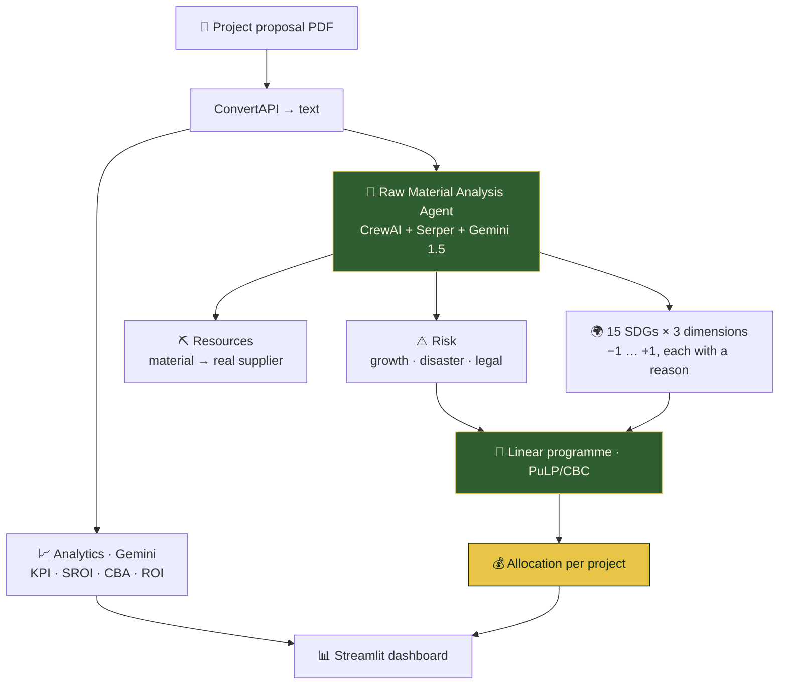

<div align="center">


<br/>


<a href="https://portfolio-sigma-blond-57.vercel.app/work/qubit-green-finance"></a>

<br/><br/>


</div>


<details>
<summary><b>📑 Table of contents</b></summary>

- [📌 Overview](#-overview)
- [✨ Highlights](#-highlights)
- [🧠 Architecture](#-architecture)
- [🌍 The 15 × 3 matrix](#-the-15--3-matrix)
- [🧮 The optimiser](#-the-optimiser)
- [🖼️ Outputs](#️-outputs)
- [🚀 Getting started](#-getting-started)
- [📂 Project structure](#-project-structure)
- [🧭 Honest notes & roadmap](#-honest-notes--roadmap)

</details>

## 📌 Overview

A bank has a green-finance mandate, a fixed pot of money, and twenty proposals. **Which get
funded, and how much?**

| Obvious approach | Why it fails |
|---|---|
| 🏅 Rank by ESG score, fund top-down | Concentrates everything in 2–3 projects; hides that goals pull against each other |
| ➗ Split evenly | Funds what shouldn't be funded, underfunds what should |
| 📄 Trust the proposal PDF | Green money goes to whoever writes the most persuasive PDF |

**Qubit** reads the proposal, follows its supply chain to the **real supplier**, scores the
result on all 15 SDGs × 3 dimensions, and hands the matrix to a **constrained linear programme**
that decides the allocation.

> 🧪 **Prototype** — the first-round implementation from team **QuBit**, committed as an artefact.

## ✨ Highlights

<table>
<tr>
<td width="50%" valign="top">

### ➖ Harm is negative, not low
Scores run **−1 to +1**. A −1 on clean water can't be averaged away by a +1 on climate — the
trade-off stays visible until a human decides.

</td>
<td width="50%" valign="top">

### 🔎 Anti-greenwashing by design
The agent scores **how the named supplier actually extracts the material**, found by web search —
a fact the proposal author doesn't control.

</td>
</tr>
<tr>
<td valign="top">

### 📏 Risk on fixed ordinal scales
Growth, disaster and legal exposure, each one of five labels — so the LLM's answer becomes a
number the optimiser can use.

</td>
<td valign="top">

### 🚧 Policy as constraints
ESG floor 0.7 and a 40% diversification cap are **hard constraints**, not weights — weights can be
traded away, constraints can't.

</td>
</tr>
</table>

## 🧠 Architecture



## 🌍 The 15 × 3 matrix

Each proposal gets **45 cells** — 15 SDGs × ecological · economic · social — each with a written
note tying the score to a specific supplier.

| Score | Meaning |
|:---:|---|
| 🟢 **+1** | good |
| 🟩 **+0.5** | partially good |
| ⚪ **0** | neutral |
| 🟧 **−0.5** | partially bad |
| 🔴 **−1** | bad |

<details>
<summary><b>⛏️ How the agent reasons backwards through the supply chain</b></summary>

1. Extract the raw materials named in the PDF — **or infer them** from the business type.
2. Extract the suppliers — **or search for the best real company** (*"make sure that you always
   give a company name"*).
3. Search how **that company** extracts the material, and how eco-friendly the method is.
4. Score the matrix on that real practice. No info on the company? Score the generic process for
   that material — never default to neutral.

Risk uses fixed scales:

```
growth           → negative | no | low | high | very high growth
natural disaster → not prone | very rarely | rarely | frequently | very frequently
legal trouble    → not likely | very slight chances | slight chance | high chances | very high chances
```

The whole output is one nested JSON — `risk`, `resources`, `matrix`.

</details>

## 🧮 The optimiser

```
maximise  Σ ESGᵢ·xᵢ  −  0.10·Σ xᵢ  −  0.05·Σ riskᵢ·xᵢ
```

| Term | Job |
|---|---|
| `Σ ESGᵢ·xᵢ` | 🌱 impact — what's being bought |
| `−0.10·Σ xᵢ` | 💤 a flat cost per rupee — lets the optimiser **leave money unspent** |
| `−0.05·Σ riskᵢ·xᵢ` | ⚠️ risk priced per rupee — scales with exposure |

| Constraint | Rule |
|---|---|
| 💰 Budget | `Σ xᵢ ≤ 1000` |
| 📏 Bounds | `min_budgetᵢ ≤ xᵢ ≤ max_budgetᵢ` |
| 🧺 Diversification | `xᵢ ≤ 0.4 · total` |
| 🚫 **ESG floor** | `ESGᵢ < 0.7 ⟹ xᵢ = 0` |

Four separate Gemini passes add **KPI, SROI, CBA and ROI** analyses — one prompt each, because one
prompt asked for four analyses returns four shallow ones.

## 🖼️ Outputs

<div align="center">

<table>
<tr>
<td width="50%"></td>
<td width="50%"></td>
</tr>
<tr>
<td></td>
<td></td>
</tr>
</table>

<details>
<summary><b>🧮 Optimiser screens, formulas and system architecture</b></summary>
<br/>

<br/><br/>

<br/><br/>

</details>

</div>

## 🛠️ Tech stack

<p align="center">
  
  
  
  
  
  
</p>

## 🚀 Getting started

```bash
git clone https://github.com/Vishal-AS-0407/Qubit-GreenFinance.git
cd Qubit-GreenFinance
pip install streamlit pandas plotly pillow numpy pulp crewai crewai-tools \
            google-generativeai python-dotenv PyPDF2 easyocr pyaudio requests
```

| Run | Command |
|---|---|
| 📊 Dashboard | `streamlit run app.py` |
| 🤖 Score a proposal | `python crew/check.py` |
| 🧮 Allocate across 20 projects | `python optimization.py` |
| 💬 Multilingual support chat | `streamlit run final.py` |

> 💡 **Tip:** set `GEMINI_API_KEY`, `SERPER_API_KEY`, ConvertAPI and Sarvam keys in your
> environment. A sample `PROPOSAL.pdf` is included to feed the pipeline.

## 📂 Project structure

```
📦 Qubit-GreenFinance
 ┣ 🐍 app.py                  Streamlit dashboard — KPI / SROI / CBA / ROI
 ┣ 📂 crew
 ┃ ┗ 🐍 check.py              the Raw Material Analysis Agent
 ┣ 🐍 optimization.py         the linear programme (Tkinter front end)
 ┣ 🐍 analytics_service.py    four Gemini analysis passes
 ┣ 🐍 conv.py                 PDF → text
 ┣ 🐍 final.py                multilingual support chat
 ┣ 📓 outputs.ipynb           captured runs
 ┗ 📄 PROPOSAL.pdf            sample input
```

## 🧭 Honest notes & roadmap

<details>
<summary><b>The LP needs one fix — and it's small</b></summary>

As committed, `optimization.py` reports **Infeasible**: every one of 20 random projects gets a
100–200 minimum, which sums past the 1,000 budget, and clashes with the ESG floor's `== 0`.
"Fund it at least `min_budget` **if** we fund it" needs a binary selector (a MILP):

```python
sel = {i: LpVariable(f"sel_{i}", cat="Binary") for i in range(n)}
for i in range(n):
    cap = min(max_budgets[i], diversification_factor * total_budget)
    problem += investment[i] >= max(min_budgets[i], min_investment_threshold) * sel[i]
    problem += investment[i] <= cap * sel[i]
    if ESG_scores[i] < min_esg_threshold:
        problem += sel[i] == 0
```

With it the same instance solves **Optimal**: 3 of 20 projects funded for the full 1,000 (two at
the 400 cap), 3 excluded by the ESG floor.

- 🎲 Project data is randomly generated each run (no seed) — it demonstrates the formulation.
- 🔌 The optimiser isn't yet wired to the agent's matrix output.
- 🖥️ `optimization.py` is Tkinter; everything else is Streamlit.

**Roadmap**
- [ ] MILP selector fix
- [ ] Feed the 15 × 3 matrix into the optimiser (multi-objective)
- [ ] `requirements.txt` + env-based keys
- [ ] Move the optimiser into the Streamlit app

</details>


<div align="center">

**📖 Read the full design story →** [portfolio · Allocation](https://portfolio-sigma-blond-57.vercel.app/work/qubit-green-finance)

<a href="https://www.linkedin.com/in/vishal-a-s04/"></a>
<a href="https://github.com/Vishal-AS-0407"></a>
<a href="mailto:vishalpersonal04@gmail.com"></a>

⭐ **If this helped you, star the repo!**


</div>
