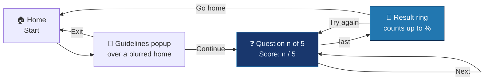

<div align="center">


<br/>


</div>


## 📌 What it is

A single-page quiz built together with Deepan — four states on one page, switched by toggling an
`active` class — plus a validated contact page.

<div align="center">
<table>
<tr>
<td align="center" width="33%"><b>🏠 Home</b><br/></td>
<td align="center" width="33%"><b>❓ Quiz</b><br/></td>
<td align="center" width="33%"><b>✉️ Contact</b><br/></td>
</tr>
</table>
</div>

## 🧠 Flow



## ✨ How it works

<table>
<tr>
<td width="33%" valign="top">

### 📦 Questions are data
`{ numb, question, options[4], answer }` — adding a question is adding an object.

</td>
<td width="33%" valign="top">

### 🟢 Feedback that teaches
A wrong pick turns red **and** the right one turns green; all options lock so the score can't be
farmed.

</td>
<td width="33%" valign="top">

### 🎯 A pure-CSS ring
`conic-gradient` stop = `percentage × 3.6deg`, stepped by `setInterval` — no SVG, no canvas.

</td>
</tr>
</table>

## 🚀 Getting started

No build step — open `Code Files/main.html` in a browser.

> 💡 **Tip:** it's static, so **GitHub Pages** (Settings → Pages → deploy from branch) gives it a
> live link in one step.

## 🧭 Known issues & roadmap

<details>
<summary><b>Fixes</b></summary>

- 📝 **Q4's key is wrong** — external stylesheets go in the **head**:
  ```js
  answer: "3. In the head section ",   // trailing space matches the option text
  ```
  Q5 (`var`) is contestable — "which keyword declares a variable that can't be reassigned?" →
  `const` has one right answer.
- 🖼️ Background image moved to `Images/` — point the CSS at `../Images/Back-Ground image.jpg`.
- 📄 `thankyou.html` was deleted — restore it (commit `714d6f9`) or confirm in place.
- 🔁 The ring can loop forever on non-multiples of 20 — round the target and compare with `>=`.
- 🏠 Go Home doesn't reset the header score.

**Roadmap**
- [ ] Answer-key fixes
- [ ] GitHub Pages deploy
- [ ] Question bank + shuffling

</details>


<div align="center">

<a href="https://portfolio-sigma-blond-57.vercel.app"></a>
<a href="https://www.linkedin.com/in/vishal-a-s04/"></a>
<a href="https://github.com/Vishal-AS-0407"></a>

⭐ **If this helped you, star the repo!**


</div>
