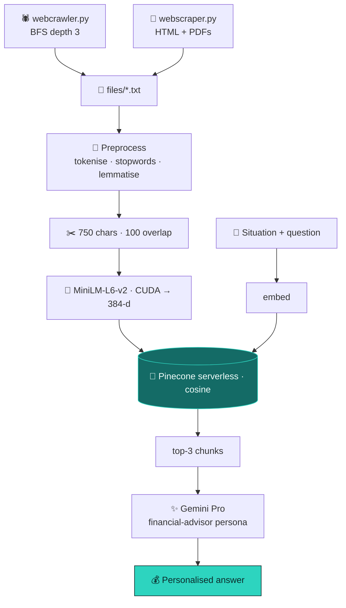

<div align="center">


<br/>


</div>


## 📌 Overview

Ask a general LLM how to save tax in India and you get fluent, confident advice — from whatever
year its training data was collected. Indian tax law moves every budget.

| Problem | Answer |
|---|---|
| 📚 **There's no dataset** — the rules live on government sites and PDF circulars | A **crawler + PDF scraper** builds the corpus |
| 🗓️ **Stale model knowledge** | Retrieval from **your crawled, current** documents |
| 🎯 **Generic advice is useless** | The query carries **income, persona and a 4-part structure** |

## ✨ Highlights

<table>
<tr>
<td width="50%" valign="top">

### 🕷️ The crawler is part of the system
Depth-limited BFS with a visited set (government sites loop), `urljoin` for relative links, and
**PDF download + extraction** — where the authoritative material actually lives.

</td>
<td width="50%" valign="top">

### ✂️ Chunks sized for atomic rules
750 chars / 100 overlap: one section, one limit, one condition per chunk — not three provisions
diluting one embedding.

</td>
</tr>
<tr>
<td valign="top">

### ⚙️ Production-minded vector layer
Idempotent index creation, cosine metric, batched upserts of 100, chunk text in metadata — one
round trip per query.

</td>
<td valign="top">

### 🔐 Keys from the environment
`PINECONE_API_KEY` and `GEMINI_API_KEY` via `os.getenv` — nothing committed.

</td>
</tr>
</table>

## 🧠 Architecture



## 🖼️ Output

<div align="center">

</div>

<details>
<summary><b>💬 The sample query</b></summary>

```
I am a middle-class man in India earning ₹1 lakh per month after tax.
Please act as a chartered accountant and provide the following:
1. Tips to improve my tax filing methods.
2. Suggestions on how to optimize the Indian tax system legally to save more.
3. Investment ideas for tax-saving and wealth growth, including mutual funds, real estate, or insurance.
4. Any other financial advice relevant to my income and tax situation.
```

Note *"legally"* — steering toward avoidance, not evasion.

</details>

## 🛠️ Tech stack

<p align="center">
  
  
  
  
</p>

## 🚀 Getting started

```bash
git clone https://github.com/Vishal-AS-0407/RAG-Based-Financial-Advisor-System-with-Pinecone-and-Gemini.git
cd RAG-Based-Financial-Advisor-System-with-Pinecone-and-Gemini
pip install -r requirements.txt
export PINECONE_API_KEY=...  GEMINI_API_KEY=...

python webcrawler.py     # 1️⃣ set start_url inside → files/*.txt
python webscraper.py     #    individual pages and PDFs
python main.py           # 2️⃣ chunk · embed · upsert · run the sample query
```

> 💡 **Tip:** no GPU? Change `device='cuda'` to `'cpu'`. Edit `query` at the bottom of `main.py` to
> ask your own question.

```
📦 RAG-Based-Financial-Advisor-System-with-Pinecone-and-Gemini
 ┣ 🐍 main.py           TextPreprocessor + RAGSystem
 ┣ 🕷️ webcrawler.py     depth-limited BFS crawl
 ┣ 📄 webscraper.py     page + PDF scraping
 ┗ 📄 requirements.txt
```

## 🧭 Notes & roadmap

<details>
<summary><b>What I'd change first</b></summary>

- 🔢 **Keep digits and brackets** — stripping them turns `80C` into `C`; in tax text the numbers
  *are* the content.
- 🔁 Preprocessing runs twice on documents and not at all on the query — pick one (likely none:
  sentence-transformers prefer natural text).
- 📏 `top_k=3` is tight for a four-part question; 5–8 is cheap.
- 🔗 Surface the chunk IDs as **citations** — they already flow through retrieval.
- 🤖 Update `gemini-pro` to a current model; add rate limiting and `robots.txt` checks to the crawler.

**Roadmap**
- [ ] Number-preserving preprocessing
- [ ] Source citations in answers
- [ ] Reranker
- [ ] Sample corpus for a one-command demo

> 💼 Not financial advice — only as current as the corpus you crawl.

</details>


<div align="center">

<a href="https://portfolio-sigma-blond-57.vercel.app"></a>
<a href="https://www.linkedin.com/in/vishal-a-s04/"></a>
<a href="https://github.com/Vishal-AS-0407"></a>

⭐ **If this helped you, star the repo!**


</div>
