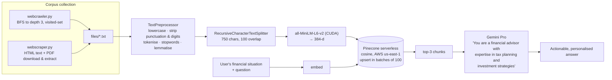

<h1 align="center">RAG Financial Advisor</h1>

<p align="center">
  <b>Retrieval-augmented tax and investment advice for the Indian context —<br>
  with the corpus collected by its own crawler, because the source material is on government websites, not in a dataset.</b>
</p>

<p align="center">
  
  
  
  
</p>

---

## The problem

Ask a general-purpose LLM how to save tax in India and you will get an answer that is fluent,
confident, and describing the rules as they were whenever its training data was collected. Indian
tax law changes every budget. Section 80C limits move. The new regime's slabs move. An assistant
that recites 2021's rules with 2025's confidence is worse than no assistant, because the user
cannot tell the difference.

Two harder problems sit underneath:

**1 — There is no dataset.** The authoritative material lives on incometaxindia.gov.in, on
scheme-specific pages, and in PDF circulars. Nobody has packaged it. Before you can build the
retrieval system you have to build the thing that collects the corpus.

**2 — Financial advice is only useful when it is specific.** "Invest in tax-saving instruments" is
not advice. "At ₹1 lakh a month post-tax, here is what 80C, 80D and NPS actually get you, and here
is what to do with the rest" is advice — and getting there needs the model to know both the rules
*and* the person's situation.

## What it does



---

## Novelty

### 1. The crawler is part of the system, not a preliminary

Most RAG projects begin with "assume you have documents". This one ships the collection layer:

```python
def crawl_and_scrape(url, folder_name, visited_urls, max_depth=3, current_depth=0):
    if url in visited_urls or current_depth > max_depth:
        return
    visited_urls.add(url)
    ...
    next_url = urljoin(url, next_url)      # resolve relative links properly
```

Depth-limited breadth-first crawl with a `visited_urls` set — the two things that stop a crawler
looping forever on a site with circular navigation, which government sites invariably have. Links
are resolved with `urljoin` rather than string concatenation, so relative hrefs, `../` paths and
protocol-relative URLs all work.

`webscraper.py` adds the piece that matters for this domain specifically: **PDF download and text
extraction**. Indian tax circulars, budget documents and scheme guidelines are published as PDFs.
A crawler that only reads HTML would miss the authoritative sources entirely and index only the
summary pages.

Recognising that the retrieval corpus has to be *built*, and building it, is the part of this
project that separates it from a tutorial.

### 2. Aggressive lexical preprocessing before embedding

```python
text = text.lower()
text = re.sub(r'[^\w\s]', '', text)      # punctuation
text = re.sub(r'\d+', '', text)          # digits
tokens = [w for w in nltk.word_tokenize(text) if w not in self.stop_words]
tokens = [self.lemmatizer.lemmatize(w) for w in tokens]
```

Lowercase, de-punctuate, de-digit, stopword-strip, lemmatise. This is a deliberate choice with a
real trade-off, and it is worth understanding both sides.

**For:** lemmatisation collapses `deduction`/`deductions`/`deducting` to one form, so a query about
"deducting" matches a document about "deductions" — and stopword removal densifies the chunk, so
750 characters carry more content words than they otherwise would. On a corpus of dry regulatory
prose, that helps.

**Against, and this is the important one:** stripping digits removes `80C`, `80D`, `10(14)`, the
slab thresholds and every rupee amount — which in tax documents is most of the information. See the
honest notes.

### 3. Chunk size tuned to the document type

```python
RecursiveCharacterTextSplitter(chunk_size=750, chunk_overlap=100)
```

750 characters is small for general RAG, and right here. Tax rules are **atomic**: one section, one
limit, one condition. A 2,000-character chunk would bundle three unrelated provisions and dilute
the embedding, so a query about 80C retrieves a chunk that is one-third about 80C. The 100-character
overlap (13%) is the standard insurance against a rule being severed mid-sentence at a boundary.

`RecursiveCharacterTextSplitter` also splits on paragraph → line → sentence → word in that order,
so it breaks at the most natural available boundary rather than at a fixed offset.

### 4. Sensible production choices in the vector layer

```python
self.pc.create_index(name=index_name, dimension=384, metric='cosine',
                     spec=ServerlessSpec(cloud='aws', region='us-east-1'))
```

- **`all-MiniLM-L6-v2`** — 384 dimensions, ~80 MB, runs on a laptop. A larger encoder would cost
  more per query for marginal gain on this kind of prose.
- **`device='cuda'`** — embedding a whole crawled corpus is the slow step; the GPU is where it
  belongs.
- **cosine similarity** — correct for sentence-transformer output, which is normalised.
- **serverless** — no idle cost between queries, which is what a personal advisory tool actually
  needs.
- **`create_index` checks `list_indexes().names()` first**, so re-running the script is idempotent
  rather than an error.
- **Batched upserts of 100** — Pinecone's request limit, handled rather than discovered.
- **Chunk text stored in `metadata`** alongside the vector, so retrieval returns readable text in
  one round trip with no second lookup against a document store.

### 5. The query carries the persona and the situation together

```
I am a middle-class man in India earning ₹1 lakh per month after tax.
Please act as a chartered accountant and provide the following:
1. Tips to improve my tax filing methods.
2. Suggestions on how to optimize the Indian tax system legally to save more.
3. Investment ideas for tax-saving and wealth growth, including mutual funds, real estate, or insurance.
4. Any other financial advice relevant to my income and tax situation.
```

Income bracket, country, professional persona, and a **four-part numbered structure** the answer
has to fill. The system prompt reinforces the role independently. Note *"legally"* — an explicit
constraint that steers the model toward avoidance rather than evasion, which is exactly the
distinction that matters in this domain and is easy to leave implicit.

---

## Repository layout

```
main.py           TextPreprocessor + RAGSystem — load, chunk, embed, upsert, retrieve, generate
webcrawler.py     depth-limited BFS crawl → files/*.txt
webscraper.py     single-page scrape + PDF download and text extraction
requirements.txt
files/            the crawled corpus (not committed — build it yourself)
```

## Running it

```bash
git clone https://github.com/Vishal-AS-0407/RAG-Based-Financial-Advisor-System-with-Pinecone-and-Gemini.git
cd RAG-Based-Financial-Advisor-System-with-Pinecone-and-Gemini
pip install -r requirements.txt

export PINECONE_API_KEY=...
export GEMINI_API_KEY=...
```

**1 — Build the corpus.**

```bash
python webcrawler.py     # set start_url inside; writes files/*.txt
python webscraper.py     # for individual pages and PDFs
```

**2 — Index and query.**

```bash
python main.py           # loads files/, chunks, embeds, upserts, then runs the sample query
```

Edit `query` at the bottom of `main.py` to ask your own. The embedding model wants a GPU
(`device='cuda'`); change it to `'cpu'` if you do not have one.

---

## Honest notes

**Keys are read from the environment** (`os.getenv`) — no credentials are committed. Good, and
worth saying since it is not true of every repo in this account.

- **Stripping digits is the one change I would make first.** `re.sub(r'\d+', '', text)` deletes
  `80C` → `C`, `₹1,50,000` → `₹`, `10(14)` → `()`. In tax documents the numbers *are* the content:
  section identifiers, limits, slab boundaries, percentages. A query about "section 80C" cannot
  match a chunk where 80C has become a bare `C`. Dropping that one line — and probably the
  punctuation strip too, since `80C(2)(a)` needs its brackets — would improve retrieval more than
  any other single edit here.

- **Preprocessing runs twice.** `load_documents` calls `self.preprocessor.preprocess(content)`, and
  then `prepare_embeddings` calls it again on the already-processed text. Harmless (the operations
  are idempotent) and wasted work.

- **The query is not preprocessed.** Documents are lemmatised and stopword-stripped; the query is
  embedded raw. That is an asymmetry between the two embedding spaces — the document vectors
  represent dense content-word text, the query vector represents natural English. Either
  preprocess both or neither. *(Neither is probably right, given the point above:
  sentence-transformers are trained on natural sentences and generally do better without lexical
  preprocessing at all.)*

- **`top_k=3` is tight.** Three 750-character chunks is ~2,250 characters of context for a
  four-part financial question. `top_k=5–8` costs almost nothing at these chunk sizes.

- **No reranking, no citations.** The retrieved chunks are concatenated with a space and handed to
  Gemini, and the answer does not say which source it came from. For financial advice, being able
  to point at the circular a claim came from is close to essential — and the chunk `id`
  (`filename_index`) is already carried through retrieval, so surfacing it is a small change.

- **`files/` is not committed**, so the repo cannot be run end to end without crawling first. A
  couple of sample documents would make it reproducible.

- **`gemini-pro` is a superseded model name.** Update to a current one.

- **Nothing rate-limits the crawler**, and `robots.txt` is not checked. Add a delay and a
  `robots.txt` check before pointing it at a live site.

- **This is not financial advice.** It is a retrieval system over documents you supply, and its
  output is only as current as the corpus you crawled.
