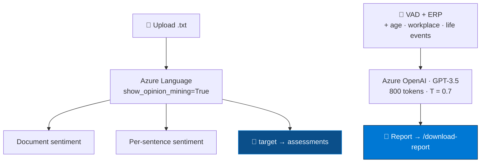

<div align="center">


<br/>


</div>


## 📌 Overview

Two tools behind one Flask app, both on **managed Azure AI** — nothing to train, nothing to serve:

| | Tool | What you get |
|:---:|---|---|
| 💬 | **Sentiment analysis** | document → sentence → **opinion mining** (which *target*, what's *said* about it) |
| 🧠 | **Mental health report** | VAD + ERP from EEG plus personal context → therapy and workload guidance |

The report tool is the report layer of the
[EEG project](https://github.com/Vishal-AS-0407/Patient-Mental-Health-Monitoring-Using-EEG),
rebuilt on Azure OpenAI with a web front end.

## 🧠 Architecture

<div align="center">

</div>



## ✨ Highlights

<table>
<tr>
<td width="50%" valign="top">

### 🎯 Opinion mining, switched on
*"The food was excellent but the service was slow"* is **mixed** overall — true and useless.
Mined: **food → positive**, **service → negative**. Actionable.

</td>
<td width="50%" valign="top">

### 🧾 A four-question report prompt
Impact of VAD/ERP → emotional & cognitive state → therapy referral → practical actions — so
recommendations follow from analysis.

</td>
</tr>
<tr>
<td valign="top">

### ☁️ Managed services by design
Azure Language, Azure OpenAI, Azure Web App — the value is in the workflow, not a custom model.

</td>
<td valign="top">

### 🔁 CI/CD from day one
`master_clouddeploycd.yml` — push to `master`, Actions builds and deploys.

</td>
</tr>
</table>

## 🖼️ Outputs

<div align="center">
<table>
<tr>
<td align="center" width="50%"><b>💬 Sentiment & opinions</b><br/></td>
<td align="center" width="50%"><b>🧠 Mental health report</b><br/></td>
</tr>
</table>
</div>

| Route | Method | Purpose |
|---|:---:|---|
| `/` | `GET` | landing |
| `/sentiment-analysis` | `GET` `POST` | upload → document / sentence / opinion results |
| `/mental-health` | `GET` `POST` | parameters + context → report |
| `/download-report/<filename>` | `GET` | download a report |

## 🛠️ Tech stack

<p align="center">
  
</p>

## 🚀 Getting started

```bash
git clone https://github.com/Vishal-AS-0407/Sentiment-Analysis-and-Mental-Health-Guidance-in-Azure.git
cd Sentiment-Analysis-and-Mental-Health-Guidance-in-Azure
pip install -r requirements.txt
python app.py
```

> 💡 **Tip:** you need an Azure **Language** resource and an **Azure OpenAI** deployment. On
> Azure Web Apps, put their keys and endpoints in **Application settings** and read them as
> environment variables.

```
📦 Sentiment-Analysis-and-Mental-Health-Guidance-in-Azure
 ┣ 🐍 app.py                  Flask · Azure Language + Azure OpenAI
 ┣ 📂 templates               landing · sentiment · mental health · results
 ┣ 📂 static/styles.css
 ┣ 📂 reports                 generated reports (one sample)
 ┗ ⚙️ .github/workflows       CD to Azure Web App
```

## 🧭 Notes & roadmap

<details>
<summary><b>Before a public deployment</b></summary>

- 🔑 Read Azure keys and Flask `secret_key` from environment variables.
- 🧩 Define `deployment_name` and move to `chat.completions.create` (the completions API is legacy).
- 📁 `secure_filename` + `MAX_CONTENT_LENGTH` on upload; constrain `/download-report` to `reports/`.
- 🔤 Open uploads with `encoding="utf-8"`.

> 🩺 Guidance text from parameters — a prompt for a conversation with a professional, not an
> assessment.

</details>


<div align="center">

<a href="https://portfolio-sigma-blond-57.vercel.app"></a>
<a href="https://www.linkedin.com/in/vishal-a-s04/"></a>
<a href="https://github.com/Vishal-AS-0407"></a>

⭐ **If this helped you, star the repo!**


</div>
