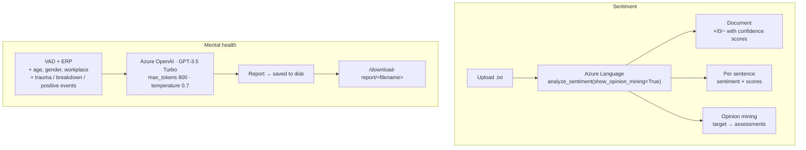

<h1 align="center">Sentiment Analysis &amp; Mental Health Guidance on Azure</h1>

<p align="center">
  <b>Aspect-based sentiment mining with Azure Language, and an EEG-parameter mental-health<br>
  report generator on Azure OpenAI — deployed through GitHub Actions to Azure Web Apps.</b>
</p>

<p align="center">
  
  
  
</p>

---

## What it does

Two tools behind one Flask app, both built on managed Azure AI services rather than on
self-hosted models.

**1 — Sentiment analysis** that goes past a single polarity label. Upload a document and get
document-level sentiment, then **per-sentence** sentiment, then **opinion mining**: which *target*
in the sentence the opinion is about and what is being *said* about it.

**2 — Mental health report generation.** Takes the psychological parameters from EEG analysis —
valence, arousal, dominance and an error-related-potential flag — plus the person's own context,
and produces a readable report with therapy and workload recommendations. This is the report layer
of the [EEG project](https://github.com/Vishal-AS-0407/Patient-Mental-Health-Monitoring-Using-EEG),
rebuilt on Azure OpenAI and given a web front end.



---

## Worth pointing out

### 1. Opinion mining, not just polarity

```python
response = text_client.analyze_sentiment(documents, show_opinion_mining=True)
...
for opinion in sentence.mined_opinions:
    opinion_data = {
        "target": opinion.target.text,
        "target_sentiment": opinion.target.sentiment,
        "assessments": [{"text": a.text, "sentiment": a.sentiment} for a in opinion.assessments],
    }
```

This is the feature most people never switch on, and it changes what the tool is for. *"The food
was excellent but the service was slow"* has document sentiment **mixed** — which is true and
useless. Opinion mining returns **food → positive (excellent)** and **service → negative (slow)**,
which is actionable.

The code walks all three levels of Azure's response — document, sentence, and mined opinion with
its assessments — and surfaces every one, rather than reading the top-level label and discarding
the structure underneath it.

### 2. The mental-health prompt asks four distinct questions

```
- The impact of Arousal, Dominance, Valence, and ERP on mental health.
- Emotional state, decision-making skills, and cognitive ability.
- Recommendations for therapy or psychological support.
- Suggestions for activities, workload management, and mental health improvement.
```

Interpretation, assessment, clinical referral, and practical action — in that order, so the
recommendations follow from the analysis rather than floating free of it. The input combines the
**objective** signals (VAD, ERP) with **subjective** context (recent trauma, emotional breakdown,
positive events, workplace), which is what lets the same VAD triple produce different reports for
different people.

`temperature=0.7` and `max_tokens=800` — enough latitude for readable prose, capped so the report
stays a report.

### 3. Managed services rather than self-hosted models

Azure Language for sentiment, Azure OpenAI for generation, Azure Web App for hosting. Nothing to
train, nothing to serve, multilingual support and entity recognition for free. For an application
whose value is in the *workflow* rather than in the model, this is the right architecture — and it
is a different engineering skill from training your own, which is what most of the rest of this
account demonstrates.

### 4. CI/CD from day one

`.github/workflows/master_clouddeploycd.yml` — push to `master`, GitHub Actions builds and deploys
to the Azure Web App. Not a "deploy it later" project.

---

## Repository layout

```
app.py                                    Flask — 4 routes, Azure Language + Azure OpenAI
templates/
  index.html                              landing
  sentiment_analysis.html · sentiment_result.html
  mental_health.html · mental_health_result.html
  result.html
static/styles.css
uploads/                                  uploaded documents
reports/                                  generated reports (one sample committed)
requirements.txt
.github/workflows/master_clouddeploycd.yml   CD to Azure Web App
```

| Route | Method | Purpose |
|---|---|---|
| `/` | GET | landing page |
| `/sentiment-analysis` | GET, POST | upload → document / sentence / opinion results |
| `/mental-health` | GET, POST | parameters + context → generated report |
| `/download-report/<filename>` | GET | download a saved report |

## Running it

```bash
git clone https://github.com/Vishal-AS-0407/Sentiment-Analysis-and-Mental-Health-Guidance-in-Azure.git
cd Sentiment-Analysis-and-Mental-Health-Guidance-in-Azure
pip install -r requirements.txt
```

You need two Azure resources — a **Language** resource and an **Azure OpenAI** deployment — and
their keys and endpoints. See the note below on where to put them.

```bash
python app.py
```

---

## Honest notes

**Credentials are empty placeholders with instructive comments** — `language_key = ""  # Use Your
Key Here` — so nothing is leaked here. That is the right default and it is worth noting, because
it is not true of every repo in this account.

The one thing to change is *how* they are supplied. They are currently module-level literals; on an
Azure Web App the natural home is application settings, read as environment variables:

```python
language_key      = os.environ["AZURE_LANGUAGE_KEY"]
language_endpoint = os.environ["AZURE_LANGUAGE_ENDPOINT"]
openai_client = AzureOpenAI(api_key=os.environ["AZURE_OPENAI_KEY"],
                            azure_endpoint=os.environ["AZURE_OPENAI_ENDPOINT"],
                            api_version="...")
```

Everything else:

- **`app.secret_key = "your_secret_key"`** — a literal placeholder used for Flask session signing.
  It must be replaced with a real random value before deployment; a known secret key means sessions
  and flashed messages can be forged.
- **`deployment_name` is referenced but never defined** in `app.py`. `generate_report` will raise
  `NameError` as written. Add it next to the client construction.
- **`openai_client.completions.create(...)` is the legacy completions API.** GPT-3.5 Turbo is a
  chat model; the current call is `chat.completions.create(messages=[...])`. The completions
  endpoint is deprecated and will stop working.
- **`analyze_file` opens with the default encoding.** An uploaded UTF-8 document with non-ASCII
  characters will fail on a Windows host. `open(file_path, encoding="utf-8")`.
- **No file-type or size validation on upload**, and uploaded files are written to `uploads/`
  under their original name — a path-traversal and disk-fill risk on a public deployment. Use
  `werkzeug.utils.secure_filename` and cap `MAX_CONTENT_LENGTH`.
- **`/download-report/<filename>` takes an unvalidated filename.** Constrain it to the reports
  directory before serving.
- **A generated report is committed** at `reports/report_Vishal A.S_12.txt`. Useful as a sample;
  worth confirming it contains nothing real.
- **This is not a diagnostic tool.** It generates guidance text from parameters, and its output
  should be read as a prompt for a conversation with a professional rather than as an assessment.
