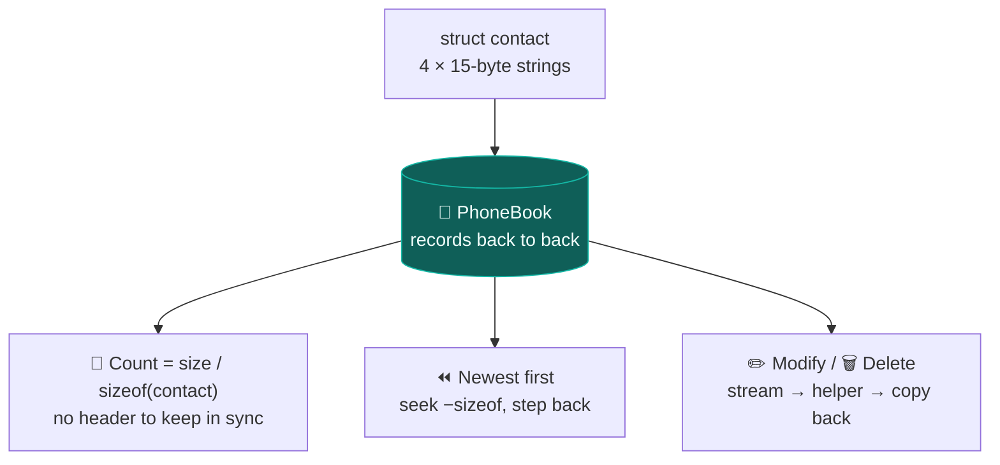

<div align="center">


<br/>


</div>


## 📌 What it is

A menu of operations over a single file called `PhoneBook`:

| # | Operation | How |
|:---:|---|---|
| 1 | ➕ **Create** | first/last name, 10-digit mobile, tag — duplicates rejected |
| 2 | 📋 **Display** | oldest first, or **newest first** by seeking backwards |
| 3 | 🏷️ **By tag** | `family`, `work`… case-insensitive |
| 4 | ✏️ **Modify** | find by name, change each field with y/n |
| 5 | 🔍 **Search** | by full name or mobile number |
| 6 | 🗑️ **Delete** | by mobile or name |
| 8 | 💣 **Delete all** | after confirmation |

<div align="center">

</div>

## 🧠 The design



> 💡 Fixed-size records make counting arithmetic and reverse listing a seek — nothing is loaded
> into memory. Edits use the classic copy-through, so the original is never edited in place.

## 🚀 Getting started

```bash
git clone https://github.com/Vishal-AS-0407/Telephone-Directory.git
cd Telephone-Directory
gcc -o directory telephone-directory.c
directory.exe
```

> 💡 **Tip:** it uses `getch()`, `strlwr()` and `system("cls")`, so build on **Windows** (MinGW
> or MSVC).

## 🧭 Known issues & roadmap

<details>
<summary><b>Fix these first — they can corrupt saved contacts</b></summary>

| # | Issue | Fix |
|:---:|---|---|
| 1 | `strlwr` lowercases names **in place** during compare, then writes them back | `_stricmp` / `strcasecmp` |
| 2 | Uninitialised `flag` in delete can copy an empty file over the book | `int flag = 0;` |
| 3 | Binary structs in text-mode files (`"r"`, `"w"`) misalign on Windows | `"rb"`, `"wb"`, `"ab"` |
| 4 | Unbounded `scanf("%s")`; `char phone[10]` for 10 digits + `\0` | `%14s`; `phone[11]` |
| 5 | `fopen` results unchecked on an empty book | check for `NULL` |

Also: close handles once, include `<ctype.h>`/`<conio.h>`, replace `fflush(stdin)` with
`scanf(" %c", ...)`, exit with `0` on a normal quit.

**Roadmap**
- [ ] Data-safety fixes above
- [ ] Portable build (no `conio.h`)
- [ ] Sorted listing and partial-name search

</details>


<div align="center">

<a href="https://portfolio-sigma-blond-57.vercel.app"></a>
<a href="https://www.linkedin.com/in/vishal-a-s04/"></a>
<a href="https://github.com/Vishal-AS-0407"></a>

⭐ **If this helped you, star the repo!**


</div>
