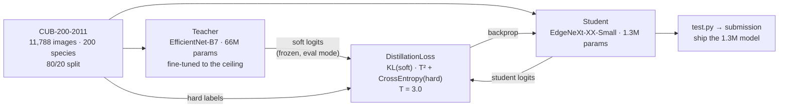

<h1 align="center">The Efficient AI Challenge — Bird Classification</h1>

<p align="center">
  <b>Train a 66M-parameter teacher to be as accurate as possible.<br>
  Then throw it away and ship a 1.3M-parameter student that learned from it.</b>
</p>

<p align="center">
  
  
  
  
</p>

---

## The problem

The competition is called the *Efficient* AI Challenge, and that word changes everything. Accuracy
alone is not the objective — the model has to be small and fast enough to run where a bird actually
is: on a field device, a phone, a camera trap, an edge box with no GPU.

Fine-grained bird classification is a genuinely hard vision task. **200 species, 11,788 images** —
roughly 59 images per class. The between-class differences are tiny (a wing bar, a bill shape, an
eye-ring), the within-class variation is enormous (juvenile, breeding plumage, wing angle,
occlusion, lighting). This is exactly the regime where a very large pretrained backbone wins,
because the task needs subtle texture features that small networks cannot learn from 59 examples.

So the two requirements pull in opposite directions:

- **Accuracy wants a large model.** EfficientNet-B7, 66M parameters.
- **Efficiency wants a tiny one.** EdgeNeXt-XX-Small, 1.3M parameters.

Training the small model directly on 200 × 59 images does not work — it does not have the capacity
to discover fine-grained features from that little data.

## The answer: knowledge distillation



The teacher is trained once, then **frozen and used only as a label generator**. The student never
sees the teacher's weights — only its opinions.

---

## Novelty

### 1. Soft targets carry the information hard labels destroy

This is why distillation works, and it is worth being precise about.

A one-hot label says *"this is a Cerulean Warbler"* and nothing else. The teacher's softmax says
*"87% Cerulean Warbler, 9% Black-throated Blue Warbler, 3% Northern Parula, 0.4% everything
else"* — and that distribution encodes **which species this one resembles**. On a fine-grained task
that similarity structure *is* the domain knowledge: it tells the student that warblers cluster
together and that the Cerulean/Black-throated-Blue boundary is the hard one, which is knowledge it
could never extract from 59 one-hot vectors.

Geoffrey Hinton called these the "dark knowledge" in a trained network. Here they are the only
reason a 1.3M-parameter model can learn a 200-way fine-grained task at all.

### 2. The loss is textbook-correct, including the `T²`

```python
soft_targets = torch.softmax(teacher_logits / self.temperature, dim=1)
soft_preds   = torch.log_softmax(student_logits / self.temperature, dim=1)
distillation_loss = self.kl_div(soft_preds, soft_targets) * (self.temperature ** 2)
classification_loss = nn.CrossEntropyLoss()(student_logits, targets)
return distillation_loss + classification_loss
```

Four details, all right:

- **`log_softmax` on the student, `softmax` on the teacher.** PyTorch's `KLDivLoss` expects
  log-probabilities for the input and probabilities for the target. Getting this backwards is the
  single most common distillation bug and it fails silently — the loss still decreases, and the
  student learns the wrong thing.
- **`reduction='batchmean'`.** The mathematically correct KL reduction. The default `'mean'`
  divides by `batch × classes` and gives you a gradient 200× too small here.
- **The `T²` factor.** Dividing logits by `T` shrinks the gradients by roughly `1/T²`; multiplying
  the loss back by `T²` keeps the distillation term's gradient magnitude comparable to the
  cross-entropy term's, so changing the temperature does not silently change the effective
  weighting between them. This is the correction from the original Hinton paper and it is very
  frequently left out.
- **Both terms, summed.** Soft targets teach the similarity structure; hard labels anchor the
  student to the ground truth and stop it inheriting the teacher's mistakes wholesale.

**`temperature = 3.0`** is a sensible choice for a 200-class problem: high enough to lift the
informative low-probability classes out of the floor, low enough that the distribution does not
flatten into uniform noise.

### 3. The teacher runs under `no_grad`, the student under `autocast`

```python
with torch.no_grad():
    teacher_logits = teacher_model(images)          # frozen — no graph, no memory

with torch.amp.autocast('cuda'):
    student_logits = student_model(images)
    loss = criterion(student_logits, teacher_logits, labels)

scaler.scale(loss).backward()
```

Holding a 66M-parameter EfficientNet-B7 and a student in GPU memory simultaneously is the practical
constraint of distillation. Two things make it fit: the teacher is inside `no_grad` so no
activation graph is retained for it, and it is in `eval()` mode so its batch-norm statistics are
frozen rather than being polluted by the student's training batches.

Mixed precision (`autocast` + `GradScaler`) applies to the student's forward and backward only,
where it belongs.

### 4. Every epoch is checkpointed

```python
torch.save(student_model.state_dict(), f'student_model{epoch}.pth')
```

100 epochs, 100 checkpoints, on a 1.3M-parameter model — a few megabytes each. Cheap insurance
against a crash 80 epochs in, and it means the best epoch can be picked after the fact rather than
relying on the last one.

### 5. `ReduceLROnPlateau` rather than a fixed schedule

```python
ReduceLROnPlateau(optimizer, factor=0.1, patience=5, verbose=True)
```

Used for both teacher and student. Distillation loss curves are less predictable than plain
supervised ones — the student chases a moving similarity structure — so a schedule that *reacts* to
a plateau beats a cosine or step schedule guessed in advance. `factor=0.1` with `patience=5` is the
standard aggressive-but-patient setting.

### 6. 51× compression, and that is the actual deliverable

| Model | Parameters | Role |
|---|---:|---|
| EfficientNet-B7 | **66M** | teacher — trained, then discarded |
| EdgeNeXt-XX-Small | **1.3M** | student — the thing that ships |

**51× fewer parameters.** EdgeNeXt is itself a good choice for the student: it is a hybrid
CNN–transformer designed for edge inference, so it keeps some of the global attention that helps on
fine-grained texture while staying mobile-sized. A 1.3M MobileNet would have less of the
architectural capacity to absorb what the teacher knows.

**Leaderboard #1** in the competition.

---

## Repository layout

```
effb7.py              teacher — EfficientNet-B7 fine-tuning
distill.py            student — EdgeNeXt-XX-Small distilled from the teacher
test.py               inference + Kaggle submission file
FINALSUBMISSION.ipynb  the submitted notebook
requirements.txt
```

## Training configuration

| | Teacher | Student |
|---|---|---|
| Model | `efficientnet_b7` (timm) | `edgenext_xx_small` (timm) |
| Input | 224×224, ImageNet normalisation | same |
| Optimiser | AdamW, lr 1e-3 | Adam, lr 1e-3 |
| Schedule | ReduceLROnPlateau (0.1, patience 5) | same |
| Loss | CrossEntropy | KL·T² + CrossEntropy, T = 3.0 |
| Precision | — | AMP (`autocast` + `GradScaler`) |
| Epochs | — | 100 |

## Running it

```bash
git clone https://github.com/Vishal-AS-0407/The-Efficient-AI-Challenge---Birds-Classification.git
cd The-Efficient-AI-Challenge---Birds-Classification
pip install -r requirements.txt
```

Put the [CUB-200-2011](http://www.vision.caltech.edu/datasets/cub_200_2011/) images in `images/`
and `annotation2.csv` at the root, then:

```bash
python effb7.py      # 1. train the teacher       → teacher checkpoint
python distill.py    # 2. distil into the student → student_model{epoch}.pth
python test.py       # 3. predictions + submission file
```

[Competition](https://www.kaggle.com/competitions/bird-classification-anokha/data) ·
[Dataset](http://www.vision.caltech.edu/datasets/cub_200_2011/)

---

## Honest notes

- **No accuracy figures are committed.** The performance table reports parameters and qualitative
  inference speed, and the leaderboard position is the accuracy claim. The teacher's top-1, the
  student's top-1, and — the number that would actually make the argument — **the gap between
  them** are not recorded. That gap is the whole point of the exercise: it says how much of a 66M
  model survives compression to 1.3M. It would take one evaluation pass to produce, and it is the
  single most valuable thing missing.
- **A hard-coded absolute path** in `distill.py`:
  ```python
  torch.save(student_model.state_dict(), f'E:/PROJECT/anokha/effi2/models/student_model{epoch}.pth')
  ```
  Immediately after a relative-path save of the same file. Will crash on any machine without an
  `E:` drive. Delete the line.
- **No validation loop.** Accuracy is printed on the *training* set each epoch, and there is no
  held-out check, so the checkpoint to pick from the 100 saved has to be chosen by leaderboard
  submission rather than by validation. The 80/20 split is described in the README but not used in
  `distill.py`.
- **`annotation2.csv` is not committed**, so the training scripts cannot run as cloned.
- **No augmentation.** Just resize + normalise. On 59 images per class, standard fine-grained
  augmentation — random resized crop, horizontal flip, colour jitter — would likely help both
  models materially, and RandAugment or Mixup more so.
- **224×224 for EfficientNet-B7** is well below its native 600×600 training resolution. That saves
  a great deal of compute and costs accuracy on a fine-grained task where the discriminative
  features are small. A deliberate trade, given the competition's efficiency framing, but worth
  naming.
- **`torch.cuda.amp.GradScaler()` and `torch.amp.autocast('cuda')`** mix the deprecated and current
  APIs. Harmless; will warn on recent PyTorch.
