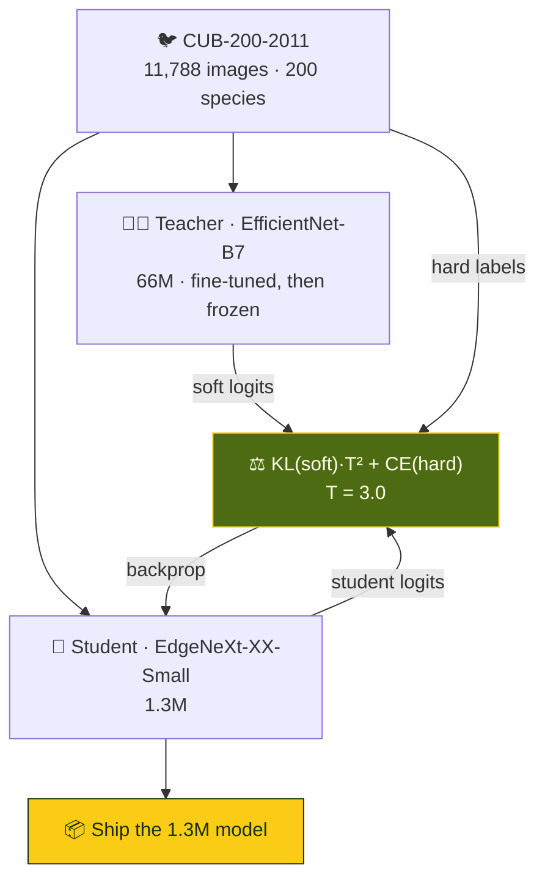

<div align="center">


<br/>


</div>


## 📌 Overview

The word *Efficient* changes the objective: the model has to run where a bird actually is — a
phone, a camera trap, an edge box. But fine-grained classification over **200 species with ~59
images each** is exactly where big backbones win.

| Requirement | Wants |
|---|---|
| 🎯 Accuracy | a large model — **EfficientNet-B7, 66M params** |
| ⚡ Efficiency | a tiny one — **EdgeNeXt-XX-Small, 1.3M params** |

The answer: **train the big one, then teach the small one.** The teacher is frozen and used only as
a label generator; the student never sees its weights, only its opinions.

## 🧠 Distillation



> 🌑 A one-hot label says *"Cerulean Warbler"*. The teacher says *"87% Cerulean, 9%
> Black-throated Blue, 3% Northern Parula"* — **which species this one resembles**. On a
> fine-grained task that similarity structure *is* the knowledge, and it's the only reason a 1.3M
> model can learn 200 classes from 59 images each.

## ✨ Highlights

<table>
<tr>
<td width="50%" valign="top">

### ✅ A textbook-correct loss
`log_softmax` on the student, `softmax` on the teacher, `batchmean` reduction, and the `T²`
correction from Hinton et al. — the one most often left out.

</td>
<td width="50%" valign="top">

### 💾 Two models, one GPU
Teacher in `eval()` + `no_grad` (no graph, frozen BN); student under AMP `autocast` +
`GradScaler`.

</td>
</tr>
<tr>
<td valign="top">

### 📉 A schedule that reacts
`ReduceLROnPlateau(0.1, patience 5)` — distillation curves chase a moving target, so react, don't
guess.

</td>
<td valign="top">

### 🧠 A student built for the edge
EdgeNeXt is a hybrid CNN–transformer — keeps some global attention for fine texture at mobile size.

</td>
</tr>
</table>

<details>
<summary><b>🔬 The loss, line by line</b></summary>

```python
soft_targets = torch.softmax(teacher_logits / self.temperature, dim=1)
soft_preds   = torch.log_softmax(student_logits / self.temperature, dim=1)
distillation_loss = self.kl_div(soft_preds, soft_targets) * (self.temperature ** 2)
classification_loss = nn.CrossEntropyLoss()(student_logits, targets)
return distillation_loss + classification_loss
```

- Swapping `softmax`/`log_softmax` is the classic silent bug — loss still falls, student learns the
  wrong thing.
- `'mean'` instead of `'batchmean'` would shrink the gradient 200× here.
- `T²` keeps the soft term's gradient comparable to CE when you change `T`.

</details>

## 📊 Configuration

| | 👨‍🏫 Teacher | 👶 Student |
|---|---|---|
| Model | `efficientnet_b7` | `edgenext_xx_small` |
| Parameters | **66M** | **1.3M** |
| Input | 224 × 224 | 224 × 224 |
| Optimiser | AdamW 1e-3 | Adam 1e-3 |
| Loss | CE | KL·T² + CE, T = 3 |
| Precision | FP32 | AMP |
| Epochs | — | 100 (each checkpointed) |

## 🛠️ Tech stack

<p align="center">
  
  
  
</p>

## 🚀 Getting started

```bash
git clone https://github.com/Vishal-AS-0407/The-Efficient-AI-Challenge---Birds-Classification.git
cd The-Efficient-AI-Challenge---Birds-Classification
pip install -r requirements.txt

python effb7.py      # 1️⃣ train the teacher
python distill.py    # 2️⃣ distil into the student → student_model{epoch}.pth
python test.py       # 3️⃣ predictions + submission
```

> 💡 **Tip:** put the [CUB-200-2011](http://www.vision.caltech.edu/datasets/cub_200_2011/) images
> in `images/` with `annotation2.csv` at the root. Remove the hard-coded `E:/...` save line in
> `distill.py` first. · The Kaggle competition
> page (`bird-classification-anokha`) is no longer public.

```
📦 The-Efficient-AI-Challenge---Birds-Classification
 ┣ 🐍 effb7.py               teacher fine-tuning
 ┣ 🐍 distill.py             student distillation
 ┣ 🐍 test.py                inference + submission
 ┗ 📓 FINALSUBMISSION.ipynb  the submitted notebook
```

## 🧭 Notes & roadmap

<details>
<summary><b>What would make the result complete</b></summary>

- 📏 Teacher and student top-1 — and **the gap between them** — aren't recorded yet; that gap is
  the whole argument.
- 🧪 Add a validation loop (the 80/20 split isn't used in `distill.py`) to pick the best epoch.
- 🎨 Fine-grained augmentation (random resized crop, flip, jitter, Mixup) would likely help both.
- 🔍 224 px is well below B7's native 600 px — a deliberate efficiency trade.

**Roadmap**
- [ ] Report teacher vs student accuracy
- [ ] Validation-based checkpoint selection
- [ ] Augmentation ablation

</details>


<div align="center">

<a href="https://portfolio-sigma-blond-57.vercel.app"></a>
<a href="https://www.linkedin.com/in/vishal-a-s04/"></a>
<a href="https://github.com/Vishal-AS-0407"></a>

⭐ **If this helped you, star the repo!**


</div>
