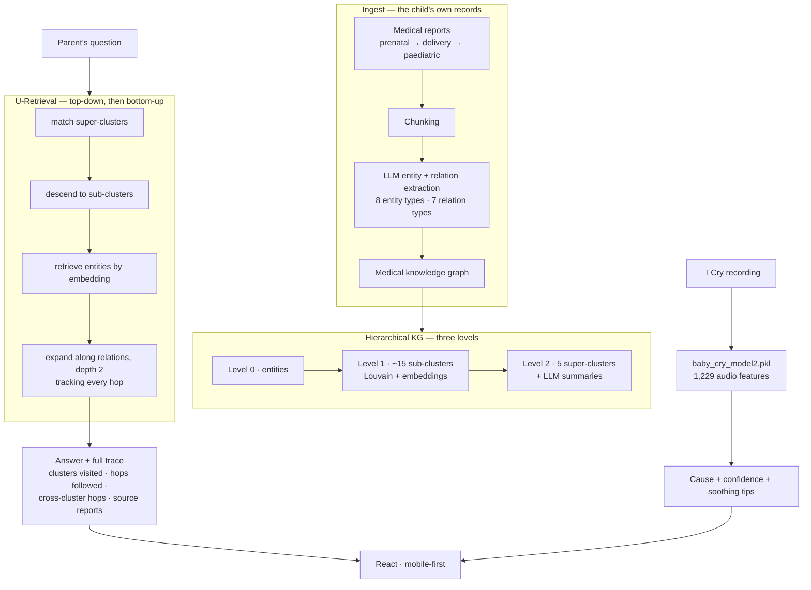

<h1 align="center">Vatsal AI</h1>

<p align="center">
  <b>A parenting companion for Indian families — from the first prenatal scan to the toddler years.</b><br>
  Cry classification, a hierarchical medical knowledge graph over the child's own records,
  and retrieval that shows its working.
</p>

<p align="center">
  
  
  
  
</p>

---

## The problem

New parents are handed a folder of paper and a decade of decisions. The folder contains prenatal
consultations, blood panels, an NT scan, a glucose tolerance test, a delivery summary, a newborn
examination, a vaccination record. It is chronological, it is in clinical language, and it answers
none of the questions a parent actually has at 2 a.m.

Three specific failures:

**1 — The records do not connect.** A glucose tolerance result in month six, a note in the delivery
summary, and a paediatric consultation at eight months might be one clinical thread. In a folder
they are three unrelated pieces of paper. A parent has no way to see the thread, and neither does
a paediatrician meeting the family for the first time.

**2 — Generic health chatbots have no idea who this child is.** "Is this rash normal?" has a
different answer for a baby who was 34 weeks, whose mother had gestational diabetes, and who is
mid-course on an antibiotic. Answering it without those facts is answering a different question.

**3 — Nobody should trust a black-box answer about their child.** An LLM that says "this is
probably teething" is worthless unless you can see *what it read* to conclude that.

## What it does



---

## Novelty

### 1. U-Retrieval — descend the hierarchy, then walk the graph

This is the centre of the project and it is a genuinely good retrieval design.

Flat vector RAG over medical records fails in a specific way: the top-5 most similar chunks to
"why does my baby have a fever" are five chunks that all say "fever", from five different visits,
with no sense of which episode they belong to. You get redundancy where you wanted context.

U-Retrieval goes down and then across:

```python
1. embed the query
2. _find_relevant_super_clusters(...)      # which of the 5 top-level areas?
3. descend into sub-clusters within those  # ~15 mid-level groups
4. retrieve entities by embedding within that narrowed scope
5. _expand_with_relations_tracked(..., expand_depth=2)   # follow the edges
```

The hierarchy is a **scope filter**, exactly as a clinician's reasoning is: work out whether this
is respiratory, nutritional or developmental *first*, then look inside. Step 4 then does what
vector search cannot — follows `PRESCRIBED_FOR`, `INDICATES`, `TREATS` edges two hops out, so an
answer about a fever can reach the antibiotic prescribed for it and the lab result that indicated
it, neither of which is textually similar to the question.

Step 3 also deliberately adds **embedding-similar clusters that the top-down match missed**
(`exclude=set(relevant_clusters)`), which is the safety valve against a bad first hop.

### 2. The retrieval trace is a first-class object

```python
class RetrievalTrace:
    def add_step(self, step_name, details)
    def add_cluster_visit(self, cluster_id, reason)      # reason, not just id
    def add_graph_hop(self, from_entity, to_entity, relation, cross_cluster)
    def add_report(self, report_id)
```

Every retrieval returns, alongside the answer: which clusters were visited **and why**, every graph
hop as a `(from, relation, to)` triple, the count of **cross-cluster hops**, and the source report
IDs.

Three reasons this is more than logging. It is **auditable** — a parent or a doctor can see that
the answer came from the June blood panel and the delivery summary, and check them. It is
**debuggable** — a bad answer becomes a specific question ("why did it enter the nutrition
cluster?"). And `cross_cluster_hops` is a real quality signal: a high count means the query
genuinely spanned domains, which is precisely when a flat retriever would have failed, and
precisely when the answer deserves more scrutiny.

The frontend surfaces this as the assistant's "thought process" rather than hiding it.

### 3. A closed medical ontology, not free-form extraction

```python
ENTITY_TYPES   = ["MEDICATION", "CONDITION", "LAB_RESULT", "PROCEDURE",
                  "VITAL_SIGN", "DATE", "DOCTOR", "PATIENT_INFO"]

RELATION_TYPES = ["PRESCRIBED_FOR", "INDICATES", "PERFORMED_ON", "TREATS",
                  "DIAGNOSED_WITH", "MEASURED_ON", "RECOMMENDED_BY"]
```

Fifteen fixed types. Let an LLM invent relation labels and you get `treats`, `is_treatment_for`,
`used_to_treat` and `helps_with` as four distinct edge types describing one relationship — and a
graph that cannot be traversed because no two edges match. Constraining the vocabulary is what
makes `expand_depth=2` mean something.

The chosen set is also **medically shaped**: `INDICATES` (lab result → condition) and `MEASURED_ON`
(vital sign → date) are the two that make a longitudinal record queryable, and neither appears in a
generic ontology. Extracted relations carry a **confidence score**, so weak edges can be filtered
before traversal.

### 4. Level 2 clusters get LLM-written summaries

```python
def generate_cluster_summary(kg, cluster_nodes) -> str
```

Each of the five super-clusters is described in natural language by an LLM reading its members.
That summary is what the query is matched against at step 2 — so the top-level routing decision is
made against *"complications and monitoring during the third trimester"* rather than against a
centroid of embeddings. Human-readable, matchable, and inspectable when the routing goes wrong.

### 5. Louvain for sub-clusters, targets for super-clusters

```python
build_hierarchy(n_super_clusters=5, n_sub_clusters=15)
```

Level 1 uses **Louvain community detection over the graph structure** — because clinical episodes
are genuinely communities of densely-connected entities, and their number is a property of the
records, not something to be guessed. Level 2 is targeted at 5–6, because the top of a hierarchy is
a **navigation** structure and humans do not navigate fifty options. Different objectives, different
methods.

### 6. Synthetic records, so the KG can be developed without patient data

Ten reports ship with the repo, spanning the whole arc:

```
RPT-001  Prenatal Consultation          RPT-006  Prenatal Follow-up, Third Trimester
RPT-002  Laboratory Report, Blood Tests RPT-007  Delivery Summary
RPT-003  Ultrasound, NT Scan            RPT-008  Newborn Examination
RPT-004  Prenatal Follow-up             RPT-009  Pediatric Vaccination Record
RPT-005  Glucose Tolerance Test         RPT-010  Pediatric Consultation, Illness
```

This is the right way to build health software. Real records cannot be committed; a KG cannot be
developed without records. The synthetic set is deliberately **longitudinal and causally linked** —
the glucose tolerance test in RPT-005 is meant to connect to the delivery summary in RPT-007 — so
it exercises exactly the multi-hop retrieval the system exists for, which a bag of unrelated
documents would not.

The built artefacts are committed too (`chunks.json`, `entities.json`, `relations.json`,
`knowledge_graph.pkl`), so the retrieval layer runs without re-extracting.

### 7. The cry classifier carried over, and given a job

`baby_cry_model2.pkl` is the trained forest from
[Why-is-my-Baby-Crying](https://github.com/Vishal-AS-0407/Why-is-my-Baby-Crying) — 1,229 audio
features, infant-band bandpass, 97.9% test accuracy. Here it stops being a demo and becomes a
feature: record → classify → confidence → soothing tips for that specific cause.

### 8. Genuinely localised content

`routes/knowledge.py` serves `/articles`, `/categories`, `/search` — and two endpoints that would
not appear in a Western parenting app:

- **`/schemes`** — Indian government maternal and child health schemes. Entitlements a family
  qualifies for and usually does not know exist. Arguably the highest-value feature in the app in
  pure rupee terms.
- **`/traditional`** — traditional practices, presented alongside clinical information rather than
  dismissed. Indian families follow these regardless; engaging with them is what keeps the app
  trusted rather than ignored.

`routes/assistant.py` carries `/voice`, `/image` and `/translate` alongside `/chat`, so the whole
assistant works by speech, by photograph, and in more than one language.

---

## API

| Router | Endpoints |
|---|---|
| `user` | `/onboard` · `/profile/{id}` (GET, PUT) |
| `cry_analyzer` | `/analyze` · `/types` |
| `medical` | `/query` (U-Retrieval + trace) · `/stats` |
| `reports` | `/analyze` · `/analyze-medical-report` · `/diet-plan` · `/medicine-check` · `/medicine-check-advanced` · `/medicine-scan` · `/history/{user_id}` · `/growth-milestones/{stage}` |
| `assistant` | `/chat` · `/voice` · `/image` · `/translate` |
| `knowledge` | `/articles` · `/categories` · `/search` · `/schemes` · `/traditional` |
| `community` | `/channels` · `/feed` · `/post` · `/post/{id}/like` · `/post/{id}/comments` · `/post/{id}/comment` |

## Repository layout

```
backend/
  main.py · config.py · database.py · models.py · schemas.py
  routes/          user · cry_analyzer · medical · reports · assistant · knowledge · community
  services/        ai_service · cry_service · content_service · community_service
    medical_kg/    chunking · entity_extraction · config      (the in-app KG)
  data/synthetic/  10 linked medical reports
  data/processed/  chunks · entities · relations · knowledge_graph.pkl
  seed_community.py

medical_kg_retrieval/           the standalone KG research project
  src/synthetic_data.py         report generation
  src/chunking.py
  src/entity_extraction.py      8 entity types, 7 relation types, confidence scores
  src/knowledge_graph.py
  src/hierarchical.py           Louvain sub-clusters + 5 super-clusters + LLM summaries
  src/retrieval.py              U-Retrieval with RetrievalTrace
  src/visualization.py
  outputs/graphs/               interactive knowledge_graph.html, hierarchy.html
  final_verification.py

frontend/src/
  pages/     Welcome · Onboarding · Dashboard · CryAnalyzer · Knowledge ·
             MedicalHistory · Reports · Assistant · Community
  components/BottomNav · MarkdownRenderer
  context/UserContext · services/api

docs/      features.md · tech_stack.md · user_flow.md ·
           backend_architecture.md · frontend_architecture.md
baby_cry_model2.pkl
```

## Running it

**Backend**

```bash
cd backend
pip install -r requirements.txt
# create .env with your OPENAI_API_KEY (see medical_kg_retrieval/.env.example)
uvicorn main:app --reload --port 8000
python seed_community.py        # optional: populate the community feed
```

**Frontend**

```bash
cd frontend
npm install && npm run dev
```

**Rebuild the knowledge graph from scratch**

```bash
cd medical_kg_retrieval
python main.py                  # synthetic data → chunks → entities → KG → hierarchy
python final_verification.py
```

Then open `outputs/graphs/knowledge_graph.html` and `hierarchy.html`.

---

## ⚠️ Security

**`sample2.py` line 187 has a live Google Gemini API key hardcoded** — and it is the **same key
that also appears in the `Why-is-my-Baby-Crying` repository**. Revoke it once at
<https://aistudio.google.com/app/apikey> and it is handled in both places.

Everything else in this repo is clean: `medical_kg_retrieval/.env.example` is the right pattern
and no real `.env` is committed.

---

## Honest notes

- **The KG exists in two places.** `medical_kg_retrieval/` is the full research implementation —
  hierarchical clustering, U-Retrieval, tracing, visualisation. `backend/services/medical_kg/`
  holds only chunking, entity extraction and config; the backend consumes the **pre-built**
  `data/processed/knowledge_graph.pkl`. Read `medical_kg_retrieval/src/` to understand the system;
  the backend serves it.
- **All medical records are synthetic.** No real patient data, by design. It also means the
  extraction quality has been validated against generated text, which is cleaner and more
  consistent than real clinical notes — real records have handwriting artefacts, abbreviations and
  inconsistent units, and the extractor has not met them.
- **The community feed is seeded, not live.** `seed_community.py` populates it; there is no
  moderation layer, which a parenting community would need before real users.
- **No evaluation of retrieval quality.** The trace tells you *what* was retrieved and never
  *whether it was right*. A labelled question set over the ten synthetic reports — with the correct
  source reports marked — would turn the trace from a debugging aid into a measurable
  precision/recall number. That is the most valuable thing missing.
- **`sample2.py` at the repo root is a scratch script**, not part of the app.
- **This is not a medical device.** It organises and retrieves a family's own records and provides
  information. Every answer is traceable to a source report precisely so that a clinician remains
  the one who decides.
