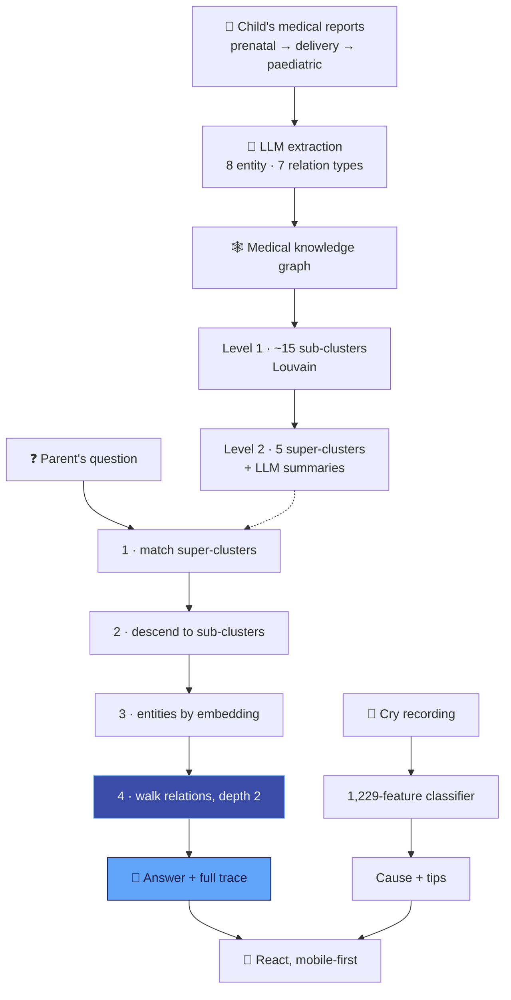

<div align="center">


<br/>


</div>


<details>
<summary><b>📑 Table of contents</b></summary>

- [📌 Overview](#-overview)
- [✨ Features](#-features)
- [🧠 Architecture](#-architecture)
- [🖼️ Screens](#️-screens)
- [🕸️ The knowledge graph](#️-the-knowledge-graph)
- [🔬 Under the hood](#-under-the-hood)
- [🔌 API](#-api)
- [🚀 Getting started](#-getting-started)
- [📂 Project structure](#-project-structure)
- [🧭 Notes & roadmap](#-notes--roadmap)

</details>

## 📌 Overview

New parents get a folder of paper and a decade of decisions — prenatal consults, blood panels, an
NT scan, a glucose tolerance test, a delivery summary, vaccinations. Chronological, clinical, and
no help at 2 a.m.

| Failure | Vatsal AI's answer |
|---|---|
| 🧩 **Records don't connect** — a month-6 glucose test and an 8-month consult may be one thread | A **medical knowledge graph** over the child's own reports |
| 🤷 **Generic chatbots don't know this child** | Answers retrieved from **this family's** records |
| 🕳️ **Black-box answers about a child are worthless** | Every answer ships with a **full retrieval trace** |

## ✨ Features

<table>
<tr>
<td width="33%" valign="top">

### 🩺 Medical Q&A
U-Retrieval over the child's records, with clusters visited, graph hops and source reports shown.

</td>
<td width="33%" valign="top">

### 👶 Cry analyzer
The [Why-is-my-Baby-Crying](https://github.com/Vishal-AS-0407/Why-is-my-Baby-Crying) model —
cause, confidence, soothing tips.

</td>
<td width="33%" valign="top">

### 💊 Reports & medicines
Report analysis, diet plans, medicine checks and scans, growth milestones.

</td>
</tr>
<tr>
<td valign="top">

### 🏛️ Government schemes
Indian maternal & child health entitlements families usually don't know they qualify for.

</td>
<td valign="top">

### 🪔 Traditional practices
Presented alongside clinical information — engaged with, not dismissed.

</td>
<td valign="top">

### 🗣️ Assistant & community
Chat by voice, photo or text, in more than one language — plus channels and a feed.

</td>
</tr>
</table>

## 🧠 Architecture



## 🖼️ Screens

<div align="center">
<table>
<tr>
<td width="50%"></td>
<td width="50%"></td>
</tr>
<tr>
<td></td>
<td></td>
</tr>
</table>

<details>
<summary><b>📸 More screens</b></summary>
<table>
<tr>
<td width="50%"></td>
<td width="50%"></td>
</tr>
<tr>
<td></td>
<td></td>
</tr>
<tr>
<td></td>
<td></td>
</tr>
<tr>
<td></td>
<td></td>
</tr>
</table>
</details>
</div>

## 🕸️ The knowledge graph

<div align="center">
<table>
<tr>
<td align="center" width="50%"><b>🌳 Cluster hierarchy</b><br/></td>
<td align="center" width="50%"><b>🏷️ Entity types</b><br/></td>
</tr>
</table>
</div>

| Entity types | Relation types |
|---|---|
| 💊 `MEDICATION` · 🤒 `CONDITION` · 🧪 `LAB_RESULT` · 🩻 `PROCEDURE` | `PRESCRIBED_FOR` · `INDICATES` · `PERFORMED_ON` · `TREATS` |
| ❤️ `VITAL_SIGN` · 📅 `DATE` · 👩‍⚕️ `DOCTOR` · 👶 `PATIENT_INFO` | `DIAGNOSED_WITH` · `MEASURED_ON` · `RECOMMENDED_BY` |

> 🧩 A **closed** vocabulary: let an LLM invent labels and you get `treats`, `is_treatment_for`,
> `used_to_treat` — four edge types for one relation, and a graph nothing can traverse.

## 🔬 Under the hood

<details>
<summary><b>🔽 U-Retrieval — down the hierarchy, then across the graph</b></summary>

```python
1. embed the query
2. _find_relevant_super_clusters(...)      # which of the 5 top-level areas?
3. descend into sub-clusters within those  # ~15 mid-level groups
4. retrieve entities by embedding within that narrowed scope
5. _expand_with_relations_tracked(..., expand_depth=2)   # follow the edges
```

Flat RAG returns five chunks that all say "fever", from five visits. U-Retrieval scopes first —
respiratory? nutritional? developmental? — then follows `PRESCRIBED_FOR` / `INDICATES` edges two
hops out, reaching the antibiotic and the lab result that aren't textually similar to the
question. Step 3 also adds embedding-similar clusters the top-down match missed, as a safety valve.

</details>

<details>
<summary><b>🧾 The retrieval trace</b></summary>

```python
class RetrievalTrace:
    def add_step(self, step_name, details)
    def add_cluster_visit(self, cluster_id, reason)      # reason, not just id
    def add_graph_hop(self, from_entity, to_entity, relation, cross_cluster)
    def add_report(self, report_id)
```

**Auditable** (which reports it came from), **debuggable** (why did it enter that cluster?), and
`cross_cluster_hops` flags questions that span domains — exactly where flat retrieval fails.

</details>

<details>
<summary><b>📁 Ten linked synthetic reports</b></summary>

| | | | |
|---|---|---|---|
| RPT-001 Prenatal consult | RPT-002 Blood tests | RPT-003 NT scan | RPT-004 Follow-up |
| RPT-005 Glucose tolerance | RPT-006 Third trimester | RPT-007 Delivery | RPT-008 Newborn exam |
| RPT-009 Vaccinations | RPT-010 Paediatric illness | | |

Longitudinal and causally linked (RPT-005 → RPT-007), so they exercise multi-hop retrieval. Built
artefacts (`chunks`, `entities`, `relations`, `knowledge_graph.pkl`) are committed.

</details>

## 🔌 API

| Router | Endpoints |
|---|---|
| 👤 `user` | `/onboard` · `/profile/{id}` |
| 👶 `cry_analyzer` | `/analyze` · `/types` |
| 🩺 `medical` | `/query` (U-Retrieval + trace) · `/stats` |
| 📄 `reports` | `/analyze` · `/diet-plan` · `/medicine-check` · `/medicine-scan` · `/history/{id}` · `/growth-milestones/{stage}` |
| 🗣️ `assistant` | `/chat` · `/voice` · `/image` · `/translate` |
| 📚 `knowledge` | `/articles` · `/categories` · `/search` · `/schemes` · `/traditional` |
| 🤝 `community` | `/channels` · `/feed` · `/post` · likes · comments |

## 🛠️ Tech stack

<p align="center">
  
  <br/>
  
  
  
</p>

## 🚀 Getting started

```bash
# ⚙️ Backend
cd backend
pip install -r requirements.txt
echo "OPENAI_API_KEY=..." > .env
uvicorn main:app --reload --port 8000
python seed_community.py               # optional

# 📱 Frontend
cd frontend && npm install && npm run dev

# 🕸️ Rebuild the knowledge graph
cd medical_kg_retrieval
python main.py                          # synthetic data → chunks → entities → KG → hierarchy
python final_verification.py
```

> 💡 **Tip:** open `medical_kg_retrieval/outputs/graphs/knowledge_graph.html` and
> `hierarchy.html` to explore the graph interactively.

## 📂 Project structure

```
📦 Vatsal-AI
 ┣ 📂 backend
 ┃ ┣ 📂 routes            user · cry_analyzer · medical · reports · assistant · knowledge · community
 ┃ ┣ 📂 services          ai · cry · content · community · medical_kg/
 ┃ ┗ 📂 data              synthetic reports + processed KG
 ┣ 📂 medical_kg_retrieval
 ┃ ┣ 📂 src               chunking · extraction · knowledge_graph · hierarchical · retrieval · viz
 ┃ ┗ 📂 outputs/graphs    interactive HTML + charts
 ┣ 📂 frontend/src        9 pages · BottomNav · MarkdownRenderer
 ┣ 📂 docs                features · tech stack · user flow · architecture
 ┗ 🧠 baby_cry_model2.pkl
```

## 🧭 Notes & roadmap

<details>
<summary><b>What to know</b></summary>

- 🕸️ The full KG lives in `medical_kg_retrieval/`; the backend serves the **pre-built** graph.
- 🧪 All records are synthetic — real notes (abbreviations, handwriting, mixed units) are untested.
- 🤝 The community feed is seeded; it needs moderation before real users.
- 📏 The trace shows *what* was retrieved, not *whether it was right* — a labelled question set
  would turn it into precision/recall.
- 🩺 Not a medical device — answers are traceable so a clinician stays the one who decides.

**Roadmap**
- [ ] Labelled retrieval evaluation
- [ ] Real-record robustness (OCR noise, units)
- [ ] Moderation for community
- [ ] In-app KG rebuild on new uploads

</details>


<div align="center">

<a href="https://portfolio-sigma-blond-57.vercel.app"></a>
<a href="https://www.linkedin.com/in/vishal-a-s04/"></a>
<a href="https://github.com/Vishal-AS-0407"></a>
<a href="mailto:vishalpersonal04@gmail.com"></a>

⭐ **If this helped you, star the repo!**


</div>
