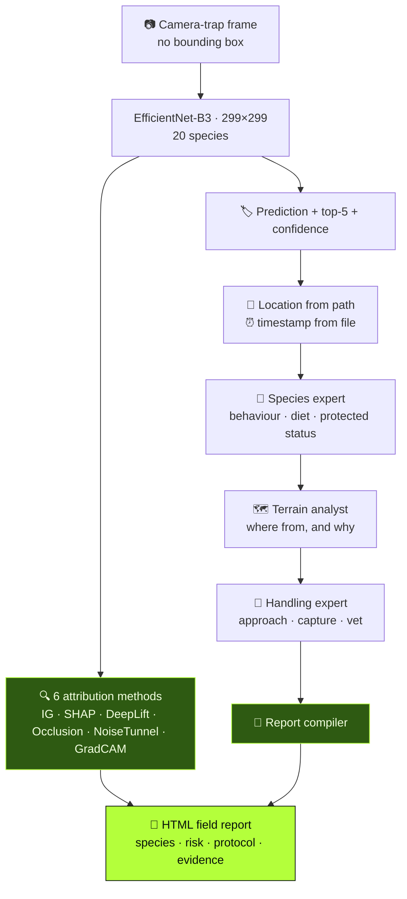

<div align="center">


<br/>


<a href="https://portfolio-sigma-blond-57.vercel.app/work/wisp"></a>

</div>


<details>
<summary><b>📑 Table of contents</b></summary>

- [📌 Overview](#-overview)
- [✨ Highlights](#-highlights)
- [🧠 Architecture](#-architecture)
- [🔍 Explainability](#-explainability)
- [🤖 The agent crew](#-the-agent-crew)
- [🦌 The 20 species](#-the-20-species)
- [🚀 Getting started](#-getting-started)
- [📂 Project structure](#-project-structure)
- [🧭 Honest notes & roadmap](#-honest-notes--roadmap)

</details>

## 📌 Overview

A camera trap fires on motion at 2 a.m. What comes back is an infrared frame — mostly foliage,
an animal somewhere in it, occluded and badly lit. A forest officer gets **thousands a week**.

| Challenge | WISP's answer |
|---|---|
| 📦 **No bounding boxes** — public corpora are labelled per *frame* | Whole-frame classifier + attribution maps as the localisation check |
| 🐆 **The rare species matter most** — an ocelot is a fraction of a percent | Top-5 + confidence banding, so the tail isn't silently rounded off |
| 📋 **A species name isn't a decision** — approach? protected? vet? | A 4-agent crew turns one detection into a field report |

## ✨ Highlights

<table>
<tr>
<td width="50%" valign="top">

### 🔍 Six attribution methods, side by side
Integrated Gradients, GradientSHAP, DeepLift, Occlusion, NoiseTunnel and GradCAM in one panel —
because gradient methods can all agree and **all be wrong**.

</td>
<td width="50%" valign="top">

### 🎞️ An animated convergence check
IG's step count sweeps 5 → 100 over ten frames into a GIF — you can *see* whether the map
converged or is an artefact of where you stopped.

</td>
</tr>
<tr>
<td valign="top">

### 🧭 Agents that reason about *why it's here*
The terrain agent searches a **5–10 km radius** for water and food, maps corridors, and asks why
the animal left its usual range.

</td>
<td valign="top">

### 🛡️ Safe failure
Without CrewAI, the report says plainly that specific protocols can't be given — the right
behaviour for a document read next to a wild boar.

</td>
</tr>
</table>

## 🧠 Architecture



## 🔍 Explainability

Without boxes, **the attribution map is the only evidence the model looked at the animal** and
not at the camera site's vegetation.

| Method | What it answers |
|---|---|
| 🛤️ **Integrated Gradients** | attribution along a path from a black baseline (`n_steps=50`) |
| 🎲 **GradientSHAP** | expected gradients over noisy baselines |
| 🧱 **DeepLift** | contribution against a reference activation |
| 🩹 **Occlusion** | *empirical* — hide a patch, measure the confidence drop |
| 📡 **NoiseTunnel** | is the attribution stable under input jitter? |
| 🔥 **GradCAM** | which region of the last conv map fired |

> 🧪 When Integrated Gradients and Occlusion **agree**, the evidence is real. When they disagree,
> it's a warning. Occlusion doesn't read gradients at all — that's why it's in the panel.

<details>
<summary><b>🔧 GradCAM that survives an architecture swap</b></summary>

```python
modules = list(model.features.children())
for i in range(len(modules) - 1, -1, -1):
    if isinstance(modules[i], torch.nn.Conv2d):
        target_layer = modules[i]
        break
if target_layer is None:                 # ResNet-shaped fallback
    for name, module in model.named_modules():
        if isinstance(module, torch.nn.Conv2d):
            target_layer = module
```

The last `Conv2d` is found by walking backwards — swap to B5, MobileNet or a ResNet and the CAM
still works, with no layer-name strings to update.

</details>

<details>
<summary><b>📦 Checkpoint loading that tolerates torchvision's head move</b></summary>

```python
if "classifier.weight" in state_dict and "classifier.1.weight" not in state_dict:
    state_dict["classifier.1.weight"] = state_dict.pop("classifier.weight")
    state_dict["classifier.1.bias"]   = state_dict.pop("classifier.bias")
model.load_state_dict(state_dict, strict=False)
```

</details>

## 🤖 The agent crew

Four CrewAI agents with live web search (Serper), running **sequentially** — each one builds on
the last.

| # | Agent | Adds |
|:---:|---|---|
| 1 | 🦁 **Species expert** | behaviour, habitat, diet, territoriality — *endangered, invasive or native?* |
| 2 | 🗺️ **Terrain analyst** | water & food within 5–10 km, travel corridors, why it left its range |
| 3 | 🧤 **Handling expert** | approach protocol, capture risk, when a vet and permit are needed |
| 4 | 📝 **Report compiler** | receives all three as context and writes the field report |

> 🧩 Handling advice for an ocelot is meaningless until you know it's protected (agent 1), and
> **wrong** if you don't know it's 8 km from its territory and probably stressed (agent 2). One
> prompt gets none of that chain.

## 🦌 The 20 species

Neotropical and European fauna in one label set — so the model learns *deer morphology*, not
"this is the European site".

| | | | |
|---|---|---|---|
| 🐹 Agouti | 🐗 Collared Peccary | 🐾 Paca | 🦌 Red Brocket Deer |
| 🦝 White-nosed Coati | 🐀 Spiny Rat | 🐆 **Ocelot** | 🐿️ Red Squirrel |
| 🐭 Common Opossum | 🐦 Bird | 🐔 Great Tinamou | 🦌 White-tailed Deer |
| 🐏 Mouflon | 🦌 Red Deer | 🦌 Roe Deer | 🐗 Wild Boar |
| 🦊 Red Fox | 🐇 European Hare | 🐁 Wood Mouse | 🐹 Coiban Agouti |

**Dataset:** [Missouri Camera Traps](https://lila.science/datasets/missouricameratraps) and related
LILA BC collections (not redistributed here).

## 🛠️ Tech stack

<p align="center">
  
  
  
  
  
</p>

## 🚀 Getting started

```bash
git clone https://github.com/Vishal-AS-0407/WISP.git
cd WISP
pip install torch torchvision captum pillow matplotlib numpy imageio crewai crewai-tools python-dotenv
```

| Mode | Command | Needs keys? |
|---|---|:---:|
| 🔍 Classify + attribution | `python xai_inference_example.py --image_path frame.jpg --output_dir out/` | ❌ |
| ⚡ Fast (no occlusion) | `python xai_inference_example.py --image_path frame.jpg --skip_occlusion` | ❌ |
| 📄 Field report | `python inference_to_cvai.py --image_path frame.jpg` | ✅ |
| 🛡️ Safety protocol | `python wildlife_safety_protocol.py --image_path frame.jpg --output_dir reports/` | ✅ |

> 💡 **Tip:** put `GEMINI_API_KEY` and `SERPER_API_KEY` in a `.env` file. Inference uses
> **299×299** and ImageNet normalisation, matching training.

## 📂 Project structure

```
📦 WISP
 ┣ 🐍 xai_inference_example.py       entry point — predict + top-5 + attribution panel + CAM
 ┣ 🐍 explainable_ai.py              6 attribution methods, GradCAM, animated IG, confusion matrix
 ┣ 🐍 cvai.py                        the four-agent CrewAI crew
 ┣ 🐍 inference_to_cvai.py           inference → metadata → crew → HTML report
 ┣ 🐍 wildlife_safety_protocol.py    hazard assessment + handling protocol
 ┣ 🧠 wildlife_classifier_best.pth   trained EfficientNet-B3
 ┗ 📄 class_mapping.json             index → species
```

## 🧭 Honest notes & roadmap

<details>
<summary><b>What to know before relying on it</b></summary>

- 🏋️ **The training script isn't committed** — only the checkpoint. Accuracy and splits aren't
  reproducible from these files.
- ⚠️ `strict=False` loading tolerates a partial checkpoint silently — log `missing_keys`.
- 📝 `wildlife_safety_protocol.py` holds example report bodies (wild boar, ocelot) as fallback
  templates.
- 🩺 Crew output is LLM text grounded in web search — a strong first draft, **not** a substitute
  for a wildlife veterinarian.

**Roadmap**
- [ ] Commit the training script + evaluation
- [ ] Log missing / unexpected keys on load
- [ ] `requirements.txt`
- [ ] Batch mode over a camera-trap folder

</details>


<div align="center">

**📖 Read the full design story →** [portfolio · After Dark](https://portfolio-sigma-blond-57.vercel.app/work/wisp)

<a href="https://www.linkedin.com/in/vishal-a-s04/"></a>
<a href="https://github.com/Vishal-AS-0407"></a>
<a href="mailto:vishalpersonal04@gmail.com"></a>

⭐ **If this helped you, star the repo!**


</div>
