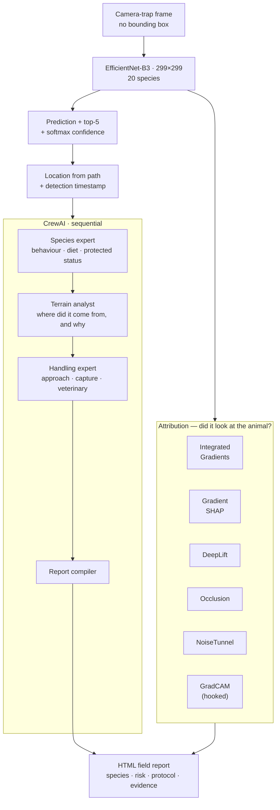

<h1 align="center">WISP</h1>

<p align="center">
  <b>Wildlife Identification and Safety Protocol automation for camera-trap environments.</b><br>
  Species classification without bounding boxes, six attribution methods on every prediction,
  and a four-agent crew that turns one detection into a field report an officer can act on.
</p>

<p align="center">
  
  
  
  
  
</p>

---

## The problem

A camera trap fires on motion at 2 a.m. What comes back is an infrared frame, mostly foliage,
with an animal somewhere in it — partially occluded, badly lit, at an unhelpful angle, and often
smaller than the leaf litter in front of it. A forest officer gets thousands of these a week.

Three things make this genuinely hard, and only the first is obvious.

**1 — There are no bounding boxes.** Public camera-trap corpora are labelled at the *frame* level:
"this image contains a red deer". Nobody has drawn a box. So the standard detection pipeline —
localise, crop, classify — has no supervision to learn from. You either pay for hundreds of
thousands of annotations, or you build a classifier that has to find the animal itself, from a
single frame-level label.

**2 — The tail is where the value is.** In any camera-trap set, a handful of common species
dominate and the animals worth protecting are rare almost by definition. An ocelot appears in a
fraction of a percent of frames. That is exactly the class you cannot afford to miss.

**3 — A species name is not a decision.** "Wild Boar, 0.94" tells a forest officer nothing they
can act on. Should they approach? Is it dangerous? Where did it come from, and why is it here and
not in its usual range? Is it protected? Do they need a veterinarian and a permit before touching
it? That is the actual job, and no classifier answers it.

## What this does



---

## Novelty

### 1. Whole-frame classification, with attribution as the localisation check

The model never sees a crop. It is handed the full 299×299 frame and has to decide what is in it
— which means it is free to key on the wrong thing. A classifier can reach high accuracy on
camera-trap data by learning *the camera*: this site has this vegetation, this site mostly gets
deer, therefore deer. It would score well and be worthless.

This is why the attribution layer is not a nice-to-have here — **it is the only available evidence
that the model localised the animal at all.** Without boxes, the attribution map *is* the
verification. It converts "97% confident" into "97% confident, and here is where it was looking,"
which is a claim a field officer can check in one glance.

### 2. Six attribution methods, computed side by side, in one panel

Most projects that reach for explainability run GradCAM and stop. `explainable_ai.py` runs six
methods from **Captum** and lays them out together:

| Method | What it answers |
|---|---|
| **Integrated Gradients** | attribution accumulated along a path from a black baseline (`n_steps=50`) |
| **GradientSHAP** | expected gradients over a distribution of noisy baselines |
| **DeepLift** | contribution against a reference activation, layer by layer |
| **Occlusion** | *empirical*: slide a patch, measure the confidence drop |
| **NoiseTunnel** | smoothing wrapper — is the attribution stable under input jitter |
| **GradCAM** | spatial: which region of the last conv feature map fired |

The reason to run all six is that **gradient methods can agree with each other and still all be
wrong**, because they share the same failure mode — a saturated gradient tells you nothing about
what the model used. Occlusion is the outlier: it does not read gradients, it *removes* a region
and measures how much the prediction falls apart. When Integrated Gradients and Occlusion agree,
the evidence is real. When they disagree, it is a warning. Presenting them adjacent is what makes
that check possible at a glance.

Occlusion is also, by an order of magnitude, the slowest — so it gets its own escape hatch:

```bash
python xai_inference_example.py --image_path frame.jpg --skip_occlusion
```

### 3. GradCAM implemented by hand, so it survives an architecture change

Rather than depending on a layer name, the code **walks the model backwards to find the last
`Conv2d`** and hooks it:

```python
modules = list(model.features.children())
for i in range(len(modules) - 1, -1, -1):
    if isinstance(modules[i], torch.nn.Conv2d):
        target_layer = modules[i]
        break
if target_layer is None:                 # ResNet-shaped fallback
    for name, module in model.named_modules():
        if isinstance(module, torch.nn.Conv2d):
            target_layer = module
```

Forward hook captures activations, backward hook captures gradients. Swap EfficientNet-B3 for
B5, MobileNet or a ResNet and the CAM keeps working — no string constants to update. Small thing;
it is the difference between a script and a tool.

### 4. An animated attribution that shows the explanation converging

`generate_animated_attribution` sweeps Integrated Gradients' step count from 5 to 100 across ten
frames and saves the result as a GIF.

This is a genuinely unusual idea and it is doing real work. IG is an *approximation* of a path
integral, and at low step counts the map is noise. Watching it resolve as the approximation
tightens tells you whether the final map is a converged signal or an artefact of where you
stopped. It is a convergence diagnostic disguised as an animation.

### 5. Robust checkpoint loading, because `torchvision` moved the classifier

```python
if "classifier.weight" in state_dict and "classifier.1.weight" not in state_dict:
    state_dict["classifier.1.weight"] = state_dict.pop("classifier.weight")
    state_dict["classifier.1.bias"]   = state_dict.pop("classifier.bias")
model.load_state_dict(state_dict, strict=False)
```

`efficientnet_b3.classifier` is a `Sequential(Dropout, Linear)`, so the head lives at
`classifier.1` — but checkpoints saved under other conventions put it at `classifier`. The loader
handles both. Likewise `load_class_mapping` accepts two different JSON shapes. Boring, and the
reason the committed `.pth` actually loads on a fresh machine.

### 6. The multi-agent layer answers the *officer's* question, not the model's

This is the part that makes WISP a system rather than a classifier. `cvai.py` defines four CrewAI
agents, each with live web search (Serper), running **sequentially** so each builds on the last:

1. **Animal Species Analysis Expert** — behaviour, habitat, diet, territoriality, seasonal
   movement, and crucially whether the species is *endangered, invasive or native here*.
2. **Terrain and Location Analysis Expert** — the interesting one. It does not just describe the
   detection site. It searches a **5–10 km radius** for water bodies, food sources and habitat,
   maps plausible travel corridors, and reasons about *why the animal left its usual range* —
   drought, mating season, human encroachment.
3. **Wildlife Management and Handling Expert** — approach protocol, capture risk, when a
   veterinarian and a permit are required.
4. **Report Compilation Specialist** — receives all three as explicit `context` and writes the
   field report.

The sequential ordering is the design. Handling advice for an ocelot is meaningless until you know
it is a protected species (agent 1), and it is *wrong* if you do not know the animal is 8 km from
its territory and probably stressed and thirsty (agent 2). A single prompt asking "what should I
do about this ocelot" gets none of that chain.

Metadata for the crew is scavenged from the frame itself — location parsed out of the camera-trap
directory structure, timestamp from the file. Nobody has to type anything.

### 7. Two report levels, and a graceful degradation path

`inference_to_cvai.py` produces a standard HTML report — prediction, confidence banding,
attribution panels, location, timestamp. `wildlife_safety_protocol.py` produces the
safety-critical version, with hazard assessment and step-by-step handling protocol, colour-coded
by risk. Both fall back to a clearly-labelled generic report when CrewAI is unavailable:

> ⚠️ IMPORTANT: This is general guidance only. Without CrewAI integration, specific safety
> protocols for *{animal_name}* cannot be provided.

Saying "I cannot answer this safely" is the correct behaviour in a document someone might act on
while standing near a wild boar.

---

## The 20 species

Neotropical and European camera-trap fauna in one label set, using LILA's numbered taxonomy:

```
1.02 Agouti              1.03 Collared Peccary    1.06 Paca              1.07 Red Brocket Deer
1.08 White-nosed Coati   1.09 Spiny Rat           1.10 Ocelot            1.14 Red Squirrel
1.19 Common Opossum      1.22 Bird (spec.)        1.25 Great Tinamou     1.27 White-tailed Deer
1.56 Mouflon             1.57 Red Deer            1.58 Roe Deer          1.59 Wild Boar
1.60 Red Fox             1.63 European Hare       1.77 Wood Mouse        1.80 Coiban Agouti
```

Mixing continents is deliberate: a model that can separate a Roe Deer from a Red Brocket Deer has
learned deer morphology rather than "this is the European site".

**Dataset:** [Missouri Camera Traps](https://lila.science/datasets/missouricameratraps) and
related LILA BC collections. Not redistributed here.

---

## Repository layout

```
xai_inference_example.py       entry point — predict + top-5 + attribution panel + CAM
explainable_ai.py              1,114 lines: 6 attribution methods, GradCAM, heatmaps,
                               animated IG, confusion matrix
cvai.py                        the four-agent CrewAI crew
inference_to_cvai.py           inference → metadata → crew → standalone HTML report
wildlife_safety_protocol.py    safety-critical report: hazard assessment + handling protocol
wildlife_classifier_best.pth   trained EfficientNet-B3 checkpoint
class_mapping.json             index → species
```

## Running it

```bash
git clone https://github.com/Vishal-AS-0407/WISP.git
cd WISP
pip install torch torchvision captum pillow matplotlib numpy imageio \
            crewai crewai-tools python-dotenv
```

**Classification with attribution** — no API keys needed, fully offline:

```bash
python xai_inference_example.py --image_path frame.jpg --output_dir out/
python xai_inference_example.py --image_path frame.jpg --skip_occlusion   # ~10× faster
```

Writes `prediction.png`, `multi_technique_comparison.png`, `class_activation_map.png`.

**Full field report** — needs a Gemini key and a Serper key in `.env`:

```bash
python inference_to_cvai.py --image_path frame.jpg
python wildlife_safety_protocol.py --image_path frame.jpg --output_dir reports/
```

**Standalone crew**, if you already know the species:

```bash
python cvai.py     # edit animal_name / location / detection_time at the bottom
```

Inference config, fixed to match training: **299×299**, ImageNet normalisation
(`mean=[0.485, 0.456, 0.406]`, `std=[0.229, 0.224, 0.225]`).

---

## ⚠️ Security — do this first

**`cvai.py` has two live API keys hardcoded** at lines 9 and 15 — a **Serper** key and a **Google
Gemini** key. They are in the public repository and in the git history.

1. **Revoke both now** — Serper at <https://serper.dev/api-key>, Gemini at
   <https://aistudio.google.com/app/apikey>.
2. `load_dotenv()` is already called at the top of the file. Use it:

```python
load_dotenv()
llm = LLM(model="gemini/gemini-1.5-flash", temperature=0.7,
          api_key=os.environ["GEMINI_API_KEY"])
# SERPER_API_KEY is read from the environment by SerperDevTool automatically
```

3. Add `.env` to `.gitignore`.

Removing the lines does not remove them from history — revocation is what protects the accounts.

---

## Honest notes

- **The README currently documents files that are not in this repository.** `analyze_wildlife.py`,
  `integrate_markdown_report.py`, `install.py`, `requirements.txt`, `report_templates/` and
  `LICENSE` are all referenced and none are committed. What actually exists is the five scripts
  listed above. *(This rewritten README documents only what is here.)*
- **The training script is not in the repo.** `xai_inference_example.py` refers to
  `improved_classification.py` for the training configuration; only the resulting checkpoint is
  committed. Accuracy, the train/test split and the class balance are therefore **not reproducible
  from these files**, and no metrics are printed by anything here.
- **`load_state_dict(..., strict=False)` will silently accept a partial load.** It is what makes
  the checkpoint portable, but it also means a genuinely mismatched checkpoint loads with random
  weights in the missing layers and no error. Worth logging the returned
  `missing_keys` / `unexpected_keys`.
- **`wildlife_safety_protocol.py` contains hard-coded example report bodies** for wild boar and
  ocelot, used as fallback content. They read as generated output; they are templates.
- **Everything the crew produces is LLM output grounded in web search.** It is a strong
  first draft for a field report. It is not a substitute for a wildlife veterinarian, and the code
  says so in the report itself.

---

<p align="center">
  <sub>Full case study, with the design decisions written out:
  <a href="https://portfolio-sigma-blond-57.vercel.app/work/wisp">portfolio → WISP</a></sub>
</p>
