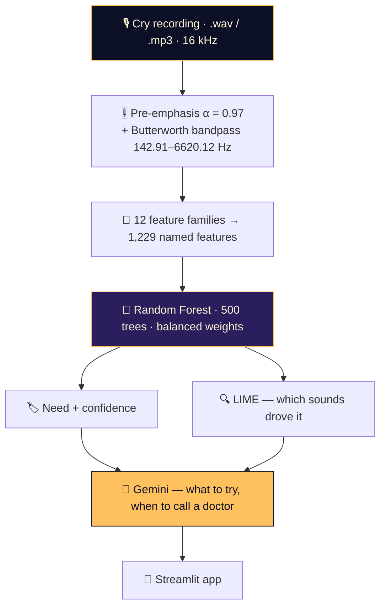

<div align="center">


<a href="https://babycrytesting.streamlit.app/">

</a>

<br/>

<a href="https://babycrytesting.streamlit.app/"></a>


<a href="https://portfolio-sigma-blond-57.vercel.app/work/baby-cry"></a>

</div>


<details>
<summary><b>📑 Table of contents</b></summary>

- [📌 Overview](#-overview)
- [✨ Highlights](#-highlights)
- [🧠 How it works](#-how-it-works)
- [📊 Results](#-results)
- [🔬 What makes it work](#-what-makes-it-work)
- [🛠️ Tech stack](#️-tech-stack)
- [🚀 Getting started](#-getting-started)
- [📂 Project structure](#-project-structure)
- [🧭 Limitations & roadmap](#-limitations--roadmap)

</details>

## 📌 Overview

A newborn has **one** way to tell you something is wrong. Hunger, wind, belly pain, tiredness and
discomfort all arrive as the same sound to an exhausted parent at 3 a.m. — but they are
*acoustically different*. This project hears the difference.

Upload a cry → the system cleans the signal, extracts **1,229 named acoustic features**, classifies
the need, **explains which sounds drove the decision**, and hands that to a pediatric-framed
assistant that tells you **what to try right now** and **when to call a doctor**.

> 🩺 **Not a medical device.** It is a caregiving aid — every answer includes explicit
> "contact a doctor if…" signs, and that framing is deliberate.

## ✨ Highlights

<table>
<tr>
<td width="50%" valign="top">

### 🎚️ Infant-tuned signal chain
Pre-emphasis (α = 0.97) → **5th-order Butterworth bandpass at 142.91 – 6620.12 Hz**, the infant
cry band — not the 300–3400 Hz telephone band speech pipelines copy. Zero-phase (`filtfilt`) so the
cry's shape survives.

</td>
<td width="50%" valign="top">

### ⚖️ Beats a 48 : 1 imbalance
Only **8** burping recordings vs **382** hungry. Three defences: proportional audio augmentation,
SMOTE on the training split only, and balanced class weights.

</td>
</tr>
<tr>
<td valign="top">

### 🔍 Explanations a parent can read
Every feature has a human name (`spectral_contrast_8_max`, `rms_1_min`), so LIME explains in
*acoustics* — "a sharp cry with no quiet gaps" — not in spectrogram pixels.

</td>
<td valign="top">

### 💬 Advice, not just a label
Gemini 1.5 gets the prediction, its confidence and your context (age, feeds, sleep) and answers in
2–3 points — detailed only when something looks serious.

</td>
</tr>
</table>

## 🧠 How it works



| Step | What happens |
|:---:|---|
| 1️⃣ | **Upload** a cry recording in the Streamlit app |
| 2️⃣ | **Clean** — pre-emphasis and the infant-band filter remove hum, hiss and room tone |
| 3️⃣ | **Describe** — 12 feature families (MFCC + Δ + ΔΔ, ZCR, RMS, spectral centroid / bandwidth / rolloff / contrast, chroma, mel, tonnetz) |
| 4️⃣ | **Classify** into `hungry` · `tired` · `discomfort` · `belly_pain` · `burping` |
| 5️⃣ | **Explain** with LIME, then **advise** with Gemini |

## 📊 Results

| Notebook | Features | Accuracy | Weighted F1 | Train time |
|---|---:|---:|---:|---:|
| `chill.ipynb` (earlier) | 461 | 97.14% | 0.9710 | 1.74 s |
| **`endsem.ipynb` (final)** | **1,229** | **97.93%** | **0.9793** | **1.53 s** |

<table>
<tr>
<td align="center" width="50%"><br/><sub><b>Confusion matrix</b> — held-out test set</sub></td>
<td align="center" width="50%"><br/><sub><b>LIME</b> — the features behind one prediction</sub></td>
</tr>
</table>

<details>
<summary><b>🏆 Top features the forest learned</b></summary>


```
spectral_contrast_8_max   0.0201   ← peak-to-valley in the highest sub-band
mel_spec_9_std            0.0095
spectral_contrast_3_mean  0.0092
mel_spec_10_mean          0.0084
rms_1_min                 0.0063   ← the quiet between sobs
mfcc_16_skew              0.0056   ← spectral asymmetry of a strained cry
```

The single most informative feature lives in the top frequency band — exactly the region a
telephone-band filter would have thrown away.

</details>

<details>
<summary><b>📉 The class imbalance it had to beat</b></summary>

| Class | Raw files | Share | After augmentation |
|---|---:|---:|---:|
| `hungry` | 382 | 83.6% | 382 |
| `discomfort` | 27 | 5.9% | 297 |
| `tired` | 24 | 5.3% | 264 |
| `belly_pain` | 16 | 3.5% | 176 |
| `burping` | **8** | **1.8%** | 88 |

A model that always says "hungry" scores 83.6% and is useless. 48 : 1 became 4.3 : 1.

</details>

## 🔬 What makes it work

<details>
<summary><b>🎛️ Augmentation proportional to rarity</b></summary>

```python
majority_class_count = max(initial_counts.values())          # 382
augmentation_factor = ceil(majority_class_count / len(label_files)) - 1
```

Each new sample composes **two** of five physically meaningful transforms, so 47× expansion does
not produce 47 near-copies:

```python
time_stretching(y, rate=U(0.85, 1.15))     # a slower or faster cry
pitch_shifting(y, sr, n_steps=U(-2, 2))    # a different baby
add_noise(y, noise_factor=U(0.001, 0.01))  # a different room
random_gain(y, 0.7, 1.3)                   # phone held nearer / further
time_shifting(y, shift_factor=U(0.1, 0.3)) # onset alignment
```

</details>

<details>
<summary><b>🧪 SMOTE after the split — so the test set stays real</b></summary>

```python
X_train, X_test, y_train, y_test = train_test_split(
    features, labels, test_size=0.20, random_state=split_seed, stratify=labels)
X_train, y_train = SMOTE(random_state=model_seed).fit_resample(X_train, y_train)
```

SMOTE before the split leaks synthetic copies of training points into the test set. Here it only
touches the training half, and both seeds (`3225806193`, `3613533475`) are printed for
reproducibility.

</details>

<details>
<summary><b>📐 Statistics chosen per feature family</b></summary>

| Family | Dims | Kept | Why |
|---|---:|---|---|
| MFCC | 40 | mean, std, **skew**, max, min | skew catches a strained cry's tilt |
| MFCC Δ / ΔΔ | 40 + 40 | mean, std | how fast / how abruptly the cry turns |
| RMS energy | 1 | mean, std, max, **min** | min = the quiet between sobs |
| Spectral contrast | 7 | mean, std, max | peak-to-valley per band |
| ZCR · centroid · bandwidth · rolloff | 4 | mean, std (+max) | noisiness and brightness |
| Chroma · mel · tonnetz | 12 + 13 + 6 | mean, std | pitch, perceptual and harmonic energy |

</details>

## 🛠️ Tech stack

<p align="center">
  
  
  
  
  
  
  
</p>

## 🚀 Getting started

```bash
# 1. clone
git clone https://github.com/Vishal-AS-0407/Why-is-my-Baby-Crying.git
cd Why-is-my-Baby-Crying

# 2. install
pip install numpy scipy scikit-learn imbalanced-learn librosa matplotlib seaborn \
            lime streamlit google-generativeai openpyxl

# 3. run the app
streamlit run ai.py
```

> 💡 **Tip:** in the sidebar, paste **your own** Gemini API key and set the model path to
> `baby_cry_model2.pkl` (the one committed in this repo).

**Retrain from scratch:** download the [donateacry-corpus](https://github.com/gveres/donateacry-corpus),
point `path` in `endsem.ipynb` at it (one folder per class) and run all cells — it writes the
model and every plot.

## 📂 Project structure

```
📦 Why-is-my-Baby-Crying
 ┣ 📓 endsem.ipynb                 final pipeline — 1,229 features, RF, LIME, plots
 ┣ 📓 chill.ipynb                  earlier 461-feature variant + n_fft ablation
 ┣ 📓 shl.ipynb                    XGBoost regression experiment
 ┣ 🐍 ai.py                        Streamlit app — upload → predict → advise
 ┣ 🐍 sample2.py                   scripted variant of the same flow
 ┣ 🧠 baby_cry_model2.pkl          trained forest + class & feature names
 ┣ 📊 extracted_features.xlsx      feature matrix (retrain without audio)
 ┗ 🖼️ confusion_matrix.png · feature_importance.png · lime_*.png
```

## 🧭 Limitations & roadmap

<details>
<summary><b>Honest notes, and what comes next</b></summary>

- [ ] **Grouped split.** Augmentation happens before the split, so variants of one recording can
      sit on both sides. 97.93% is an upper bound; splitting by source recording would give the
      true field number.
- [ ] **Fail loudly on feature mismatch.** `ai.py` pads/truncates if the model and extractor
      disagree — that should be an assertion.
- [ ] **Default model path** in `ai.py` points to `baby_cry_model.pkl`; the committed file is
      `baby_cry_model2.pkl`.
- [ ] **Read the API key from an environment variable** instead of a default in the sidebar.
- [ ] Mobile recording directly in the app.

</details>


<div align="center">

**📖 Read the full design story →** [portfolio · Night Shift](https://portfolio-sigma-blond-57.vercel.app/work/baby-cry)

<a href="https://www.linkedin.com/in/vishal-a-s04/"></a>
<a href="https://github.com/Vishal-AS-0407"></a>
<a href="mailto:vishalpersonal04@gmail.com"></a>

⭐ **If this helped you, star the repo!**


</div>
