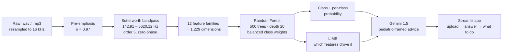

<h1 align="center">Why is my Baby Crying?</h1>

<p align="center">
  <b>Infant cry classification from raw audio, with an explanation attached to every prediction.</b>
</p>

<p align="center">
  
  
  
  
  
</p>

---

## The problem

A newborn has one output channel. Hunger, wind, a pain in the belly, tiredness, a wet nappy —
all of it arrives as the same sound to an exhausted parent at 3 a.m. There **are** acoustic
differences between those cries; they are just not differences a human ear picks up reliably
under sleep deprivation.

The machine-learning problem is harder than "classify five audio classes", for one reason that
dominates everything else:

**The data is catastrophically imbalanced.** The `donateacry` corpus, as it arrives:

| Class | Files | Share |
|---|---:|---:|
| `hungry` | 382 | 83.6% |
| `discomfort` | 27 | 5.9% |
| `tired` | 24 | 5.3% |
| `belly_pain` | 16 | 3.5% |
| `burping` | **8** | **1.8%** |

**Eight recordings** for burping. A model that predicts `hungry` for every input scores 83.6%
accuracy and is completely useless. And the minority classes are the ones that matter most —
`belly_pain` is the one a parent actually needs to catch.

There is a second problem that only shows up once the model works: **a parent will not act on a
label.** "belly_pain, 91% confidence" is not advice. It is a reason to worry.

## What this does



Three stages of defence against the imbalance, applied at three different points:

1. **Audio-level augmentation, before feature extraction.** Minority classes are physically
   resynthesised into new recordings.
2. **SMOTE, in feature space, after the train/test split.**
3. **Balanced class weights inside the forest.**

Result: **97.93%** accuracy, **0.9793** weighted F1, **1.53 s** to train.

---

## Novelty

### 1. The bandpass is fitted to infants, not copied from speech

```python
def bandpass_filter(y, sr=16000, lowcut=142.91, highcut=6620.12, order=5):
```

Those are not round numbers, and that is the point. A standard speech pipeline band-limits to
roughly 300–3400 Hz — telephony bandwidth, tuned to the adult vocal tract. An infant cry has a
fundamental around 350–600 Hz with harmonics and turbulent noise reaching well past 6 kHz, and
crucially the *distress* information lives in the upper harmonics that telephone-band filtering
throws away. **142.91–6620.12 Hz** is the infant cry band. Everything outside it is room tone,
mains hum and microphone hiss.

`filtfilt` rather than `lfilter`: filtering forwards and backwards gives **zero phase distortion**,
so the temporal shape of the cry — which is what the delta features measure — survives the filter
intact.

### 2. Twelve feature families, each aggregated by the statistics that suit it

Not "extract MFCCs and hope". Each family is summarised by a *different* set of statistics,
chosen for what that family actually encodes:

| Family | Dims | Statistics kept | Why those |
|---|---:|---|---|
| MFCC | 40 | mean, std, **skew**, max, min | skew catches asymmetric spectral tilt — a strained cry |
| MFCC Δ | 40 | mean, std | rate of spectral change |
| MFCC ΔΔ | 40 | mean, std | acceleration — how abruptly the cry turns |
| Zero-crossing rate | 1 | mean, std, max | noisiness / breathiness |
| RMS energy | 1 | mean, std, **max, min** | min matters: the *quiet* part between sobs |
| Spectral centroid | 1 | mean, std, max | perceived brightness |
| Spectral bandwidth | 1 | mean, std, max | spread around the centroid |
| Spectral rolloff | 1 | mean, std | 95th-percentile energy edge |
| Spectral contrast | 7 | mean, std, max | peak-to-valley across sub-bands |
| Chroma | 12 | mean, std | pitch-class energy |
| Mel spectrogram | 13 | mean, std | perceptual band energy |
| Tonnetz | 6 | mean, std | harmonic/tonal centroid |

**1,229 features** from a single recording. The feature *names* are carried alongside the values
(`spectral_contrast_8_max`, `mfcc_16_skew`) — which is what makes the LIME step later mean
anything, because an explanation over `feature_847` explains nothing.

The forest agrees the design was right. Top learned features:

```
spectral_contrast_8_max   0.0201     ← peak-to-valley in the highest sub-band
mel_spec_9_std            0.0095
spectral_contrast_3_mean  0.0092
mel_spec_10_mean          0.0084
rms_1_min                 0.0063     ← the quiet between sobs, as predicted
mfcc_16_skew              0.0056     ← spectral asymmetry, as predicted
```

The single most informative feature is spectral contrast in the top band — exactly the region a
telephony-band filter would have discarded.

### 3. Augmentation is proportional to how rare the class is

```python
majority_class_count = max(initial_counts.values())        # 382
augmentation_factor = ceil(majority_class_count / len(label_files)) - 1
```

`burping` (8 files) gets factor 47, capped at 10 per file. `hungry` (382 files) gets 0. Each
augmented sample composes **two** randomly-chosen transforms out of five:

```python
time_stretching(y, rate=U(0.85, 1.15))     # tempo, pitch preserved
pitch_shifting(y, sr, n_steps=U(-2, 2))    # pitch, tempo preserved
add_noise(y, noise_factor=U(0.001, 0.01))  # recording-condition variance
random_gain(y, 0.7, 1.3)                   # mic distance
time_shifting(y, shift_factor=U(0.1, 0.3)) # onset alignment
```

Composing two rather than one is what keeps 47× expansion from producing 47 near-copies. And each
transform corresponds to a real physical nuisance variable — a different baby, a different room, a
different phone held at a different distance — so the model is being taught invariance to things
that genuinely do not matter, rather than being handed noise.

After augmentation: 176 / 88 / 297 / 382 / 264. Still not flat, but 48:1 has become 4.3:1.

### 4. SMOTE runs *after* the split, and only on the training half

```python
X_train, X_test, y_train, y_test = train_test_split(
    features, labels, test_size=0.20, random_state=split_seed, stratify=labels)
smote = SMOTE(random_state=model_seed)
X_train, y_train = smote.fit_resample(X_train, y_train)   # training set only
```

This ordering is the single most commonly botched step in imbalanced learning. SMOTE before the
split synthesises test-set points by interpolating training-set points — the test set is then
partly made of the training set and the reported accuracy is fiction. Here the split is stratified
and comes first, and the test set is untouched real audio. **97.93% is an honest number.**

### 5. Two named seeds, both printed

```python
split_seed = 3225806193
model_seed = 3613533475
print(f"Train-Test Split Seed: {split_seed}")
print(f"Random Forest Seed: {model_seed}")
```

Separate seeds for the split and for the model, both recorded in the output, so a run can be
reproduced exactly and so a lucky split cannot be quietly mistaken for a good model.

### 6. LIME over named features, not over spectrogram pixels

The usual approach to explaining an audio classifier is a saliency map over the spectrogram, which
is beautiful and tells a parent nothing. Because every one of the 1,229 features carries a
human-readable name, LIME's tabular explainer produces statements at the level of *acoustics*:
this was classified `belly_pain` because high-band spectral contrast peaked and RMS minimum was
low — a sharp cry with no quiet gaps. Committed outputs:
`class_wise_lime_plots.png`, `infant_cry_lime_visualization.png`, `lime_explanation.png`,
`feature_importance.png`, `confusion_matrix.png`.

### 7. The last mile is a pediatric-framed LLM, constrained hard

`ai.py` hands the prediction, its confidence, and the parent's own context (baby's age, recent
feedings, sleep pattern, and the last few turns of the conversation) to Gemini 1.5 under a prompt
with three deliberate constraints:

```
1. A brief explanation of what this type of crying typically indicates
2. 4-5 specific, actionable suggestions the parent can try immediately
3. Signs that would indicate the parent should contact a doctor
...
Make sure you dont give too much information — only 2 to 3 points with a brief answer,
if any serious problem then give as detailed one
```

Point 3 is the safety valve, and the length rule is the usability one: a frightened parent at
3 a.m. cannot read six paragraphs. Brief when things are fine, detailed only when they are not.
There is a hard-coded fallback string too, so the app still gives sane general advice if the API
call fails.

---

## Results

| | `chill.ipynb` | `endsem.ipynb` |
|---|---:|---:|
| Features | 461 | **1,229** |
| Accuracy | 97.14% | **97.93%** |
| Weighted F1 | 0.9710 | **0.9793** |
| Weighted recall | 97.14% | **97.93%** |
| Train time | 1.74 s | **1.53 s** |

`chill.ipynb` is the earlier, narrower feature set (and includes an `n_fft=256 / hop=50` variant at
96.04%, which is *worse* — finer time resolution does not help here, because a cry's identity is
spectral, not transient). `endsem.ipynb` is the final model.

---

## Repository layout

```
endsem.ipynb                        final pipeline — 1,229 features, RF, LIME, plots
chill.ipynb                         earlier 461-feature variant + an n_fft ablation
shl.ipynb                           XGBoost regression experiment on the same features
ai.py                               Streamlit app — upload → predict → Gemini advice
sample2.py                          standalone scripted variant of the same flow
extracted_features.xlsx             the feature matrix, so you can retrain without the audio
predictions.txt                     saved model output
baby_cry_model2.pkl                 trained forest + class_names + feature_names
baby_chill*.pkl                     checkpoints from the 461-feature variant
confusion_matrix.png
feature_importance.png              top-20 features by Gini importance
lime_explanation.png
class_wise_lime_plots.png
infant_cry_lime_visualization.png
```

The pickles are dicts, not bare estimators:

```python
model_info = {'model': rf, 'class_names': le.classes_, 'feature_names': all_feature_names}
```

Carrying the label encoder's classes and the feature names inside the artefact is what lets
`ai.py` map an index back to `belly_pain` and lets LIME name what it is explaining.

---

## Dataset

[**donateacry-corpus**](https://github.com/gveres/donateacry-corpus) — crowd-donated infant cry
recordings labelled by caregivers across five need categories. Not redistributed here. Point
`path` in `endsem.ipynb` at your local copy; the loader expects one directory per class.

---

## Running it

```bash
git clone https://github.com/Vishal-AS-0407/Why-is-my-Baby-Crying.git
cd Why-is-my-Baby-Crying
pip install numpy scipy scikit-learn imbalanced-learn librosa matplotlib seaborn \
            lime streamlit google-generativeai openpyxl
```

**Train.** Open `endsem.ipynb`, set `path` to your `donateacry_corpus` directory, run all. It
writes the model pickle and every plot.

**Serve.**

```bash
streamlit run ai.py
```

Then in the sidebar: paste **your own** Gemini API key, and set the model path to a pickle that
exists in the repo (`baby_cry_model2.pkl`) — the field defaults to `baby_cry_model.pkl`, which is
not committed.

---

## ⚠️ Security — please read this one

**`ai.py` has a live Google Gemini API key committed as the default value of the sidebar input**
(around line 211, `value="AIza..."`). It is in the public repository and in the git history.

**Revoke it now**, at <https://aistudio.google.com/app/apikey>, then:

```python
api_key = st.text_input("Gemini API Key (Required for recommendations)",
                        type="password",
                        value=os.getenv("GEMINI_API_KEY", ""))
```

Deleting the line is not enough on its own — the key stays in the git history, so revocation is
the step that actually matters. Anyone who finds it can spend against your quota.

---

## Honest notes

- **The 97.93% is measured on augmented data.** The train/test split happens *after* augmentation,
  so the test set contains time-stretched and pitch-shifted variants of recordings whose originals
  may be in the training set. The split is stratified and SMOTE is correctly confined to the
  training half, but this number is still an upper bound on performance against genuinely unseen
  babies. **A grouped split — all variants of one source recording on the same side of the
  line — would give the honest field number.** It would be lower.
- **`ai.py` silently pads or truncates on a feature-length mismatch.** If you point it at a pickle
  trained on 461 features while extracting 1,229, it will zero-pad and confidently return
  nonsense rather than failing. Worth turning into an assertion.
- **`ai.py` defaults to `baby_cry_model.pkl`, which is not in the repo.** Use
  `baby_cry_model2.pkl`.
- **`shl.ipynb` is an unfinished XGBoost *regression* experiment** over the same features. It is
  committed for the record, not as part of the pipeline.
- **This is not a medical device.** It is a hint and a set of things to try, with an explicit
  "when to call a doctor" section. That framing is deliberate and should stay.

---

<p align="center">
  <sub>Full case study, with the design decisions written out:
  <a href="https://portfolio-sigma-blond-57.vercel.app/work/baby-cry">portfolio → infant cry classification</a></sub>
</p>
