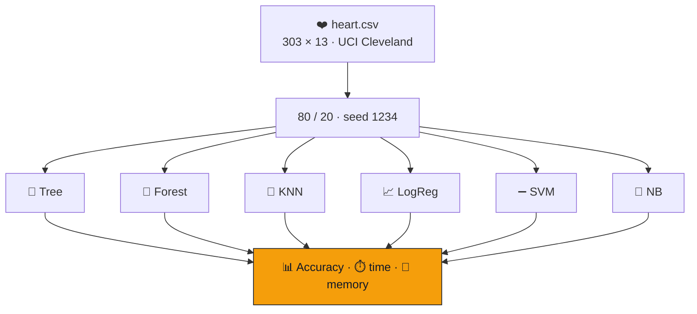

<div align="center">


<br/>


</div>


## 📌 Why

`clf.fit(X, y)` is three tokens and hides everything that matters — why KNN collapses on unscaled
features, when a tree stops splitting, what the hinge loss's two branches do to the weights.
**The way to find out is to write them.**

| | Algorithm | Lines | Core idea |
|:---:|---|:---:|---|
| 🌳 | **Decision Tree** | 116 | entropy, size-weighted information gain, recursive growth |
| 🌲 | **Random Forest** | — | bagging **and** per-split feature subsampling, majority vote |
| 📍 | **KNN** | 29 | Euclidean distance, `argsort`, vote |
| 📈 | **Logistic Regression** | 33 | sigmoid + gradient descent |
| ➖ | **SVM** | — | sub-gradient descent on the hinge loss |
| 🎲 | **Naive Bayes** | 46 | Gaussian likelihoods, summed log-probabilities |

## 🧠 The benchmark



> ⏱️ A single accuracy number says who won on this dataset. Accuracy **against** time and memory
> says which one you'd deploy — KNN "trains" instantly and pays at prediction time, the opposite of
> everything else.

## 🔬 Inside the implementations

<details open>
<summary><b>🌳 Information gain — weighted by subset size</b></summary>

```python
def _information_gain(self, y, X_column, threshold):
    parent_entropy = self._entropy(y)
    left_idxs, right_idxs = self._split(X_column, threshold)
    n, n_l, n_r = len(y), len(left_idxs), len(right_idxs)
    e_l, e_r = self._entropy(y[left_idxs]), self._entropy(y[right_idxs])
    child_entropy = (n_l/n) * e_l + (n_r/n) * e_r
    return parent_entropy - child_entropy
```

Unweighted, a 2-sample pure split beats a 200-sample mostly-pure one. Stops on `max_depth`, purity,
or `min_samples_split`; the node's `value` is keyword-only so a leaf can't be built by accident.

</details>

<details>
<summary><b>🌲 Both sources of decorrelation</b></summary>

```python
idxs = np.random.choice(n_samples, n_samples, replace=True)        # bagging: rows
feat_idxs = np.random.choice(n_feats, self.n_features, replace=False)  # per split: columns
```

Bagging alone gives near-identical trees when one feature dominates. Votes are tallied over
`np.swapaxes(predictions, 0, 1)` — vectorised, not looped.

</details>

<details>
<summary><b>➖ Soft-margin SVM in eight lines</b></summary>

```python
y_ = np.where(y <= 0, -1, 1)
condition = y_[idx] * (np.dot(x_i, self.w) - self.b) >= 1
if condition:
    self.w -= self.lr * (2 * self.lambda_param * self.w)
else:
    self.w -= self.lr * (2 * self.lambda_param * self.w - np.dot(x_i, y_[idx]))
    self.b -= self.lr * y_[idx]
```

Outside the margin: only regularisation. Inside or wrong: the hinge pushes the hyperplane. That
asymmetry **is** the support-vector idea.

</details>

## 🛠️ Tech stack

<p align="center">
  
  
  
  
</p>

## 🚀 Getting started

```bash
git clone https://github.com/Vishal-AS-0407/ml-algorithms-from-scratch.git
cd ml-algorithms-from-scratch
pip install -r requirements.txt
python main.py
```

> 💡 **Tip:** point `pd.read_csv(...)` in `main.py` at the committed `heart.csv`.

```
📦 ml-algorithms-from-scratch
 ┣ 🌳 DecisionTree.py        ┣ 📈 LogisticRegression.py
 ┣ 🌲 RandomForest.py        ┣ ➖ SVM.py
 ┣ 📍 KNN.py                 ┣ 🎲 NaiveBayes.py
 ┣ 🐍 main.py                runs all six, times them, plots
 ┗ ❤️ heart.csv
```

## 🧭 Notes & roadmap

<details>
<summary><b>Harness fixes (the algorithms themselves are correct)</b></summary>

- ➖ `SVM.predict` returns `{-1, +1}` against `{0, 1}` labels — map back:
  ```python
  return np.where(np.sign(np.dot(X, self.w) - self.b) <= 0, 0, 1)
  ```
- 📏 No scaling — fine for trees, harmful for KNN / LogReg / SVM (`chol` vs `oldpeak`).
- 💾 `sys.getsizeof` measures the data, not the fitted model — compare model sizes instead.
- 🎲 Seed the forest; time multiple runs.

**Roadmap**
- [ ] Scaled vs unscaled comparison (the best lesson this repo could teach)
- [ ] Model-size chart
- [ ] Cross-validated accuracy

</details>


<div align="center">

<a href="https://portfolio-sigma-blond-57.vercel.app"></a>
<a href="https://www.linkedin.com/in/vishal-a-s04/"></a>
<a href="https://github.com/Vishal-AS-0407"></a>

⭐ **If this helped you, star the repo!**


</div>
