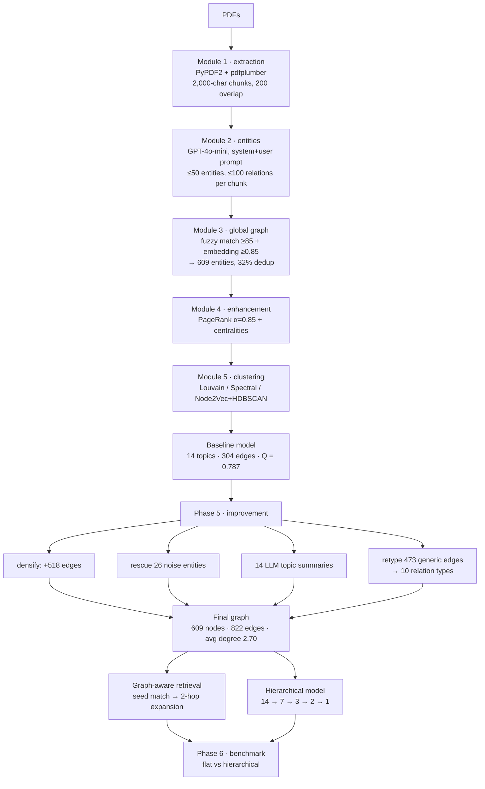

<h1 align="center">SemantiGraph</h1>

<p align="center">
  <b>A five-phase pipeline that turns a pile of PDFs into a typed, queryable knowledge graph —<br>
  then keeps going, because a graph you cannot traverse is just an expensive index.</b>
</p>

<p align="center">
  
  
  
  
  
  
</p>

---

## The problem

An organisation's knowledge sits in PDFs. Not in a database, not in a wiki — in a folder of papers,
reports and specs that nobody can query. The usual answer is to chunk them, embed the chunks and
call it RAG.

That answer has a specific failure mode: **chunks have no relationships.** Ask "what was ViT
trained on?" and vector search returns three passages that *mention* ViT. It cannot tell you that
ViT `trained_on` ImageNet-21k, that ImageNet-21k is `part_of` a family of benchmarks, or that a
different paper `compared_to` ViT on the same benchmark. The facts are adjacent in the corpus and
unconnected in the index.

Building the graph instead surfaces four problems that RAG never has to face:

1. **The same entity has many surface forms.** `ViT`, `Vision Transformer`, `Vision Transformer
   (ViT)`, `ViT-Large`, `ViT/DeiT` — across a dozen papers, one concept becomes a dozen nodes and
   the graph fragments into disconnected islands.
2. **Extracted relationships are almost all `related_to`.** A graph where 100% of edges are
   "related to" carries no more information than co-occurrence.
3. **The graph comes out too sparse to traverse.** Extract per document, merge, and you get
   average degree ≈ 1: a forest of stars, not a network. Multi-hop retrieval has nowhere to hop.
4. **Clustering a knowledge graph is not clustering a point cloud.** There is no obvious `k`, the
   degree distribution is heavy-tailed, and different algorithms disagree — a lot.

## The pipeline



---

## Novelty

### 1. Entity resolution in two independent passes — lexical *and* semantic

Module 3 merges surface forms with **two thresholds that catch different failures**:

```python
FUZZY_MATCHING_THRESHOLD    = 85     # Levenshtein ratio, 0–100
EMBEDDING_SIMILARITY_THRESHOLD = 0.85  # cosine, 0–1
```

Fuzzy string matching catches `Vision Transformer` ≈ `Vision Transformers` — typos, plurals,
punctuation. It is useless on `ViT` ≈ `Vision Transformer`, which share almost no characters.
Embedding similarity catches exactly that case, and is useless on `ViT-Large` vs `ViT-Base`, which
embed nearly identically and are *different models*.

Running both, with the strict-side threshold high enough that neither over-merges, is what takes
the raw extraction down to **609 unique entities — a 32% reduction**. That number is the difference
between a graph and a pile of aliases.

### 2. Relationship **retyping** as a separate phase

This is the most interesting idea in the repo. Extraction produces mostly generic edges; a later
pass goes back over the finished graph and re-types them using the graph context that did not
exist at extraction time.

**822 generic edges → 349 generic, 473 typed**, across ten relation types:

| Relation | Count | | Relation | Count |
|---|---:|---|---|---:|
| `semantically_related` | 237 | | `authored_by` | 68 |
| `uses` | 222 | | `trained_on` | 55 |
| `related_to` | 112 | | `part_of` | 13 |
| `evaluated_on` | 100 | | `compared_to` | 7 |
| `applied_to` | 7 | | `based_on` | 1 |

Why a separate phase rather than better extraction prompts: when Module 2 reads a single 2,000-
character chunk it often cannot tell whether "ViT — ImageNet-21k" is training, evaluation or a
citation. After the global graph exists, the *neighbourhood* disambiguates it — an entity with
many `evaluated_on` edges from many papers is a benchmark, and its edges retype accordingly.
Typing is a graph-level judgement, so it belongs in a graph-level pass.

The payoff is at query time. `trained_on` and `evaluated_on` support completely different
traversals; `related_to` supports none.

### 3. Densification — because sparse graphs cannot be traversed

The baseline graph had **304 edges over 609 nodes: average degree 1.00.** That is a forest of
isolated stars. A 2-hop retrieval from any seed reaches almost nothing.

Phase 5 adds **518 inferred edges**, taking average degree to **2.70**. And this is where the
project is honest with itself, because densification has a measurable cost:

| | baseline | after densification |
|---|---:|---:|
| Edges | 304 | 822 |
| Average degree | 1.00 | 2.70 |
| **Modularity** | **0.787** | **0.670** |
| Coverage | — | 0.384 → 0.427 |

Adding edges *lowers* modularity, by definition — cross-community links are what modularity
penalises. The trade is deliberate: **0.117 modularity bought a graph you can actually walk.**
Most projects would report 0.787 and stop. Both numbers are in `showcase/results.json`.

### 4. Noise rescue

HDBSCAN and Louvain both emit a `-1` noise label, and on this graph **375 of 609 entities** land
there — a coverage of 38.4%. Rather than accept that, Phase 5 revisits the unclustered entities
and reassigns 26 of them from graph context, lifting coverage to 42.7%.

The honest framing, which the code preserves: an entity mentioned once in one paper genuinely does
not belong to a topic. Rescuing all 375 would mean inventing structure. Rescuing the 26 with
enough neighbourhood evidence is the defensible subset.

### 5. Three clustering algorithms, chosen for what they see

All three are implemented in full (`enhanced_module5_semantic_clustering.py`), and the docstrings
explain the reasoning:

| Method | Sees | Blind to |
|---|---|---|
| **Louvain** | modularity-optimal communities, no `k` needed | long-range structure |
| **Spectral** | global structure via Laplacian eigendecomposition | needs `k` fixed in advance (here 8) |
| **Node2Vec + HDBSCAN** | long-range dependencies via biased random walks (128-d, walk length 30, 200 walks); HDBSCAN then needs no `k` | expensive; gated to graphs < 500 nodes |

Node2Vec is skipped automatically above 500 nodes and wrapped in a `try` that degrades to the
other two — a real engineering decision, since Node2Vec on a large graph is minutes, not seconds.

### 6. Two model shapes, benchmarked against each other rather than asserted

`run_phase6_evaluation.py` builds both a **flat** 14-topic model and a **hierarchical** one
(14 → 7 → 3 → 2 → 1, branching factor 2.0, 27 nodes over 5 levels) and measures them on the same
queries. The result is genuinely two-sided:

| | Flat | Hierarchical |
|---|---:|---:|
| Modularity | **0.670** | — |
| Coverage | 0.384 | — |
| Topic coherence | 0.208 | **0.894** (mean across levels) |
| Retrieval F1 | **0.274** | 0.000 |
| Precision / Recall | 0.167 / **0.783** | — |
| Retrieval time | 82 ms | **36 ms** |

The hierarchy produces far more coherent topics and is twice as fast, and **retrieves nothing** —
its F1 is zero. That is a real finding, reported rather than buried: hierarchical abstraction
improves how a topic *reads* and destroys how it *retrieves*, because the levels above the leaves
are summaries with no entities of their own to return.

Note also the flat model's precision/recall shape — **0.167 precision against 0.783 recall**. It
returns 20 entities and finds most of what it should, with a lot of noise alongside. For a
retrieval layer feeding an LLM that is arguably the right bias; for a UI it is not.

### 7. Graph-aware retrieval with hop distance in the score

`graph_retrieval.py` does not return a ranked list of chunks. It **seeds** on direct entity matches
and expands outward, keeping the hop distance:

```
Question: How does Vision Transformer (ViT) work?

Seeds (hop 0):  ViT-Base · Vision Transformer (ViT) · ViT-Large · ViT · ViT/DeiT
Expanded:       ImageNet-21k (hop 1) · Transformer architecture (hop 1) · GPT-3 (hop 2)

Vision Transformer (ViT) → uses       → Transformer
Vision Transformer (ViT) → trained_on → ImageNet-21k
Vision Transformer (ViT) → trained_on → JFT-300M

20 entities · 27 relationships · max hop 2
```

`GPT-3` arriving at hop 2 is the whole argument for the graph. No embedding of the question
"how does ViT work" retrieves GPT-3 — but the path `ViT → Transformer → GPT-3` is exactly the
context that lets an answer say *why* ViT works, by connecting it to the architecture it borrowed.
That is multi-hop reasoning, and flat RAG structurally cannot do it.

---

## Results

Full run: **95.9 seconds**, 5 phases.

| | |
|---|---:|
| Unique entities | **609** (32% deduplication) |
| Semantic topics | **14** |
| Baseline modularity | **0.787** — "excellent" is conventionally > 0.7 |
| Final edges | 822 (from 304) |
| Typed relation types | 10 |
| Edges retyped from generic | 473 |
| Noise entities rescued | 26 |
| Retrieval latency | 82 ms (flat) / 36 ms (hierarchical) |

Top discovered topics: Vision Transformer (28 entities), GPT-3 (36), Transformer Architecture (30),
CLIP (23), Neural Networks (21).

Everything above is reproduced from committed JSON — `showcase/results.json`,
`comparison/benchmark_results.json`, `comparison/enhanced_benchmark_results.json`,
`data/phase5_results.json` — not from memory of a run.

---

## Repository layout

```
config.py                    all thresholds and paths in one place
utils.py

modules/
  module1_pdf_extraction.py               PyPDF2 + pdfplumber, chunk 2000 / overlap 200
  hybrid_module2_entity_extraction.py     GPT-4o-mini, system + user prompt, JSON schema
  enhanced_module3_global_graph.py        fuzzy + embedding entity resolution, merge
  enhanced_module4_graph_enhancement.py   PageRank (α = 0.85) + centralities
  enhanced_module5_semantic_clustering.py Louvain · Spectral · Node2Vec+HDBSCAN
  graph_improvements.py                   densify · rescue noise · summarise · retype
  graph_retrieval.py                      seed match → multi-hop expansion
  hierarchical_clustering.py              build the 14 → 7 → 3 → 2 → 1 tree
  hierarchical_retrieval.py               retrieval over that tree

run_complete_pipeline.py     modules 1–5, end to end
run_phase5.py                the improvement phase
run_benchmark.py             flat vs hierarchical
run_enhanced_benchmark.py    adds precision / recall / F1
run_phase6_evaluation.py     full evaluation
compare_retrieval.py         before/after retrieval on the same queries
generate_showcase.py         charts + Q&A showcase
visualize_hierarchy.py       static + interactive hierarchy plots

data/best_kg/                the graph, in JSON, GML, GraphML and edgelist
data/best_semantic_models/   flat · improved · hierarchical
showcase/                    figures, qa_showcase.md, interactive HTML
comparison/                  benchmark JSON + charts
```

The graph is exported in **four formats** — JSON, GML, GraphML, edgelist — so it opens in Gephi,
Cytoscape, NetworkX or a browser without a converter.

## Running it

```bash
git clone https://github.com/Vishal-AS-0407/sematic_model_unstructured_data.git
cd sematic_model_unstructured_data
pip install -r requirements.txt
cp .env.example .env          # then add OPENAI_API_KEY
```

Drop PDFs into `data/pdfs/`, then:

```bash
python run_complete_pipeline.py     # modules 1–5  → baseline graph + semantic model
python run_phase5.py                # densify, rescue, summarise, retype
python run_phase6_evaluation.py     # flat vs hierarchical
python generate_showcase.py         # figures + qa_showcase.md
python visualize_hierarchy.py       # interactive HTML
python compare_retrieval.py         # before/after on the same queries
```

Roughly 20 minutes and about $0.45 of GPT-4o-mini for a corpus of that size. The committed
`data/` and `showcase/` outputs mean you can read every result without spending anything.

Key knobs in `config.py`:

```python
OPENAI_MODEL                   = "gpt-4o-mini"
EMBEDDING_MODEL                = "text-embedding-3-small"
CHUNK_SIZE, OVERLAP            = 2000, 200
FUZZY_MATCHING_THRESHOLD       = 85
EMBEDDING_SIMILARITY_THRESHOLD = 0.85
PAGERANK_ALPHA                 = 0.85
CLUSTERING_METHOD              = "community"    # 'community' | 'spectral' | 'node2vec' | 'ensemble'
NODE2VEC_DIMENSIONS            = 128
MIN_CLUSTER_SIZE, MIN_SAMPLES  = 3, 2
```

---

## Honest notes

- **The `ensemble` method is a priority cascade, not consensus voting.** `cluster_ensemble` runs
  all three algorithms and builds a `votes` list — then ignores it:

  ```python
  primary_vote = clusters_community[node]
  ensemble_clusters[node] = primary_vote if primary_vote >= 0 else clusters_spectral[node]
  ```

  Louvain wins; spectral is consulted only where Louvain says noise; **Node2Vec's result is
  computed and discarded**. The module's own docstrings describe a co-assignment matrix and
  majority vote, which is not what the code does. Real consensus clustering — build the
  co-association matrix over the three partitions, then cluster *that* — is a contained change and
  is the single highest-value next commit here.
- **The default is not the ensemble anyway.** `config.py` ships `CLUSTERING_METHOD = "community"`,
  so an unmodified run is plain Louvain.
- **0.787 is the baseline graph's modularity, before densification.** The final, traversable graph
  scores 0.670. Both are legitimate and they measure different objects; quoting only the higher one
  would be misleading, so both are above.
- **Coverage is 38–43%, not 100%.** 375 of 609 entities are unclustered noise. The earlier README
  stated both "Topic Coverage 100%" and "coverage 38.4%" in different sections — 38.4% (flat) and
  42.7% (after rescue) are the measured numbers.
- **The earlier README documented files that do not exist** — `run_best_pipeline.py`,
  `demo_best.py`, `demo_best_enhanced.py`, `download_more_pdfs.py`, `PROJECT_STRUCTURE.md`,
  `DETAILED_PIPELINE_DOCUMENTATION.md`, `PIPELINE_RESULTS_SUMMARY.md`, `DEMO_RESULTS.md`,
  `LICENSE` — and cloned from `yourusername/semantigraph`. This rewrite documents the scripts that
  are actually committed.
- **`data/pdfs/` ships empty** (just a `.gitkeep`). The corpus was AI/ML papers — ViT, GPT-3,
  Transformer, CLIP — and is not redistributed. All downstream artefacts *are* committed, so the
  results are inspectable without rerunning.
- **Hierarchical retrieval F1 is 0.000.** Not a bug in the benchmark: the upper levels are
  summaries with no entities of their own, so nothing is returned to score. It is a real limitation
  of that model shape and it is reported rather than hidden.
- **`SPACY_MODEL = "en_core_web_trf"` is configured but the committed Module 2 is LLM-only.** The
  "hybrid" in `hybrid_module2_entity_extraction.py` refers to the intended spaCy + LLM design; what
  runs is GPT-4o-mini with a two-prompt schema.

---

<p align="center">
  <sub>Full case study, with the design decisions written out:
  <a href="https://portfolio-sigma-blond-57.vercel.app/work/semantic-modeling">portfolio → semantic modeling</a></sub>
</p>
