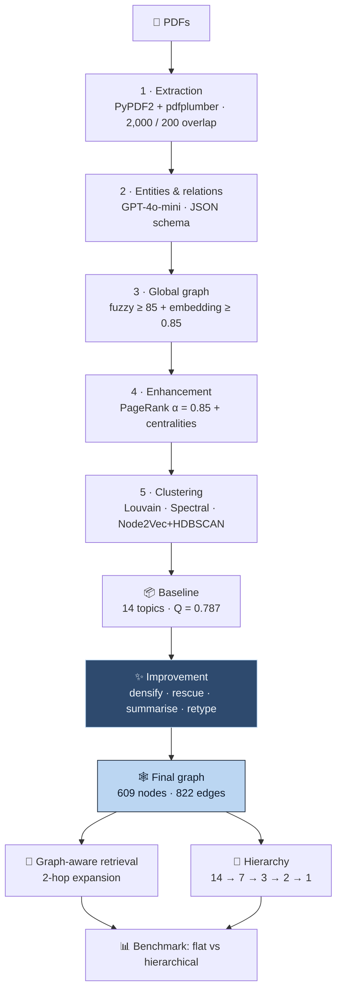

<div align="center">


<br/>


<a href="https://portfolio-sigma-blond-57.vercel.app/work/semantic-modeling"></a>

</div>


<details>
<summary><b>📑 Table of contents</b></summary>

- [📌 Overview](#-overview)
- [✨ Highlights](#-highlights)
- [🧠 The pipeline](#-the-pipeline)
- [🕸️ The graph](#️-the-graph)
- [📊 Results](#-results)
- [🔬 Under the hood](#-under-the-hood)
- [🚀 Getting started](#-getting-started)
- [📂 Project structure](#-project-structure)
- [🧭 Honest notes & roadmap](#-honest-notes--roadmap)

</details>

## 📌 Overview

Knowledge lives in PDFs. Chunk-and-embed RAG finds passages that **mention** ViT — but can't tell
you that ViT `trained_on` ImageNet-21k, or that another paper `compared_to` it. **Chunks have no
relationships.**

SemantiGraph builds the graph instead, and solves the four problems RAG never has to face:

| Problem | Fix |
|---|---|
| 🪞 `ViT`, `Vision Transformer`, `ViT/DeiT`… one concept, a dozen nodes | Two-pass entity resolution → **32% dedup** |
| 🔗 Almost every extracted edge is `related_to` | Retyping pass → **473 edges, 10 types** |
| 🌵 Average degree ≈ 1 — nowhere to hop | Densification → **+518 edges, degree 2.70** |
| 🧮 No obvious `k`, heavy-tailed degrees | Louvain · Spectral · Node2Vec+HDBSCAN |

## ✨ Highlights

<table>
<tr>
<td width="50%" valign="top">

### 🪞 Lexical *and* semantic resolution
Fuzzy match ≥ 85 catches plurals and typos; embeddings ≥ 0.85 catch `ViT` ≈ `Vision Transformer`.
Each covers the other's blind spot.

</td>
<td width="50%" valign="top">

### 🏷️ Typing as a graph-level judgement
A 2,000-char chunk can't tell training from evaluation. The finished graph's **neighbourhood**
can — so edges are retyped afterwards.

</td>
</tr>
<tr>
<td valign="top">

### ⚖️ Trade-offs reported, not hidden
Densifying dropped modularity **0.787 → 0.670** — the price of a graph you can walk. Both numbers
are committed.

</td>
<td valign="top">

### 🔗 Multi-hop retrieval
Seed on matching entities, expand two hops, keep the hop distance. GPT-3 arrives at hop 2 — no
embedding of the question would find it.

</td>
</tr>
</table>

## 🧠 The pipeline



## 🕸️ The graph

<div align="center">


<table>
<tr>
<td align="center" width="50%"><b>🏷️ Relation types</b><br/></td>
<td align="center" width="50%"><b>⭐ Top entities</b><br/></td>
</tr>
</table>

</div>

**A real 2-hop retrieval:**

```
❓ How does Vision Transformer (ViT) work?

🌱 Seeds (hop 0):  ViT-Base · Vision Transformer (ViT) · ViT-Large · ViT · ViT/DeiT
🔗 Expanded:       ImageNet-21k (hop 1) · Transformer architecture (hop 1) · GPT-3 (hop 2)

Vision Transformer (ViT) → uses       → Transformer
Vision Transformer (ViT) → trained_on → ImageNet-21k
Vision Transformer (ViT) → trained_on → JFT-300M

20 entities · 27 relationships · max hop 2
```

## 📊 Results

Full run: **95.9 s**, five phases. Every number below is read from committed JSON
(`showcase/results.json`, `comparison/*.json`, `data/phase5_results.json`).

| Metric | Value |
|---|:---:|
| 🧬 Unique entities | **609** (32% dedup) |
| 🧩 Semantic topics | **14** |
| 📐 Baseline modularity | **0.787** |
| 🕸️ Edges | 304 → **822** |
| 🏷️ Edges retyped from generic | **473** (10 types) |
| 🛟 Noise entities rescued | 26 |
| ⚡ Retrieval latency | 82 ms flat · 36 ms hierarchical |

**Flat vs hierarchical — a genuinely two-sided result**

| | Flat | Hierarchical |
|---|:---:|:---:|
| Topic coherence | 0.208 | **0.894** |
| Retrieval F1 | **0.274** | 0.000 |
| Precision / recall | 0.167 / **0.783** | — |
| Latency | 82 ms | **36 ms** |

> 🔎 The hierarchy reads far better and is twice as fast — and **retrieves nothing**, because the
> levels above the leaves are summaries with no entities of their own. Reported, not buried.

<details>
<summary><b>📈 Benchmark and hierarchy charts</b></summary>

<p align="center">
  
  <br/><br/>
  
  <br/><br/>
  
</p>

</details>

## 🔬 Under the hood

<details>
<summary><b>🏷️ The ten relation types after retyping</b></summary>

| Relation | Count | Relation | Count |
|---|:---:|---|:---:|
| `semantically_related` | 237 | `authored_by` | 68 |
| `uses` | 222 | `trained_on` | 55 |
| `related_to` | 112 | `part_of` | 13 |
| `evaluated_on` | 100 | `compared_to` | 7 |
| `applied_to` | 7 | `based_on` | 1 |

`trained_on` and `evaluated_on` support completely different traversals; `related_to` supports none.

</details>

<details>
<summary><b>🌵 Densification: what it bought, what it cost</b></summary>

| | Baseline | After |
|---|:---:|:---:|
| Edges | 304 | 822 |
| Average degree | 1.00 | 2.70 |
| Modularity | **0.787** | 0.670 |
| Coverage | 0.384 | 0.427 |

Cross-community links are exactly what modularity penalises — the 0.117 drop is the deliberate
price of traversability.

</details>

<details>
<summary><b>🧮 Three clustering algorithms, for what each one sees</b></summary>

| Method | Sees | Blind to |
|---|---|---|
| **Louvain** | modularity-optimal communities, no `k` | long-range structure |
| **Spectral** | global structure via the Laplacian | needs `k` (8) |
| **Node2Vec + HDBSCAN** | long-range walks (128-d, length 30, 200 walks) | expensive — gated below 500 nodes |

</details>

<details>
<summary><b>⚙️ Key knobs in <code>config.py</code></b></summary>

```python
OPENAI_MODEL                   = "gpt-4o-mini"
EMBEDDING_MODEL                = "text-embedding-3-small"
CHUNK_SIZE, OVERLAP            = 2000, 200
FUZZY_MATCHING_THRESHOLD       = 85
EMBEDDING_SIMILARITY_THRESHOLD = 0.85
PAGERANK_ALPHA                 = 0.85
CLUSTERING_METHOD              = "community"    # 'community' | 'spectral' | 'node2vec' | 'ensemble'
```

</details>

## 🛠️ Tech stack

<p align="center">
  
  
  
  
  
</p>

## 🚀 Getting started

```bash
git clone https://github.com/Vishal-AS-0407/sematic_model_unstructured_data.git
cd sematic_model_unstructured_data
pip install -r requirements.txt
cp .env.example .env          # add OPENAI_API_KEY
```

| Step | Command | What it does |
|:---:|---|---|
| 1️⃣ | `python run_complete_pipeline.py` | modules 1–5 → baseline graph |
| 2️⃣ | `python run_phase5.py` | densify · rescue · summarise · retype |
| 3️⃣ | `python run_phase6_evaluation.py` | flat vs hierarchical |
| 4️⃣ | `python generate_showcase.py` | figures + Q&A showcase |
| 5️⃣ | `python visualize_hierarchy.py` | interactive HTML |

> 💡 **Tip:** drop PDFs into `data/pdfs/` first. A full run is ~20 min and ~$0.45 of GPT-4o-mini —
> but every output is already committed, so you can read all results for free. The graph ships
> in **JSON, GML, GraphML and edgelist** for Gephi, Cytoscape or NetworkX.

## 📂 Project structure

```
📦 sematic_model_unstructured_data
 ┣ ⚙️ config.py                      every threshold and path
 ┣ 📂 modules
 ┃ ┣ 🐍 module1_pdf_extraction.py
 ┃ ┣ 🐍 hybrid_module2_entity_extraction.py
 ┃ ┣ 🐍 enhanced_module3_global_graph.py
 ┃ ┣ 🐍 enhanced_module4_graph_enhancement.py
 ┃ ┣ 🐍 enhanced_module5_semantic_clustering.py
 ┃ ┣ 🐍 graph_improvements.py        densify · rescue · summarise · retype
 ┃ ┣ 🐍 graph_retrieval.py           seed → multi-hop expansion
 ┃ ┗ 🐍 hierarchical_*.py            the 14 → 1 tree + its retrieval
 ┣ 🐍 run_*.py                       pipeline, phase 5, benchmarks, evaluation
 ┣ 📂 data/best_kg                   the graph in 4 formats
 ┣ 📂 showcase                       figures, qa_showcase.md, interactive HTML
 ┗ 📂 comparison                     benchmark JSON + charts
```

## 🧭 Honest notes & roadmap

<details>
<summary><b>Read before quoting numbers</b></summary>

- 🗳️ **`ensemble` is a priority cascade, not a vote** — Louvain wins, Spectral fills Louvain's
  noise, Node2Vec is computed and discarded. The default config is plain Louvain anyway.
- 📐 **0.787 is the baseline**; the final traversable graph is 0.670. Both are reported.
- 🧩 **Coverage is 38–43%** — 375 of 609 entities are single-mention noise; only the 26 with real
  neighbourhood evidence are rescued.
- 📂 `data/pdfs/` ships empty — the AI/ML paper corpus isn't redistributed; all downstream
  artefacts are committed.
- 🧪 The "hybrid" extractor runs GPT-4o-mini only; spaCy is configured but not wired in.

**Roadmap**
- [ ] Real consensus clustering over a co-association matrix
- [ ] Hierarchical retrieval that descends to leaf entities
- [ ] spaCy + LLM hybrid extraction
- [ ] Query UI over the graph

</details>


<div align="center">

**📖 Read the full design story →** [portfolio · The Plate](https://portfolio-sigma-blond-57.vercel.app/work/semantic-modeling)

<a href="https://www.linkedin.com/in/vishal-a-s04/"></a>
<a href="https://github.com/Vishal-AS-0407"></a>
<a href="mailto:vishalpersonal04@gmail.com"></a>

⭐ **If this helped you, star the repo!**


</div>
